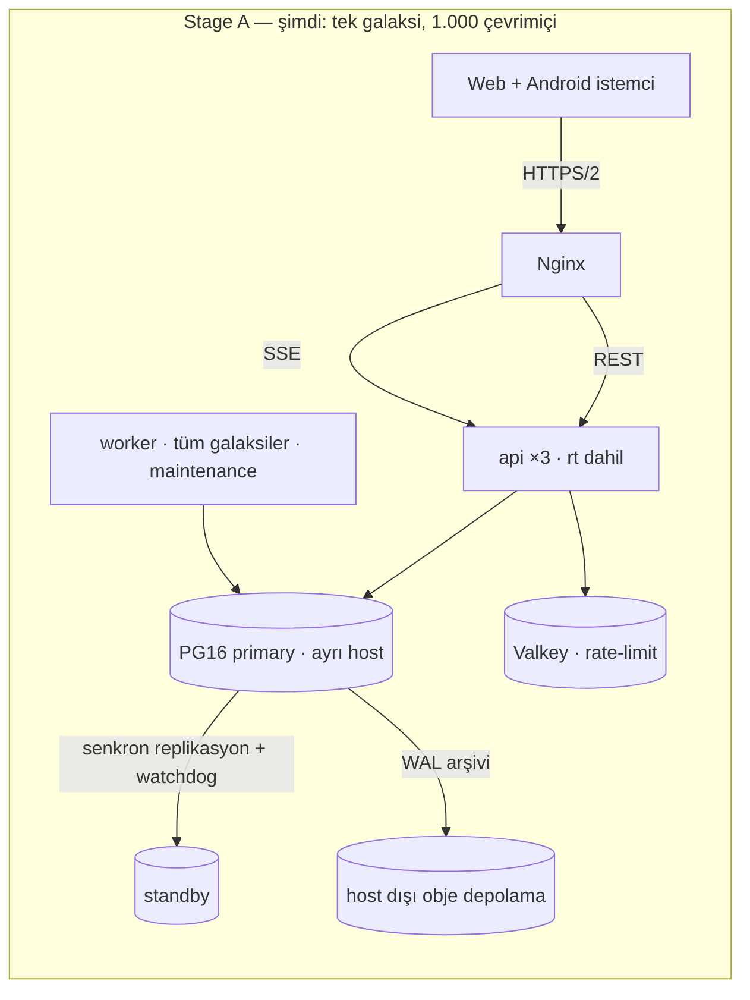
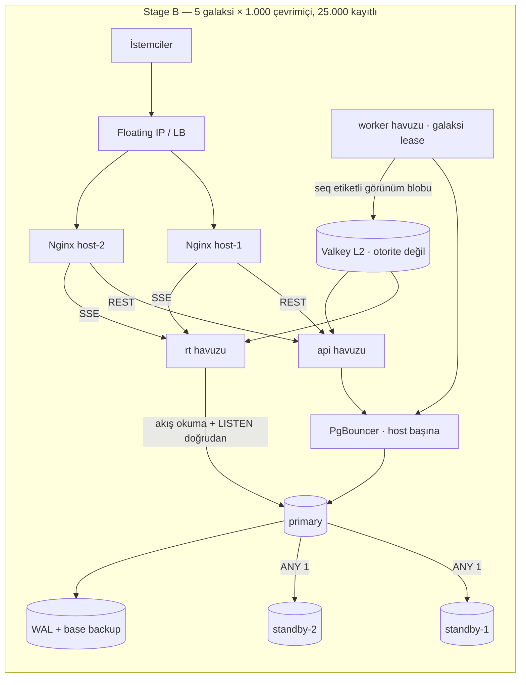
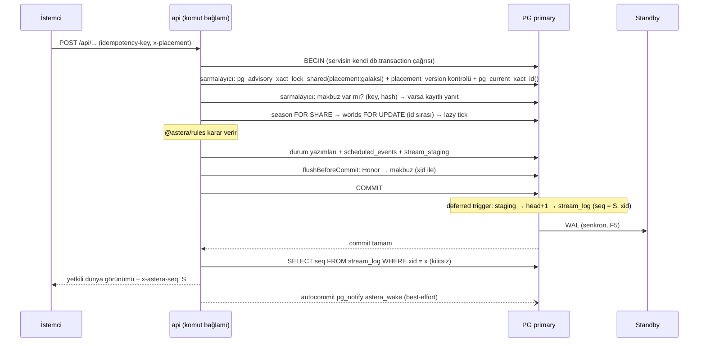
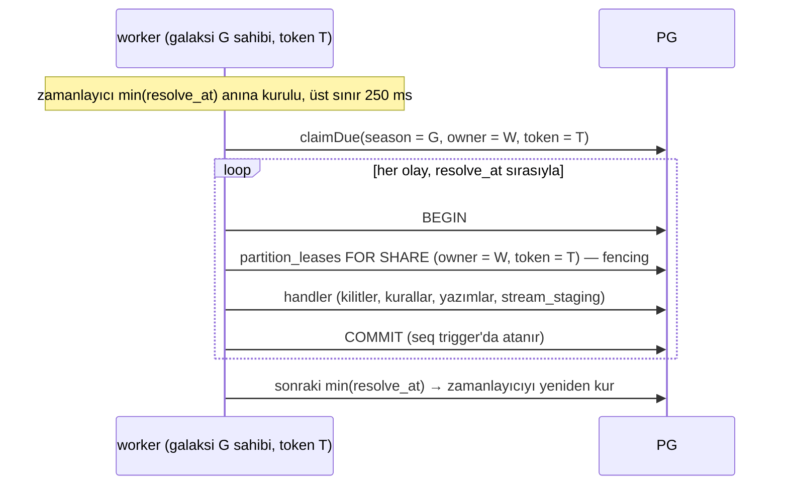
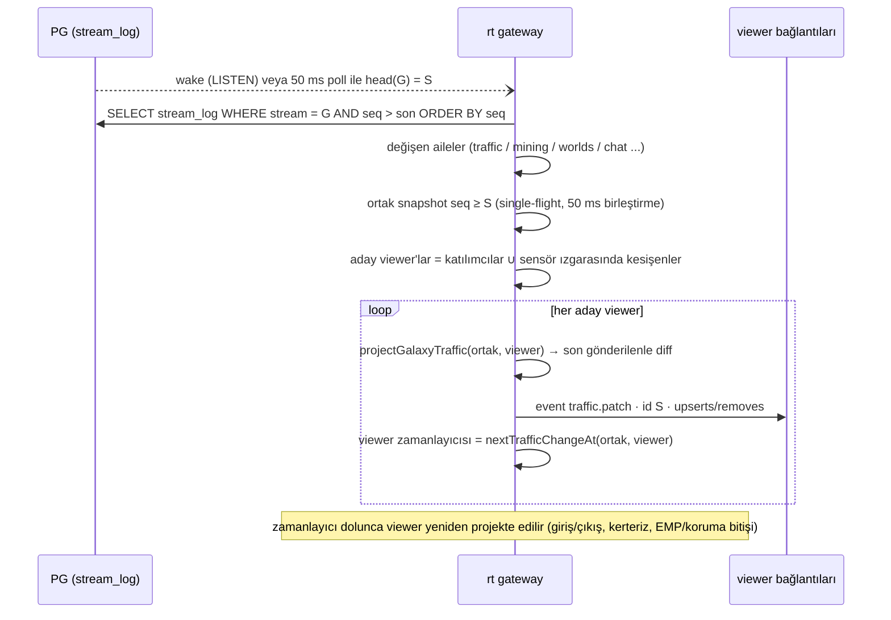
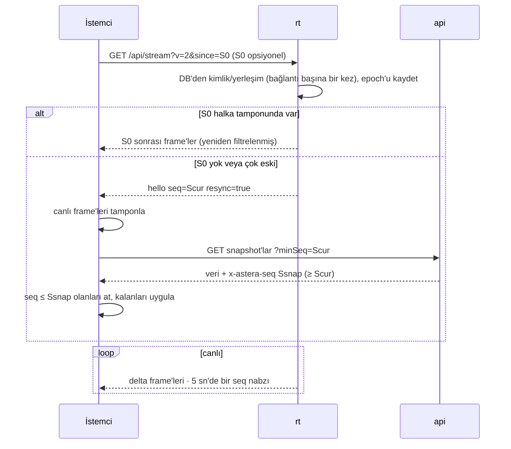
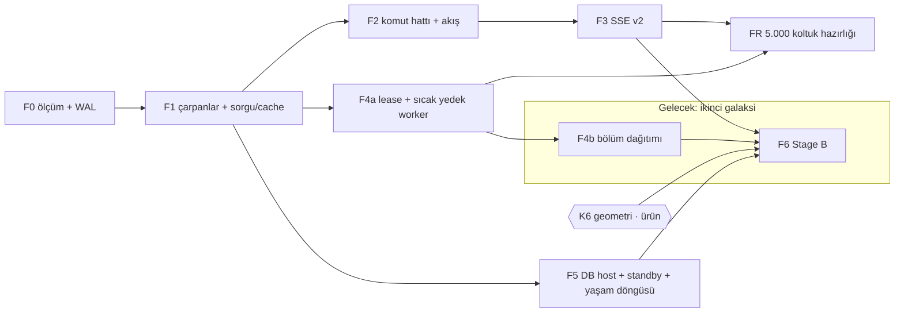

# Astera — Ölçekleme mimarisi ve uygulama planı

**Şimdi:** tek galaksi, 1.000 eşzamanlı oyuncu.
**Gelecek:** galaksi başına 5.000 kayıtlı / 1.000 eşzamanlı × 5 galaksi = **25.000 kayıtlı, 5.000 eşzamanlı**.
Yapı, gelecek hedefe yeniden tasarım gerektirmeden büyüyecek şekilde kurulur (§1.3).

**Bu planın hedefi (owner, 28 Eki):** galaksileri 5.000 koltuğa çıkarmak değil. Hedef, koltuk artırılırsa
yapının bunu kaldıracağını plan sonunda kanıtlanmış hâle getirmek. Kanıt, FR fazında 5.000 koltuklu bir test
galaksisiyle yapılan yük testidir. Koltuk artışının kendisi ve yeni harita (K6) plan dışı ürün kararlarıdır.

27 Ekim 2026 · Durum: **plan, 3. review (ölçümlü)**.

- Bu belge yazılırken ürün kodu değiştirilmedi ve yük testi çalıştırılmadı. 3. review'da izole bir PG16
  container'ında mikro ölçümler ve 26 Ekim prod kopyasında sorgular yapıldı; sonuçlar ve düzeltmeler §15'te.
- Girdiler: `reports/Astera eşzamanlı oyuncu kapasitesi.md`, `research_notes/Astera eşzamanlı oyuncu kapasitesi/*`,
  `~/Desktop/Astera-Mimari.html` ve belgede satır numarasıyla anılan güncel kod.
- Owner cevapları 27 Ekim'de alındı. Review düzeltmeleri §14'te, 3. review'un ölçümleri ve oyun mantığı
  çakışmaları §15'te.
- Kod ve testler bu belgeyle çelişirse doğru olan koddur. Bir faza başlarken anılan satırları yeniden doğrula.

---

## 0. Tek sayfada kararlar

1. **PostgreSQL tek yazma otoritesi olarak kalır (CAP'te CP).** Redis/Valkey hiçbir zaman otorite olmaz;
   yalnız yeniden kurulabilir cache ve rate-limit için kullanılır.
2. **Ölçeğin ve tutarlılığın birimi galaksidir.** Her galaksinin:
   - commit sırasına eşit, boşluksuz tek bir olay akışı (`seq`),
   - lease ve fencing ile korunan tek bir worker sahibi,
   - yalnız kendi galaksisini etkileyen cache alanı vardır.

   **Şu an tek galaksi var.** Her yeni bileşen galaksi anahtarlı yazılır ve testleri iki galaksiyle koşar.
   İkinci galaksi bu sayede kod değil yapılandırma işi olur (§1.3).
3. **Bir komut tek transaction'da biter:** kilit → kural → durum → makbuz → akış kaydı → commit.
   Oyun transaction'larının içinden `pg_notify` çağrısı kaldırılır.
4. **Okuma yolu: ortak veri bir kez kurulur, oyuncuya göre sunucuda filtrelenir, istemciye yalnız fark gider.**
   - Ortak snapshot galaksinin `seq` değeriyle etiketlenir.
   - Fog, bugünkü saf projeksiyon fonksiyonlarıyla sunucuda uygulanır.
   - İstemciye SSE v2 üzerinden yetkili delta gider.
   - 5 saniyelik trafik polling'inin yerini, sunucuda oyuncu başına çalışan görüş-sınırı zamanlayıcısı alır.
5. **İki ayrı ölçek ekseni planlanır.**
   - **N (çevrimiçi):** fan-out, REST ve komut hızını belirler.
   - **R (kayıtlı/koltuk):** dünya sayısını, galaksi DTO'sunu, Honor kadrosunu, rollover'ı, korsan ve
     asteroit sayısını, veri büyümesini belirler.

   Bugünkü kod R'ye bağlı birkaç yerde 5.000 koltukta kırılır (§2.3). Bunlar 5.000 koltuktan **önce** düzeltilir.
6. **Önce birim iş, sonra donanım.** Sıra: ölç → iş çarpanlarını kaldır → yazma sözleşmesi → canlı delta →
   worker lease ve sıcak yedek → host/HA ayrımı → ikinci galaksiyle ölçek-out. Ölçülmüş bir zorunluluk yoksa DB sharding, mikroservis,
   Kubernetes ve Kafka yok.
7. **Galaksi başına 5.000 koltuk bir ürün kararıdır.** Bugünkü geometri 1.000 koltuk için kurulmuştur:
   yarıçap, sensör merdiveni ve katmanlar. CLAUDE.md "300–1.000 per galaxy" diyor. Yeni geometri ve onun
   seyahat süresi/denge etkisi bu planın dışında, **K6** olarak ayrıca kararlaştırılır. Plan koltuk artırmaz;
   FR fazı sonunda 5.000 koltuklu test galaksisinde kanıtlanmış bir hazırlık bırakır.
8. **Tek galakside üç sıralama noktası bütün oyunun tavanıdır:** akış head'i (commit kuyruğu), tek worker
   yürütücüsü ve Honor sezon kilidi. Commit kuyruğunun tavanı diskin flush süresine bağlıdır. Serileşen
   commit yolu (bugünkü NOTIFY ve plandaki head) yerelde 243–1.078 commit/s ölçüldü; 1.000 çevrimiçinin
   ölçülmüş davranıştan çıkan talebi ~15–75 commit/s (§15.1). Üçü prod donanımında F0'da yeniden ölçülür.
   Eşik aşılırsa yapıyı değiştirmeden genişletme yolu tanımlıdır (§1.3, F7).
9. **Veritabanı şeması genel olarak sağlıklı.** Sorunlar birkaç yerde toplanıyor: eksik değişmez kısıtları,
   oyuncu başına yazılan galaksi olayı bildirimleri (bildirimlerin %72'si), indekssiz FK'lar ve savaş başına
   baştan yazılan Honor muhasebe blob'u (bugün 75 KB ve 1,4 ms; FR fazında düzeltilir). Cache ve
   sorgu planı ölçülmüş kanıta dayanır (§6A, §15).

26 Ekim prod kopyasında ana sezonda 53, bekleme odası sezonunda 735 oyuncu vardı. Yani bugün de aynı
süreçlerde birden çok canlı sezon çalışıyor; sezon izolasyonu (F1.2) şimdiden gerçek bir ihtiyaç.
**Protokol ve altyapı değişikliği için en ucuz an trafik düşükken.**

---

## 1. Varsayımlar, kapsam, hedefler

### 1.1 Varsayımlar

| # | Varsayım | Neden önemli |
|---|---|---|
| V1 | "Çevrimiçi oyuncu": oturumu açık, uygulama önde, SSE'si bağlı istemci. Planlama değeri dakikada ~2 komut, savaş dalgasında 10×. **Ölçülen** (prod kopyası, ana sezon): aktif oyuncu başına saatte 12–20 görev/madencilik/inşa (≈0,2–0,33/dk); planlama değeri ~5× pay taşır | Kapasite bağlantı sayısıyla değil iş miktarıyla ölçülür |
| V2 | **Şu an tek galaksi** (owner 27 Eki). Gelecekte galaksi başına R = 5.000 koltuk, N = 1.000 çevrimiçi (%20); 5 galaksi: R = 25.000, N = 5.000 (**K1**). | N fan-out'u, R veri büyüklüğünü belirler |
| V3 | Tasarımın sıcak bölümü: bir galakside 1.000 çevrimiçi + 4.000 çevrimdışı komutan. Çevrimdışı oyuncuların filoları uçar, saldırıya uğrar, rapor biriktirir. | Çekirdek döngü "DISPATCH → WAIT OFFLINE"; çevrimdışı oyuncu da yük üretir |
| V4 | Tek bölge, tek veri merkezi. Çok bölgeli aktif-aktif yok. | Tutarlılık önceliğiyle çelişir ve bu ölçekte gereksiz |
| V5 | Oyun kuralları, risk/ödül, fog ve Honor muhasebesi semantiği **değişmez**. Her optimizasyonun eşdeğerlik testi bunu kanıtlar. | Ask-first alanlarına girilmez |
| V6 | Arena (Komutan Gemisi) ayrı sistemdir. Bugün tek süreçte tek ortak oda (`ARENA_SEATS` = 100) çalışıyor (`arena/server.ts:121, 222`). Çok odalı ölçek ayrı plandır (K8). | 5.000 CCU'da arena talebi 100'ü aşarsa oyuncu reddedilir |

### 1.2 SLO hedefleri (faz kapıları)

Aşağıdakiler **hedeftir, ölçülmüş sonuç değildir**. Gecikmeler sunucu tarafını kapsar; mobil RTT bunlara eklenir.

| Metrik | Bugün (bilinen) | **Şimdi — Stage A:** tek galaksi, 1.000 çevrimiçi (F1–F3 sonu) | **Gelecek — Stage B:** 5 × 1.000 çevrimiçi (F6 sonu) |
|---|---|---|---|
| Komut süresi (API giriş → yanıt) | prod p95 ölçülmedi; runner hedefi p95 ≤400 ms | p95 ≤120 ms · p99 ≤300 ms | p95 ≤80 ms · p99 ≤200 ms |
| Snapshot GET | `/planets` p95 794 ms, `/planets/:id` p95 424 ms (26 Eki, düşük yük) | p95 ≤200 ms | p95 ≤100 ms |
| Commit → istemciye frame | olay → 250 ms birleştirme → GET → yanıt ≈ 0,5–1,5 sn | p95 ≤150 ms · p99 ≤300 ms (F3) | aynı |
| Görüş alanına girişin ekranda görünmesi | 0–5 sn (polling) | p95 ≤150 ms (F3) | aynı |
| Worker gecikmesi (`resolve_at` → işleme başlangıcı) | 1 sn poll → ortalama ~500 ms | p95 ≤100 ms · p99 ≤500 ms | aynı; galaksiler birbirini etkilemez |
| Aynı hedefe 200 saldırı patlaması | ölçülmedi | worker p99 ≤2 sn | aynı |
| RPO (kabul edilmiş yazının kaybı) | ≤24 saat (günlük `pg_dump`, aynı host) | ≤60 sn (F0, WAL arşivi) → 0 (F5, senkron standby) | 0 |
| RTO | tanımsız | ≤60 dk (prova edilmiş PITR) → ≤15 dk (promote) | ≤15 dk |
| Doğruluk | — | çift harcama 0 · çift ödül/rapor 0 · fog sızıntısı 0 · kayıp görev 0 | aynı |

### 1.3 Şimdi tek galaksi, sonra çok galaksi

Owner kararı (27 Ekim): şu an tek galaksi açık olacak. Plan bu yüzden ikiye ayrılır:

- **Plan kapsamı:** F0, F1, F2, F3, F4a, F5 (tek galaksi, 1.000 çevrimiçi) ve FR (5.000 koltuk hazırlığı).
- **Gelecekte (ikinci galaksi açılırken):** F4b, F6.
- **Koşullu:** F7, iki durumda da yalnız ölçüm tetiklerse.

**Gelecek için hazırlık kuralları.** Şimdi uygulanır; ek maliyetleri çok küçüktür.

| Kural | Neden | Bugünkü maliyet |
|---|---|---|
| Her yeni durum, cache, akış ve lease anahtarı galaksi (sezon) id'si taşır. "Tek sezon" varsayan sabit veya singleton yazılmaz | İkinci galaksi kod değişikliği değil yapılandırma olur | Yok |
| Yeni bileşenlerin entegrasyon testleri **iki galaksili fixture** ile koşar ve izolasyonu doğrular | Çok galaksi davranışı prod'da açılmadan kanıtlanır | Test başına küçük fixture |
| Akış anahtarı `season:<id>`. İstemci imleci akış → `seq` haritası tutar (şimdi tek girdi) | Çok galaksi ve global akış aynı protokolle çalışır | Yok |
| Worker lease anahtarı **bölüm** = `(season_id, lane)`. Şimdi tek bölüm: `(galaksi, 0)` | İkinci galaksi ve galaksi içi paralellik (F7) aynı mekanizmayı kullanır | Yok |
| Bağlantı, CPU ve SQL bütçe formülleri `G` (galaksi) ve `P` (süreç) parametrelidir | Kapasite hesabı ikinci galaksi için hazır olur | Yok |
| Commander transfer'i iki head'i sıralı almaya devam eder | Galaksiler arası atomik taşıma bozulmaz | Yok |

**Şimdilik yapılmayanlar (YAGNI):**

- İkinci app hostu (yalnız HA için istenirse yapılır).
- PgBouncer (bağlantı bütçesi %60'ı aşmadıkça).
- Valkey L2 (§6.1: tek galakside yeniden kurma ~900 SQL/sn, gerek yok).
- Worker'ları hostlara dağıtmak, galaksi tedariki otomasyonu, async read replica.

**Tek galaksinin özel riski: küresel sıralama noktaları.** Çok galakside bunlar galaksi sayısına bölünür;
tek galakside bütün oyunun tavanıdır.

| Nokta | Neden var | Tavan (kaba) | Ölçüm (F0) | Eşik aşılırsa (yapı değişmeden) |
|---|---|---|---|---|
| Akış head'i (commit kuyruğu) | Commit sırası = `seq` sırası (G4, G9) | ≈ `1/t_c`. Yerelde 334–954 commit/s ölçüldü; 1 ms standby gecikmesiyle −%20–25 (§15.1) | `pg_test_fsync`, head bekleme p99 | Kilit süresi zaten en kısa hâlinde (§5.1). Önce hızlı flush'lı disk; sonra logical decoding veya kilitsiz filigran (F7) |
| Tek worker yürütücüsü | Aynı hedefteki olaylar zaman sırasıyla çözülmeli | `1/T_handler` olay/s | Kind başına süre, patlama birikimi | Önce `T_handler` düşürülür (F1.7, kilit süresi). Sonra hedef dünyaya göre galaksi içi şeritler (F7) |
| Honor sezon kilidi (`honor_seasons FOR UPDATE`, `honorLedger.ts:96`) | Honor muhasebesi sıralıdır | `1/T_settle` savaş/s | Kilit bekleme ve tutma süresi | F1.7: kilit altında yapılan iş küçültülür; muhasebe semantiği değişmez |

Bugünkü NOTIFY kilidi (M6) zaten cluster genelinde aynı kapsamda bir commit kuyruğudur. Tek galakside
head bu kuyruğu genişletmez; kuyruğu tek bir yere bağlar ve ölçülebilir hâle getirir. **Ölçüldü:** iki yolun
tavanı aynı (±%15).

---

## 2. Bugünkü sistem

### 2.1 Korunacak sağlam parçalar

Plan bunları yeniden yazmaz:

- Saf `@astera/rules` paketi.
- Planet id sırasıyla alınan satır kilitleri ve kilidin içinde çalışan lazy tick.
- Koşullu status update ile idempotent handler'lar.
- NOTIFY'ın commit'e bağlı teslimi.
- `AsyncCache` single-flight; bus sağlıksızken cache bypass.
- İstemcide `snapshotAt` koruması.
- "Mutation answers with the world" (D53); D72 iptal kuralı.
- Sınırlı SSE buffer'ları; filo hareketinin istemcide zamandan hesaplanması.
- `x-server-time` saat modeli.
- `MIN_NATIVE_BUILD` kapısı (`app.ts:284`).
- `idempotentMutation` makbuzları (`services/idempotency.ts:58`).
- Xact-seviyesinde advisory lock kullanımı: session seviyesinde lock yok, Silent Space lease'i `pg_try_advisory_xact_lock` (`silentSpace.ts:18`).

### 2.2 Çevrimiçi sayısıyla (N) büyüyen çarpanlar

| # | Çarpan | Kanıt | Etki | Faz |
|---|---|---|---|---|
| M1 | Her SSE frame'i ve 25 saniyelik ping, alıcı başına `players⋈accounts` SELECT'i yapıyor (native istemcide ek sorgu var) | `routes/session.ts:233` | `Σ(N_g×E_g) + N/25` SELECT/s. 1.000 alıcı × 10 olay/s = 10.000/s | F1 |
| M2 | Olay veri taşımıyor; istemci olayı alınca yeniden GET atıyor | `web/src/session/shardEvents.ts:59` | `e×n×k` GET ve her seferinde tam DTO | F3 |
| M3 | Trafik 5 saniyede bir sorgulanıyor. Bu bir güvenlik ağı değil: **görüş alanına girişi yakalayan tek mekanizma bu** | `constants.ts:1292` | `N/5` GET/s: 1.000 → 200/s, 5.000 → 1.000/s. API çağrılarının %30'u | F3 |
| M4 | Bir galaksinin `world/control/season/rollover` olayı **bütün galaksilerin** özel cache'lerini siliyor. `private:strategic-sight` bütün sezonların trafik cache'ini siliyor. `reconcilePlacement`, transfer geçmişi olan bir komutanı süreçte ilk kez görünce hepsini siliyor; süreç 1.024'ten fazla hesap görürse harita sıfırlanıyor ve bu silme tekrar tekrar oluyor | `services/projections.ts:147–152, 307, 328` | Galaksiler arası izolasyon yok. 5.000 hesapta silme fırtınası | F1 |
| M5 | Okuma listesinde olmayan her authenticated handler, galaksi advisory kilidini 2 bağlantılık ayrı havuzda handler boyunca tutuyor. Buna yazan GET'ler de dahil: `/api/galaxy` (ilk 5 endpoint), `/api/intel`, `/api/monuments` | `services/placementGate.ts:106` | Küme genelinde en fazla 6 eşzamanlı handler; throughput ≈ `6/T`. Hesap: `/api/galaxy` API çağrılarının %4,74'ü, ortalama 94 ms → 1.000 çevrimiçide tek başına ortalama ~2,9 slot. Komutlar ve `/api/intel` ile p95'te doyar | F1'de ölç, F2'de kaldır |
| M6 | Neredeyse her oyun transaction'ı içinde `pg_notify` çağrılıyor | `stream/bus.ts:592` | PostgreSQL, NOTIFY yapan transaction'ların commit'ini **cluster genelinde tek bir kilitle** sıralar (`async.c`, `PreCommit_Notify`; kilit commit flush bitene kadar tutulur). Senkron standby gelince her commit uzar, bu sıra da uzar. **Yerelde doğrulandı (§15.1):** NOTIFY'lı commit 243–1.078/s, NOTIFY'sız 2.298–13.328 tps | F2 |
| M7 | Tek worker bütün galaksileri sırayla işliyor; bakım işleri claim'den önce bekletiliyor | `worker/queue.ts:26`, `worker/loop.ts:168` | Bir galaksinin uzun işi (rollover, büyük savaş) diğer galaksileri geciktiriyor. Tek galakside asıl risk sıcak yedek olmaması: worker ölürse kurtarma 5 dk | F1 (bakım), F4a (sıcak yedek), F4b (galaksi bölümü) |
| M8 | Worker sabit 1 saniyelik aralıkla poll ediyor | `worker/loop.ts:461` | Ortalama ~500 ms görünür gecikme: "filo, bombalamayı bitirdiği dünyanın üstünde bekliyor" | F1 |
| M9 | `/api/planets` 4 dünya için 113 SQL ifadesi, detay 41 | `docs/architecture-performance-audit-2026-10-26.md:76` | DB ayrı hosta taşınınca her ifadeye +0,2–0,5 ms ağ RTT'si: 113 ifade ≈ **+25–55 ms** | F1 (**DB ayrımından önce**) |
| M10 | Hesap başına SSE bağlantı sınırı yok | `services/streamRegistry.ts` | Tek hesap çok sayıda stream açıp fan-out maliyetini katlayabilir | F1 |
| M11 | Yedek: aynı hostta günlük `pg_dump` | `deploy/backup.sh:23` | RPO 24 saat; disk kaybında her şey gider | F0 |

### 2.3 Kayıtlı sayısıyla (R) büyüyen maliyetler: FR fazında düzeltilir

| # | Maliyet | Kanıt | 5.000 koltukta | Faz |
|---|---|---|---|---|
| R1 | Honor launch commitment'ı, **her saldırı fırlatmasında** sezondaki bütün oyuncu id'lerini okuyup JSON snapshot'a yazıyor (`presentAtLaunch`) | `services/honorCommitment.ts:65–70` | Fırlatma başına ~5.000 uuid (≈190 KB JSON + WAL); 35 fırlatma/s ≈ 6–7 MB/s | F1.7 |
| R2 | Honor settlement **bütün** oyuncu toplamlarını upsert ediyor. Late dalı bütün toplam sahiplerine ayrı ayrı `publish` yapıyor ve geçmiş olayların tamamını yeniden oynatıyor | `services/honorLedger.ts:159–161, 171–174, 133` | Savaş başına binlerce satır yazımı; tek transaction'da binlerce bildirim. Honor 3 Kasım'da görünür oluyor | F1.7 |
| R3 | Sezon kapanışı exclusive sezon kilidi altında sahip olunan her dünyayı sırayla `loadLocked` ediyor | `worker/handlers.ts:2107–2115, 2215` | 5.000+ dünyalık tek transaction. Galaksi dakikalarca kilitli kalabilir | F4.3 |
| R4 | `/api/galaxy` DTO'su bütün dünyalar üzerinden üretiliyor ve her viewer için bütün dünyalarda fog uygulanıyor. İstemcide LOD ve 10 Hz label taraması bütün düğümleri dolaşıyor | `routes/galaxy.ts:138, 211`, `web/src/galaxy/PlanetField.tsx:233`, `GalaxyCanvas.tsx:1143` | Yanıt, viewer CPU'su ve telefonda parse/kare maliyeti dünya sayısıyla büyür | F3.3, FR.4 |
| R5 | Korsanlar aktif komutan başına saatte 0,25 doğuyor; dinamik asteroit alanı oyuncu sayısıyla büyüyor | `constants.ts:3464–3466, 2575` | 1.000 aktifte galaksi başına ~250 korsan/saat. Asteroit keşif taraması `O(A×E)` | F1.5, F0 ölçüm |
| R6 | Veri büyümesi: 53 oyunculuk kopyada 39.473 görev satırı | top-endpoints audit §2 | 25.000 oyuncuda sezon başına on milyonlarca satır: rapor, bildirim, sensör epoch'u, Honor olayı | F5.7 |
| R7 | Bugünkü galaksi geometrisi 1.000 koltuk içindir (yarıçap `GALAXY.radius` = 4.500, sensör merdiveni, katmanlar) | `constants.ts:2483, 3182` | 5.000 koltuk yeni geometri gerektirir: seyahat süresi, yoğunluk, denge | **K6 (ürün)** |
| R8 | Galaksi olayı başlangıç ve bitiş bildirimi, sezondaki **her oyuncuya ayrı satır** olarak yazılıyor | `services/galaxyEvents.ts:1065` (`notifySeason`) | Prod kopyasında 272.012 bildirimin 195.614'ü (%72) bu iki tür. 5.000 koltukta olay başına 10.000 satır | FR.3 (N10) |

---

## 3. CAP / PACELC kararı

### 3.1 Neden CP

Ağ bölünmesi olduğunda sistem tutarlılığı seçer. Bölünme şunlar arasında olabilir: API ↔ DB primary,
primary ↔ standby, gateway ↔ akış. Primary'de commit edilemeyen komut kabul edilmez. Hiçbir düğüm
"şimdilik kabul edeyim, sonra birleştiririm" diye yerel yazma yapmaz.

Gerekçe:

- Oyunun bahsi sahiplik ve kaynaktır: "The planet is the stake". Çift harcama veya kaybolan filo bu
  mimarinin en kötü hatasıdır (`docs/architecture.md`, "Why a fleet can never disappear").
- Çekirdek döngü zaten çevrimdışı beklemeye dayanıyor. Birkaç saniyelik erişilemezlik oyuncuya ucuza
  gelir; tutarsızlık kalıcıdır.

**PACELC — normal işleyişte (E):**

- Komutlarda gecikme yerine tutarlılık seçilir: tek primary, satır kilitleri, senkron commit.
- Gecikme başka yollarla geri kazanılır: daha az round trip, polling yerine push, worker'ın tam zamanında
  uyanması, istemcide mevcut tahmin/uzlaştırma.
- Sınırlı gecikmeli (bounded staleness) okumaya yalnız açıkça kamusal ve karar üretmeyen verilerde izin verilir.

**Tutarlılık ile dayanıklılık ayrımı.** Tek bir yazılabilir primary olduğu sürece linearizability korunur.
Standby kaybı yalnız dayanıklılığı (RPO) etkiler; tutarlılığı etkilemez. K3 kararı (§3.5) bu ayrıma dayanır.

### 3.2 Veri sınıfları

| Sınıf | Örnek | Otorite | Tutarlılık | Okuma yolu | İzinli gecikme |
|---|---|---|---|---|---|
| **A · Ekonomi ve sahiplik** | kaynak, gemi, bina, sahiplik, uçuştaki filo, zamanlanmış olay, koloni sadakati | PG primary | Aggregate başına linearizable (satır kilidi); değişmezler transaction'da | Komut yanıtı (transaction içinde) + `seq` etiketli snapshot | **0**: kendi yazdığını okur |
| **B · Kimlik, oturum, yerleşim** | `authVersion`, native oturum iptali, `placementVersion`, ban, reclaim | PG | Fail-closed; gateway epoch fence'i | Bağlantıda DB; sonrasında akıştaki iptal olayı | Akış sırası kadar; akış kopukken özel frame yok |
| **C · Fog ve görünürlük (oyuncuya özel türev)** | sensör temasları, hatırlanan dünyalar, intel | A + kurallardan türer | **Asla sızmaz**; gecikebilir, öne geçemez | Ortak veri + oyuncu projeksiyonu (sunucuda) | ≤150 ms |
| **D · Kamusal galaksi** | kamusal dünya katmanı, anıt, sezon saati, podyum | A'dan türer | Sınırlı gecikme | `seq` etiketli ortak snapshot, bir kez serialize | ≤1 sn; sıralama ≤30 sn |
| **E · Sosyal** | galaksi sohbeti, klan mesajı, DM | PG | Kanal içinde nedensel sıra | Push (F3) | ≤1 sn |
| **F · Geçici gerçek zamanlı** | Arena konumları, presence | Arena odası (bellek) | Oda içi; sonuç PG'ye kalıcı | WebSocket | Oda çökerse anlık durum kaybolabilir, sonuç kaybolmaz |
| **G · Geçmiş ve analitik** | eski raporlar, sezon kayıtları | PG (ileride async replica) | Eventual | Replica/arşiv | dakikalar |

### 3.3 Garantiler

Her biri en az bir otomatik testle bağlanır.

| # | Garanti | Mekanizma |
|---|---|---|
| G1 | Aggregate başına linearizable komut | Satır kilitleri sabit sırada (bugünkü) |
| G2 | Bir komutun etkisi tam bir kez uygulanır | `idempotency-key` + makbuz aynı transaction'da (§5.3) |
| G3 | Zamanlanmış olayın etkisi tam bir kez uygulanır | İş idempotency'si (bugünkü) + galaksi fencing token'ı (F4) |
| G4 | Galaksi akışı commit sırasında ve boşluksuzdur | `stream_heads` satırının commit anında artırılması (§5.1) |
| G5 | Kendi yazdığını okur | Komut yanıtında `seq`; snapshot `minSeq` ile istenir |
| G6 | İstemci okumaları monoton ilerler | İstemci `seq`'i düşük frame/snapshot'ı atar. Delta'lar varlığın tam durumunu taşıyan idempotent upsert'lerdir |
| G7 | Fog sızıntısı sıfır | Delta oyuncuya göre sunucuda, REST ile **aynı** projeksiyon fonksiyonuyla üretilir; ham olay yayınlanmaz |
| G8 | Kabul edilmiş yazı kaybolmaz | F0: WAL arşivi (RPO ≤60 sn). F5: senkron standby (RPO 0; standby düşerse §3.5) |
| G9 | Yetki iptali sızıntısız işler | İptal sinyali DB trigger'ıyla üretilir (yazıcı unutamaz). Oyuncuya özel veri taşıyan frame ile o oyuncunun iptali aynı akışta sıralanır |
| G10 | Zaman kararları tek saat kaynağına dayanır | Stage B'de bütün hostlarda chrony; skew alarmı >20 ms; lease süreleri DB `now()` ile |

### 3.4 Arıza davranışı

| Arıza | Sistem ne yapar | Oyuncu ne görür |
|---|---|---|
| API ↔ PG primary kopuk | Komut `503 RETRYABLE` döner; aynı anahtarla tekrar güvenlidir. Okumada cache bypass edilir, hata döner. Eski veri güncelmiş gibi sunulmaz | "Komuta merkezine bağlanılıyor" şeridi; tahmin edilmiş değişiklik geri alınır |
| Senkron standby yanıtsız | §3.5: 10 sn bekler, sonra otomatik async + alarm + promote kilidi. Stage B'de `ANY 1 (s1, s2)` sayesinde tek standby kaybında hiçbir şey değişmez | En fazla ~10 sn yavaşlama |
| Gateway akışı okuyamıyor | Galaksiyi `stale` işaretler. 3 sn'den uzun sürerse `resync` gönderir; istemci bugünkü REST polling'e döner. O sürede özel frame gitmez | "Senkronize ediliyor" çipi |
| LISTEN kopması (wake kaybı) | 50 ms'lik poll fallback devralır; bugünkü cache reset davranışı korunur | Fark edilmez |
| Valkey kesintisi | Oyun rate-limit'i fail-open, auth fail-closed (ikisi de bugünkü davranış). L2 cache bypass. Stage B'de login için tek nokta arızası olarak **kabul edilmiş risk**; restart saniyeler sürer | Login geçici reddedilebilir |
| Worker sahibi öldü | Lease TTL'i (15 sn) dolunca yeni sahip `token+1` ile devralır; eski sahibin geç commit'i reddedilir | Varış gecikir, kayıp olmaz |
| PG primary öldü | Prova edilmiş promote (RTO ≤15 dk); eski primary fence'lenir (servis durdurulur, IP taşınır). Degraded modda promote kilidi devrede | Bakım ekranı |
| API sürecinin deploy/restart'ı | Kapanmadan önce bağlı SSE'lere rastgele gecikmeli `reconnect` gönderilir (drain); rolling restart | Fark edilmez |

### 3.5 K3 kararı: tek standby düşerse oyun durmamalı

**Karar (owner, 27 Ekim): durmamalı.** Kısa süre beklenir, sonra otomatik olarak async'e geçilir. Bu bilinçli ve görünür
bir degraded moddur.

Neden:

1. **"Dur" politikası erişilebilirliği bugünden kötü yapar.** Tek senkron standby ile "dur" demek, iki
   makineden herhangi birinin arızasında oyunun durması demek. Standby, oyunu korumak için alınır;
   oyunu durdurma sebebi olmamalı.
2. **Tutarlılık riske girmez.** Yazılabilir tek primary var. Failover manuel olduğu için split-brain
   oluşamaz.
3. **Kaybedilen tek şey ikinci arızaya karşı koruma.** Degraded pencerede primary de çökerse, standby'a
   gitmemiş son birkaç saniyelik yazı WAL arşivinin kapsadığı noktaya kadar kurtarılır. Bu bir çift arıza
   senaryosudur ve olasılığı düşüktür.

Mekanizma (F5.2):

- **Watchdog** (systemd timer, 2 sn): `pg_stat_replication`'da senkron standby yoksa 10 sn bekler, sonra
  `ALTER SYSTEM SET synchronous_standby_names = ''` + `pg_reload_conf()` çalıştırır. Bekleyen commit'ler
  serbest kalır, alarm çalar, degraded başlangıç LSN'si kaydedilir.
- **Promote kilidi:** degraded moddayken standby, primary'nin degraded öncesi son LSN'sini yakalamadan
  promote edilmez. Runbook'ta zorunlu kontrol.
- **Geri dönüş:** standby yakalayınca (gecikme <1 MB) watchdog senkron modu otomatik açar.
- **Stage B:** 2 standby `ANY 1` ile çalışır; tek standby kaybı degraded moda bile düşürmez.
- `synchronous_commit = on` (standby flush) varsayılandır. `remote_write` daha hızlıdır ama standby OS
  çökmesinde riskli; yalnız ölçüm gerekirse açılır. Ölçüm (§15.1): 1 ms ek flush gecikmesi serileşen commit
  yolunu %20–25 yavaşlatıyor. `remote_write`, standby'ın flush süresini bu zincirden çıkarır.

---

## 4. Hedef mimari

### 4.1 Roller

Tek imaj, modüler monolit. Bugünkü `ROLE` mekanizması genişletilir.

| Rol | Görev | Durum | Ölçek |
|---|---|---|---|
| `edge` (Nginx) | TLS, HTTP/2, REST ve SSE için **ayrı** upstream | var | host başına 1 |
| `api` | Durumsuz REST komutları ve snapshot okumaları; L1 cache galaksiye göre bölünür | var | yatay |
| `rt` (gateway) | SSE bağlantıları, akış okuma, oyuncu projeksiyonu, delta | F3'te `api` içinde başlar; F6'da ölçüm isterse ayrı rol olur | yatay |
| `worker` | Sahip olduğu galaksilerin olayları; Stage B'de görünüm kurucusu | var (tek) | F4'ten sonra galaksi lease'iyle yatay |
| `maintenance` | Reap, sweep, retention, bot sweep; tekil lease | `worker` içinde ayrı döngü | 1 aktif |
| `arena` | Komutan Gemisi, tek oda | var | çok odalı yapı K8 |
| PostgreSQL primary + standby | Otorite + RPO 0 | primary var | dikey; standby F5 |
| PgBouncer (transaction mode) | Bağlantı çoğullama; LISTEN doğrudan PG'ye bağlanır | yok | F5/F6, her app host'ta yerel |
| Valkey | Rate-limit (mevcut) + isteğe bağlı L2 görünüm cache'i (ayrı instance) | var | F6 |
| İzleme | Prometheus + Grafana (küçük container) + alarm kanalı | yok | F0 |

### 4.2 Topoloji





### 4.3 Yazma yolu: komut

Servisler kendi transaction'larını açıyor; örneğin `launchAttack(db, ...)` içinde `db.transaction`
(`services/mission.ts:98, 163`). Bu yüzden komut hattı **imza değiştirmeden** kurulur:

- Route, bir `AsyncLocalStorage` komut bağlamı başlatır: hesap, placement, `idempotency-key`.
- `createDb` transaction sarmalayıcısı (`db/client.ts:32–38`) bu bağlamı görür:
  - transaction başında placement fence'ini alır ve aynı ifadede `xid`'i öğrenir,
  - `flushBeforeCommit` içinde makbuzu yazar.
- `seq` commit anında trigger'da atanır (§5.1); uygulama onu commit'ten sonra `xid` ile okur.



Bugünkünden farkları:

- **Bağlantı sayısı:** fence ve iş aynı transaction'da. Komut başına bir bağlantı (bugün iki).
- **Kapasite:** 6 eşzamanlı handler tavanı kalkar.
- **Commit kilidi:** transaction içinde NOTIFY yok. Tek galakside yerini head kuyruğu alır ve tavan aynı
  kalır (ölçüldü, §15.1). Kazanç throughput değil: kalıcı, boşluksuz ve kaldığı yerden devam edilebilen akış.
- **Taşıma koşulu:** bir route komut hattına ancak handler'ı tam **bir** yazma transaction'ı açıyorsa taşınır.
  Bunu test ölçer. Birden çok transaction açan handler'lar, tek transaction'a indirilene kadar bugünkü
  lease'te kalır. Böylece "çok sorgulu yazma yerleşim değişikliğinin iki yanına düşemez" kuralı korunur.

### 4.4 Zamanlanmış olay yolu



### 4.5 Akış ve fan-out yolu



### 4.6 Bağlanma ve kaldığı yerden devam



- Boşluk tespiti gateway'de yapılır, çünkü gateway boşluksuz akışı DB'den okur.
- İstemci, bağlantı içindeki TCP/SSE sırasına güvenir. Filtrelenip kendisine gelmeyen `seq`'ler için de
  imleci `seq` nabzı ilerletir.
- Özel fetch parser kullanıldığı için `Last-Event-ID` yerine `since` parametresi gönderilir.
- Yeniden bağlanınca yeni gateway, canlı sorgular için önce `reset` frame'i (o anki tam projeksiyon) yollar.

---

## 5. Veri modeli değişiklikleri

### 5.1 Galaksi akışı: commit sırası = `seq` sırası

```sql
-- Akış başına tek sayaç satırı. Bu satırın kilidi commit anına kadar tutulur.
CREATE TABLE stream_heads (
  stream text PRIMARY KEY,          -- 'season:<uuid>' | 'global'
  seq    bigint NOT NULL DEFAULT 0
) WITH (fillfactor = 20);           -- HOT update; tek satır, sık güncelleme

-- Transaction içinde biriken olaylar. Aynı transaction'da silinir; başka oturum hiç görmez.
CREATE TABLE stream_staging (
  xid      xid8 NOT NULL DEFAULT pg_current_xact_id(),
  stream   text NOT NULL,
  family   text,                    -- 'traffic','mining','pirates','worlds','season','score','chat',...
  player   uuid,                    -- kişisel kitle (yalnız sunucu içi; istemciye gitmez)
  hint     text,                    -- v1 istemcilerin bugünkü event kind'ı
  entity   text                     -- 'planet:<id>' gibi hedefli yenileme
);
CREATE INDEX stream_staging_xid_idx ON stream_staging (xid);

-- Commit edilmiş her transaction için akış başına tek satır: kalıcı, sıralı, replay edilebilir.
CREATE TABLE stream_log (
  stream       text   NOT NULL,
  seq          bigint NOT NULL,
  families     text[] NOT NULL,
  players      uuid[] NOT NULL,
  hints        text[] NOT NULL,
  entities     text[] NOT NULL,
  xid          xid8   NOT NULL,        -- uygulamanın commit sonrası seq'i bulması için
  committed_at timestamptz NOT NULL DEFAULT clock_timestamp(),
  PRIMARY KEY (stream, seq)
);
CREATE INDEX stream_log_xid_idx ON stream_log (stream, xid);
```

Mekanizma:

1. **Yayın çağrıları staging'e yazar.** `publish()`, `publishShard()`, `publishPrivate()`...
   (`stream/bus.ts:592`) artık `pg_notify` çağırmaz; `stream_staging`'e satır ekler.
   - Kişisel olaylar oyuncunun sezon akışına yazılır; sezon `players` tablosundan çözülür.
   - Duyuru ve chat-badges gibi hesap genelindeki olaylar `global` akışına gider.
   - **Çağrı noktalarının hiçbiri değişmez.** `notifications.ts` ve `dm.ts` içindeki doğrudan
     `pg_notify` çağrıları da aynı yola alınır.
2. **Tablo trigger'ları tamlığı garanti eder.** Trafik ve kamusal görünüm tablolarındaki satır
   trigger'ları da `stream_staging`'e aile kaydı ekler: `missions`, `mining_runs`, `pirate_raids`,
   `trade_runs`, `intergalactic_convoy_runs`, interception/impact, `planets` kamusal sütunları ve F2.0
   envanterinin çıkaracağı diğerleri. Böylece **olay yaymayı unutan yazıcı olamaz.**
   - `planets` trigger'ı yalnız kamusal sütunlarla sınırlıdır (`AFTER UPDATE OF <sütunlar>` +
     `WHEN (OLD.<sütunlar> IS DISTINCT FROM NEW.<sütunlar>)`). Her komuttaki lazy tick kaynak sütunlarını
     yazar; o yazım staging satırı üretmemeli.
3. **Katlama commit anında, tek bir yerde yapılır.** `stream_staging` üzerindeki
   `DEFERRABLE INITIALLY DEFERRED` constraint trigger COMMIT sırasında çalışır:
   - bu `xid`'in staging satırlarını siler,
   - `stream_heads.seq + 1 ... RETURNING seq` çalıştırır,
   - sonucu `xid` ile birlikte `stream_log`'a yazar.

   Aynı `xid` için ikinci tetiklenme satır bulamaz ve hiçbir şey yapmaz. Birden çok akışa yazan transaction
   head'leri `stream` sırasıyla artırır; deadlock oluşmaz. Uygulamayı atlayan transaction'lar da aynı yoldan
   geçer, ayrı bir güvence yolu gerekmez.
   - **Neden commit anında:** head kilidi trigger'ın UPDATE'inden commit sonuna kadar tutulur. Kilidi
     uygulamanın son ifadesinde almak, tutma süresine bir app ↔ DB round trip'i ekler. Tek galakside head
     bütün oyunun commit kuyruğudur; bu süre en aza indirilir.
   - **Uygulama `seq`'i nasıl öğrenir:** komut bağlamı, transaction'ın ilk ifadesinde (placement fence ile
     aynı ifadede) `pg_current_xact_id()` değerini alır. Commit'ten sonra
     `SELECT seq FROM stream_log WHERE stream = $s AND xid = $x` ile `seq`'i okur ve yanıta
     (`x-astera-seq`) ekler. Bu okuma kilit tutmaz; komut başına bir indeksli okuma ekler.
   - Makbuz `xid`'i saklar. Aynı anahtarla tekrar gelen istek `seq`'i retention süresi içinde
     `stream_log`'dan okur.
4. **Neden doğru:** head satırının kilidi commit bitene kadar tutulur. Aynı galakside `seq` sırası commit
   sırasının ta kendisidir ve boşluk olmaz (rollback sayacı da geri alır).
   - REPEATABLE READ snapshot'ı `stream_heads.seq = S` görüyorsa, `seq ≤ S` olan bütün transaction'ları
     görür, `> S` olanların hiçbirini görmez. Snapshot + `S` sonrası delta tam olarak güncel durumu verir.
   - REPEATABLE READ kullanmayan okuma yolları `seq`'i **önce** okur ve onu alt sınır olarak etiketler.
     Delta'lar idempotent upsert olduğu için iki kez uygulanmaları zararsızdır.
5. **Wake:** commit'ten sonra sarmalayıcı autocommit olarak tek bir `pg_notify('astera_wake', 'stream:seq')`
   gönderir. Bu sadece hız içindir; doğruluk okuyucunun 50 ms'lik poll'una dayanır.

**Bilinçli maliyet:** head kilidi galaksi başına commit kuyruğu yaratır. Bugünkü NOTIFY kilidi aynı şeyi
cluster genelinde yapıyor; burada galaksiye daralıyor. **Tek galakside kapsam bugünküyle aynıdır**
(§1.3): kuyruk büyümez ama ikinci galaksiye kadar da bölünmez.

- Bu kuyrukta group commit çalışmaz. **Ölçüldü (§15.1):** yerelde (fdatasync 0,86 ms) head yolu 334–954
  commit/s, bugünkü NOTIFY'lı yol 243–1.078 commit/s, kilitsiz yol 2.298–13.328 tps. 1 ms ek flush
  gecikmesi (senkron standby emülasyonu) serileşen yolu %20–25 yavaşlatır.
- Tavan diskin flush süresine bağlıdır: ≈ `1/(yerel flush + standby RTT + standby flush)`. Prod DB hostunda
  `pg_test_fsync` F0.3'te ölçülür. DB hostu, fdatasync süresi ≤0,5 ms olan (güç kaybı korumalı) NVMe ile seçilir.
- Ölçülmüş davranışla 1.000 çevrimiçi ≈ 15–30 commit/s (yoğun saat), dakikalık tepe ≈ 30–75 commit/s.
  Yerel tavanla kilit kullanımı ≈ %5–30.
- Doğruluk yerelde sınandı: 34.719 commit, 0 boşluk, 0 kayıp `xid` okuması, 4.000/4.000 tutarlı RR kesiti,
  READ COMMITTED okuyucuda 56.701 poll'da 0 boşluk.
- WAL maliyeti transaction başına +~900 bayt (staging ekle/sil, log satırı, head). 100 commit/s'de ~90 KB/s.
- **İzolasyon şartı:** akışa yazan transaction READ COMMITTED olmalı. REPEATABLE READ yazıcısı, snapshot'ından
  sonra commit olan herhangi bir transaction yüzünden head UPDATE'inde `40001` alır. Trigger izolasyonu
  kontrol eder ve açık hata verir. Bugün tek aday `routes/monuments.ts:41`: RR transaction'ında vade geçişi
  yazabiliyor. F2.0'da yazma kısmı ayrı bir RC transaction'ına alınır.
- **Geçiş kriteri (F7):** bir galakside 5 dakika boyunca commit hızı ölçülmüş tavanın %50'sini aşarsa veya
  head bekleme p99 >20 ms görülürse aynı arayüz korunarak logical decoding (pgoutput CDC) okuyucusuna geçilir.

### 5.2 Sezon cache anahtarları

- Özel cache anahtarları `${seasonId}:${accountId}` biçimine geçer.
- Ortak snapshot'lar `(seasonId, seq)` ile etiketlenir. İsteğin `minSeq`'i entry'nin `seq`'inden büyükse
  cache yeniden kurulur. TTL yalnız onarım ağı olarak kalır.

### 5.3 Komut makbuzu

Mevcut `request_log` (`db/schema.ts:4523`) ve `idempotentMutation` (`player, operation, key` + body hash)
komut bağlamına genelleştirilir. Taşınan her mutasyon route'unda `idempotency-key` zorunlu olur; header
CORS'ta zaten izinli.

- Aynı anahtar farklı body ile gelirse 409; aynı anahtarla tekrar gelirse kayıtlı yanıt ve `seq` döner.
- Retention 7 gün.
- Anahtar göndermeyen eski native build'ler bugünkü gibi çalışır.

### 5.4 Bölüm lease ve fencing (F4)

```sql
-- Bölüm = (galaksi, şerit). Şimdi galaksi başına tek şerit: lane = 0.
CREATE TABLE partition_leases (
  season_id  uuid     NOT NULL REFERENCES seasons(id),
  lane       smallint NOT NULL DEFAULT 0,
  owner      text,
  token      bigint   NOT NULL DEFAULT 0,
  expires_at timestamptz NOT NULL DEFAULT 'epoch',
  PRIMARY KEY (season_id, lane)
);
ALTER TABLE scheduled_events ADD COLUMN lane smallint NOT NULL DEFAULT 0,
  ADD COLUMN claimed_by text, ADD COLUMN claim_token bigint;
```

- **Alma:** `UPDATE ... SET owner=$me, token=token+1, expires_at=now()+'15s' WHERE season_id=$s AND lane=$l AND (expires_at<now() OR owner=$me) RETURNING token`.
- **Yenileme:** 5 saniyede bir. Süreler DB `now()` ile ölçülür, host saatiyle değil.
- **Fence:** her handler transaction'ında `SELECT 1 FROM partition_leases WHERE season_id=$s AND lane=$l AND owner=$me AND token=$t FOR SHARE`.
  Devralma UPDATE'i uçuştaki transaction bitmeden ilerleyemez; iki sahip hiçbir an çakışmaz.
- **Devralmada reap:** yeni sahip o sezonun `processing` satırlarını hemen `pending`'e çevirir.
  Kurtarma ~15 saniyeye iner (bugün 5 dakika).
- **Tekil bakım:** `maintenance` aynı desenle tek satırlık lease kullanır.

### 5.5 Retention ve veri yaşam döngüsü

| Tablo | Saklama | İş |
|---|---|---|
| `stream_log` | 24 saat (replay için 5 dk yeter; kalanı denetim ve iç tüketiciler için) | Maintenance; akış başına toplu silme |
| makbuzlar | 7 gün | Maintenance |
| Geçmiş tablolar (görev, rapor, bildirim, sensör epoch'u, Honor olayı) | Sezon kapanınca arşiv tablosuna/obje depolamaya; büyük tablolarda sezon bazlı partition | F5.7 |

---

## 6. Kapasite modeli ve bütçeler

Bu formüller **iş sayımıdır**, ölçüm değildir. F0 sabitleri ölçer; tablolar o ölçümle güncellenir.

### 6.1 N'ye bağlı iş (galaksi başına 1.000, toplam 5.000 çevrimiçi)

Oyuncu başına bugünkü REST hızı ≈ **0,66 istek/sn**. Türetme: trafik oyuncu başına 0,2/sn ve trafik toplam
API'nin %30,44'ü (26 Ekim logu). F3 sonrası hedef: trafik, mining, olay, sohbet ve kamusal galaksi push'a
geçtiği için ≈ 0,15–0,2/sn.

| Büyüklük | Bugün, 1.000 çevrimiçi (tek galaksi) | Şimdi: tek galaksi, F3 sonrası | Gelecek: 5 galaksi, F6 sonrası |
|---|---:|---:|---:|
| REST istek/sn | ~660 | ~150–200 | ~750–1.000 |
| SSE teslim kontrolü SELECT/sn | `Σ N_g×E_g` (10 olay/s ile 10.000) | **0** | **0** |
| Komut commit/sn (normal / patlama) | planlama ~35 / ~350; ölçülmüş davranışla ~15–30 / ~30–75 | aynı | ×5; galaksi başına aynı |
| Worker olayı/sn | varış/dönüş + korsan; ölçülmüş davranışla dakikalık tepe ~13/s | aynı | ×5 (5 worker sahibine bölünür) |
| SSE frame/sn | olay × alıcı (hint) | ~300–1.000 | ~1.500–5.000 |
| Ortak snapshot yeniden kurma SQL/sn | — | `G × P × min(20, E_g) × Q_loader`; 1 galaksi × 3 süreç × 20 × 15 ≈ 900 | 5 × 8 × 20 × 15 ≈ 12.000 → **L2 zorunlu** (F6.4) |
| Toplam SQL ifade/sn (kaba) | ölçülecek | ~5.000 | L2 ile ~10.000 |

16 vCPU'lu bir PostgreSQL 10.000 basit ifade/s'yi rahat taşır. Asıl risk kilit bekleme ve commit kuyruğudur;
F0 bunları ayrı ölçer.

### 6.2 R'ye bağlı büyüklük (galaksi başına 5.000, toplam 25.000 kayıtlı)

| Büyüklük | Formül | F0'da ölçülecek sabit |
|---|---|---|
| DB boyutu | `R × bayt/oyuncu + sezon geçmişi` | Bugünkü kopyada oyuncu başına bayt ve günlük büyüme |
| Galaksi DTO | `dünya sayısı × bayt/dünya` (gzip'li) | 1.000 ve 5.000 dünyada sıkıştırılmış yanıt |
| Viewer başına fog CPU'su | `O(dünya + F×S + A×E)` | `projectGalaxyTraffic` ve galaxy projeksiyonunun µs maliyeti |
| Honor fırlatma ve settlement | Bugün `O(R)`; hedef `O(katılımcı)` | F1.7 öncesi ve sonrası süre |
| Rollover | Bugün `O(sahip olunan dünya)`, tek transaction | Batch başına süre |

### 6.3 Oyuncu projeksiyonu CPU bütçesi

Gateway'de değişiklik başına iş yalnız aday viewer'lar için yapılır: `aday_viewer × proj_maliyeti`.
Zamanlayıcı kaynaklı iş: `N × (viewer başına zamanlayıcı/sn) × proj_maliyeti`.

- Bütçe: **1.000 viewer başına en fazla bir çekirdeğin %20'si.**
- R = 5.000'de uçuş ve asteroit sayısı büyüdüğü için **varsayılan tasarım artımlıdır**: yalnız değişen
  varlıklar aday viewer'lar için projekte edilir.
- Tam projeksiyon yalnız `reset`, viewer'ın kendi sensör değişimi ve parity testinin artımlı yolu
  doğrulamadığı aileler için yapılır.

### 6.4 PostgreSQL bağlantı bütçesi

| Kullanıcı | Bugün | F2 sonrası (Stage A) | Stage B (PgBouncer) |
|---|---:|---:|---:|
| API ana havuz | 3×8 | 3×8 | → PgBouncer |
| Placement havuzu | 3×2 | lease'te kalan route'lar için 3×2, sonra 0 | 0 |
| LISTEN (doğrudan) | 3 | 3 | api + rt ≈ 8 |
| Worker | 12 | 12 | → PgBouncer |
| Arena | 2 | 2 | 2 |
| Watchdog, admin, migrate, backup, izleme | ~5 | ~6 | ~6 |
| **Toplam PG backend** | ~52 | ~47–53 | PgBouncer→PG ≈ 40 + 16 doğrudan ≈ **56** |

`max_connections = 100` iki aşamada da yeterli. Aktif backend hedefi ≈ 2–3 × DB vCPU.

**PgBouncer kontrol listesi:**

- Session advisory lock: **yok** (doğrulandı).
- Session `SET` kullanımı: yalnız `SET LOCAL` olmalı (kontrol edilecek).
- postgres.js prepared statement'ları: PgBouncer ≥1.21 `max_prepared_statements` veya `prepare: false`.
- LISTEN mutlaka doğrudan PG'ye bağlanır.

### 6.5 Donanım (başlangıç önerisi; F0/F6 ölçümü onaylar veya küçültür)

Stage A şimdiki tek galaksi içindir. Stage B ikinci galaksiyle birlikte açılır.

| Aşama | Host | Öneri | İçerik |
|---|---|---|---|
| A | app-1 (mevcut) | 6 vCPU / 12 GB | Nginx, api×3, worker, arena, Valkey, izleme |
| A | db-1 (yeni) | 8 vCPU / 32 GB / NVMe (fdatasync ≤0,5 ms, `pg_test_fsync` ile doğrulanır), aynı DC özel ağ | PG16 primary: `shared_buffers` 8 GB, `effective_cache_size` 24 GB, `wal_compression=zstd`, `pg_stat_statements`, `auto_explain` (≥200 ms) |
| A | db-2 (yeni) | db-1 ile aynı | Senkron standby + watchdog |
| A | obje depolama | farklı sağlayıcı veya bölge | pgBackRest/WAL-G: WAL + günlük base backup |
| B | app-1, app-2 | 8 vCPU / 16 GB | Nginx, api, rt, worker, PgBouncer; floating IP; chrony |
| B | db-1 | 16 vCPU / 64 GB / NVMe (25.000 kayıtlı için RAM F0 ayak iziyle doğrulanır) | primary |
| B | db-2, db-3 | db-1 ile aynı | `synchronous_standby_names = 'ANY 1 (db2, db3)'` |
| — | yük üreticisi | saatlik kiralık VPS, aynı bölge | Yalnız test penceresinde açık |

---

## 6A. Veritabanı şeması, normalizasyon, cache ve sorgu planı

**Kaynaklar:**

- `apps/server/src/db/schema.ts`: 136 tablo, 162 jsonb kolonu, 202 CHECK kısıtı (betikle çıkarıldı).
- `docs/architecture-performance-audit-2026-10-26.md`: prod kopyasında EXPLAIN (ANALYZE, BUFFERS) ölçümleri.
- Bu belgedeki kod doğrulamaları.
- Prod kopyası (`~/.local/state/astera-architecture-audit-20261026`) F0 ölçümlerinde yeniden kullanılır.
  30 günlük özel yedek kuralı gereği ~25 Kasım'a kadar saklanabilir.

**Ölçek bağlamı (prod kopyası, 26 Eki, ölçüldü):** 788 oyuncunun 53'ü ana sezonda, 735'i bekleme odasında.
Ana sezonun 22 gününde 166.662 zamanlanmış olay, 39.417 görev ve 74.177 bildirim birikti: oyuncu başına
≈3.150 olay ve ≈1.400 bildirim. Aynı davranışla 1.000 aktif oyunculu bir galaksi 30 günlük sezonda ≈4,3 M
olay ve ≈1,9 M bildirim satırı üretir. Sezon sonu wipe bu satırları zaten siliyor (wipe edilmiş sezonlarda
0 satır); büyüme sezon içinde sınırlı kalır.

### 6A.1 Genel değerlendirme

Şema OLTP için büyük ölçüde doğru normalize edilmiş:

- `buildings`, `units`, araştırma tablolarında bileşik birincil anahtarlar var.
- Değişmezler kısmi unique indekslerle kodlanmış: oyuncu başına tek capital, slot tekliği, dedupe anahtarı.
- 202 CHECK kısıtı var.
- jsonb çoğunlukla değişmez fotoğraflar için kullanılıyor (raporlar, probe okumaları, Honor kanıtı); bu doğru.

Sorunlar birkaç yerde toplanıyor: **Honor muhasebe blob'u, float4 kaynak kolonları, eksik değişmez
kısıtları, retention, indekssiz FK'lar ve sıcak satır ayarları.**

### 6A.2 Normalizasyon ve şema düzeltmeleri

| # | Bulgu | Kanıt | Etki | Öneri | Faz |
|---|---|---|---|---|---|
| N1 | **Honor muhasebe durumu tek bir JSON blob'u.** `honor_seasons.state` = `{pairs, totals, repeats, retaliations}`; sezon boyunca büyüyor ve her settlement'ta tamamı yeniden yazılıyor. `totals` ayrıca `honor_totals` tablosunda da var (iki kaynak) | `honorAccounting.ts` (`emptyHonorState`), `honorLedger.ts:159–163` | Savaş başına bütün blob yeniden yazılır (TOAST + WAL), sezon kilidi altında. Büyüme ayrı çift sayısına bağlı; tekrar ve misilleme kayıtları 24 saatlik pencerede budanır. **Ölçüldü:** bugün 75 KB metin / 15 KB saklanan (1.042 olay sonrası 144 çift, 63 toplam, 161 misilleme); settlement başına 1,4 ms CPU. Sentetik 10× çiftte 4,6 ms, 50× çiftte (~7.200 çift, ~1 MB) 25 ms. 1.000 oyunculu ölçekte (~2.700 çift) ~5–8 ms; kilit kullanımı <%5. **Stage A için zorunlu değil** | `pairs` / `repeats` / `retaliations` / `totals` ayrı tablolara. `honor_seasons`'ta yalnız checkpoint (`lastAt`, `lastKey`) kalır. Settlement yalnız katılımcıların dilimlerini okur, yalnız değişen satırları yazar. **Okuma kümesi doğrulandı:** çiftler, toplamlar ve pencereler katılımcı anahtarıyla okunuyor (`honorAccounting.ts:156–171`); geç kanıt dalı bütün geçmişi yeniden kurar | FR.1 (erken tetik: Honor kilidi p95 >20 ms) |
| N2 | Honor kadro snapshot'ı fırlatma başına bütün sezon oyuncularını yazıyor (R1). Reclaim `players` satırını sildiği için kadro geçmişi başka yerde de tutulmuyor | `honorCommitment.ts:65–70`, `reclaim.ts` | Fırlatma başına O(R) bayt. **Ölçüldü:** ortalama 3,4 KB, en fazla 7 KB (53 oyuncu); 1.000 oyuncuda ~39 KB, 5.000'de ~195 KB | Ekleme-yalnız `season_roster_log(season_id, player_id, joined_at, left_at)`. Snapshot yalnız zamanı ve sürümü saklar; kadro bu tablodan yeniden kurulur | FR.1 |
| N3 | **Kaynak kolonları `real` (float4).** `planets.alloy/crystal`, `buffer*`, `pending_leak*` ve run/görev tablolarındaki kaynak kolonları `real`; `planets.deuterium` ise `double precision`. float4 yaklaşık 7 anlamlı basamak tutar: 1 M'de çözünürlük 0,0625; 16,7 M'nin üstünde tam sayılar da kaybolur | `schema.ts` (planets L1394 ve run tabloları) | Kurallar JS double ile hesaplar, her yazımda değer yuvarlanır. Tablolar arası aktarımda (yağma, jsonb kargo) tip farkı oluşur; defter korunumu birebir tutamaz | **K9: değiştirilmiyor (owner, 27 Eki).** Bugünkü değer aralığında fark oyuncuya görünmez. F0.8 en yüksek kaynak değerini izler; 1 M'yi aşarsa yeniden değerlendirilir | — |
| N4 | **DB seviyesinde temel değişmez kısıtları eksik.** `planets`'te yalnız 3 CHECK var (academy, posture, controller/kind); kaynak ≥ 0 yok. `units.count` için CHECK yok | `schema.ts` | Uygulama hatası sessizce bozuk veri bırakabilir | Kuralların garanti ettiği değişmezler `NOT VALID` olarak eklenir, prod kopyasında taranır, sonra `VALIDATE` edilir. Hata, reddedilen transaction'a dönüşür (CP). Kolonlar float4 kaldığı için (K9) önce yazım yollarının yuvarlamadan doğan küçük negatifleri sıfıra sabitlediği doğrulanır | F2 |
| N5 | **Sezon içi büyüme.** Wipe, biten sezonların satırlarını zaten siliyor (ölçüldü: wipe edilmiş sezonlarda 0 satır; `services/servers.ts:671, 743`). Ana sezonda olayların %99'u `done`; bunlar `events_dedupe_key_idx` (unique) ile tekrar teslimi zararsız kılan mezar taşı (`services/faults.ts:79`) | prod kopyası, `schema.ts` scheduled_events | 1.000 aktif oyunculu galaksi 30 günlük sezonda ≈4,3 M olay, ≈1,9 M bildirim satırı | Aktif sezonda olay satırları silinmez. Claim maliyeti Q9 kısmi indeksiyle bloat'tan bağımsız olur. Bildirimler: K10 (görülmüş 30 gün; 30 günlük sezonda bugün hiçbir satırı silmez) ve N10. Sezon uzarsa veya wipe kalkarsa sezon bazlı partition | F5.7 |
| N6 | **İndekssiz FK kolonları:** 62 tabloda 90 FK kolonunun önünde indeks yok (betik çıktısı). Çoğu küçük tablolarda zararsız. Kritik olanlar parent silindiğinde (reclaim `players` siler, wipe, sezon temizliği) her çocuk tabloyu tam tarar: `units.owner_player_id`, `planets.stats_owner_player_id`, `trade_runs.owner_player_id`, `radiation_bomb_flights.owner_player_id`, `strategic_interceptions.attacker_player_id`, `attack_commitments.target_player_id`, `clan_war_operations.leader_player_id`. Sezon silmede `battle_reports.season_id`, `missions.season_id`, `strategic_impacts.season_id`, `clan_*.season_id`. Hedef okumalarında `battle_reports/probe_reports/probe_world_memories.target_planet_id` | betik + `schema.ts` | Reclaim ve wipe uzun kilit tutar. **Ölçüldü:** bugün child tablo başına 0,05–2,3 ms. Tahmin: 1.000 oyuncuda tablo başına ~10–40 ms, reclaim başına ~0,1–0,4 sn | Prod kopyasında reclaim/wipe EXPLAIN'iyle **doğrulanan** kolonlara `CREATE INDEX CONCURRENTLY`. 90 indeksin hepsini körlemesine eklemek yok (yazma maliyeti) | F1 (reclaim yolu), F5.7 |
| N7 | **Sıcak satırlar ve HOT update.** `planets` 41 kolon + 2 jsonb (`season_telemetry`, `built_ever`) ve her lazy tick'te yeniden yazılıyor; `units`, `missions`, `scheduled_events` da sık güncelleniyor. fillfactor varsayılanı 100 | `schema.ts` | HOT update için sayfada yer kalmaz → indeks güncellemesi + bloat + WAL | fillfactor 85 (planets, units, missions, scheduled_events; stream_heads 20) ve tablo bazında autovacuum. **Ölçüldü:** `planets` ortalama satırı 518 B (en fazla 1,6 KB; telemetri 234 B), 1 KB eşiğinin altında; sıcak/soğuk ayrımı gerekmez. HOT oranı prod'da okunur. Düşük öncelik | F5.7 |
| N8 | Ekleme ağırlıklı tablolarda rastgele UUIDv4 birincil anahtar (missions, scheduled_events, notifications, battle_reports, probe_reports, honor_events) | `defaultRandom()` | B-tree'de rastgele sayfa yazımı, düşük cache yerelliği, fazla full-page write | Yeni satırlar için uygulamada UUIDv7 (zaman sıralı). Tip aynı kalır, eski id'ler geçerli. Ölçülürse yapılır | F5.7 |
| N9 | **Bilinçli olarak normalize edilmeyenler:** `battle_reports`'un 14 jsonb'si, probe okumaları, Honor kanıtı, `commander_transfers.worlds`, `request_log.response`, run tablolarındaki fleet/tech/damage jsonb'leri | — | — | Bunlar o anın değişmez fotoğrafıdır; REMEMBERED fog'u ve raporlar bunlara dayanır. Benzer şekilli tablolar (3 dominion_events, 8 uçuş/run tablosu) da birleştirilmez: refactor riski yüksek, kazanç yok. Trafik okumasının çok tablolu olması gerekirse okuma modeliyle çözülür (Q10) | — |
| N10 | Galaksi olayı bildirimleri oyuncu başına satır olarak yazılıyor (R8) | `services/galaxyEvents.ts:1065` (`notifySeason`) | Bildirimlerin %72'si; 5.000 koltukta olay başına 10.000 satır | Olay bir kez saklanır (`galaxy_event_occurrences` zaten var). Bildirim listesi okunurken oyuncunun sezona katıldığı andan sonraki olaylar birleştirilir; "görüldü" oyuncu başına filigranla tutulur. **Ön koşul:** istemcinin "görüldü" davranışı aynı kalmalı; kalmıyorsa bu bir ürün sorusu olur | FR.3 |

### 6A.3 Cache planı

**İlkeler:**

1. Komut kararları cache'ten verilmez; daima DB'de, kilit altında verilir.
2. Cache'in geçerliliği bus/akış sağlığına bağlıdır (mevcut D99 ilkesi); kopuklukta bypass edilir.
3. TTL güvenlik mekanizması değil, yalnız onarım ağıdır.
4. Ortak ham veri cache'lenir, oyuncuya göre projeksiyon sonra yapılır. Oyuncuya özel çıktıyı ortak anahtarla
   cache'lemek yasaktır (audit §8).
5. Her anahtar galaksi (sezon) ve `seq`/sürüm taşır.

| # | Ne | Katman | Anahtar | Geçersiz kılma | Kazanç | Faz |
|---|---|---|---|---|---|---|
| C1 | Kimlik epoch'u (authVersion, ban, silme onayı, native oturum) | L1 süreç | accountId | İptal trigger'ı (F1.1) → `private:auth`; bus kopuksa bypass | Her authenticated istekte 1 SELECT kalkar (`app.ts:186`). Komutlar transaction içinde yine DB'den doğrular | F1 |
| C2 | Yerleşim epoch'u | L1 | accountId | Aynı | Cache'ten servis edilen okumalarda önce/sonra 2 SELECT kalkar; trafik GET'i isabette **0 SQL** | F1 |
| C3 | Sezon kuralları, shard rolü, sabit tarihler | L1 | seasonId + config sürümü | `shard:season`, admin/adoption | Route'larda tekrarlanan season okuması | F1 |
| C4 | Galaksi yardımcıları: podium (eşitlik korunarak), anıt ham verisi, radyasyon kaynakları, kamusal klan presence'ı, kamusal fault | L1 | seasonId + seq | İlgili akış aileleri | `/api/galaxy` cache isabetinde bile ~16 SQL yapıyor (audit §5, §7) | F1 |
| C5 | Araştırma/keşif görünümü (shieldInsight) | L1 | seasonId:playerId | Araştırma bitişi, yeni uygun savaş raporu (kişisel olay) | Her gezegen okumasındaki rapor geçmişi jsonb taraması kalkar (`researchState.ts:133`) | F1 |
| C6 | Oyuncunun klan görünümü | L1 | seasonId:playerId + üyelik sürümü | Üyelik, kick, disband, posture, ad | Klan ekranları | F2 |
| C7 | Trafik/mining/pirates ortak snapshot'ı (mevcut) | L1 → Stage B'de L2 | seasonId + seq | Akış aileleri | Mevcut; `seq`'e bağlanır | F2/F3 |
| C8 | Kamusal dünyalar blob'u (serialize edilmiş) | L1 + HTTP ETag | seasonId + seq | `worlds` ailesi, zamanlı durumlar | Viewer başına JSON üretimi kalkar; 304 ile byte tasarrufu | F3 |
| C9 | Sohbet son penceresi (kanal başına son 50 mesaj) | L1 | kanal + seq | Mesaj eklenmesi (push) | Sohbet açılışlarındaki DB okuması | F3 |
| C10 | Oyuncu özel cache'leri (commander, sensors, remembered, sensorHistory; mevcut) | L1 | seasonId:accountId | Mevcut + F1.2 | İzolasyon ve silme fırtınasının bitmesi | F1 |
| C11 | Statik asset'ler | HTTP | hash'li dosya adı | — | **Zaten var** (`astera.conf:311`, immutable 1 yıl). Stage B'de CDN isteğe bağlı | — |

**Bilinçli olarak cache'lenmeyenler:**

- **Özel gezegen snapshot'ı:** ekonomi "şimdi"ye projekte edilmeli ve sık yazılıyor. Önce toplu yükleyici
  (F1.4), sonra ölçüm.
- **Bildirim ve rapor sayfaları:** önce indeks ve sorgu düzeltmesi (Q1, Q4). Oyuncuya özel ve yazma ağırlıklı.
- **Komutların okuduğu her şey:** kararlar DB'de, kilit altında.

### 6A.4 Sorgu optimizasyonu planı

Sıra, kanıt ve etkiye göredir.

| # | Sorgu | Kanıt | Değişiklik | Beklenen | Faz |
|---|---|---|---|---|---|
| Q1 | Bildirim listesi: `WHERE player_id ORDER BY created_at DESC LIMIT 30`. **29 Eki: yapıldı** — migration 0209 `notifications_player_time_idx (player_id, created_at DESC NULLS FIRST, id DESC NULLS FIRST)`; sorgu `created_at DESC, id DESC`. Not: drizzle `.desc()` varsayılanı NULLS LAST'tir ve düz `DESC` ile eşleşmez (indeks okunur ama yine Sort yapılır); `.nullsFirst()` şart. Testler: `read-indexes.test.ts` (Sort yok), `session.test.ts` (eşit zaman sırası) | audit §6.1: 8.679 satır taranıyor; 3,96 ms → yeni indeksle **0,031 ms** (prod kopyası) | `(player_id, created_at DESC, id DESC)` indeksi + deterministik tie-breaker. Mevcut `(player_id, seen, created_at)` okunmamışlar için kalır | SQL'de ~128×; 25.000 oyuncuda zorunlu | F1 |
| Q2 | `/api/planets` 113, detay 41 ifade | audit §5 | Toplu yükleyici (F1.4) | ≤30 / ≤15 | F1 |
| Q3 | `/api/galaxy` isabetteki yardımcı okumalar; anıt dalında GET içinde season SHARE kilidi | audit §7 | C4 cache; okuma yolunda kilitsiz okuma (kilit yalnız yazmada) | ~16 → ~2 SQL | F1 |
| Q4 | Rapor listesi: `attacker OR defender ORDER BY LIMIT 20` | audit §6.3: 600 → 35 buffer | Dal başına LIMIT + UNION ALL. Önce id/zaman adayı seçilir, sonra dar kolonlarla satır okunur. Rakip özeti ayrı toplu sorgu | Buffer ~17× az | F1 |
| Q5 | Araştırma keşfi aynı `jsonb_array_elements(rounds)` toplamını iki kez hesaplıyor | audit §6.2 | Tek toplam + C5 cache. `(attacker_player_id, shield_absorbed)` indeksi küçük ek kazanç | Gezegen okumasından tamamen çıkar | F1 |
| Q6 | Honor podium bütün uygun oyuncuları okuyup ilk 3'ü uygulamada kesiyor | audit §7, `honorPodium.ts:12–17` | Eşitliği koruyan eşik sorgusu (3. farklı skora eşit veya büyük) + C4 | O(R) → O(podium) | F1 |
| Q7 | Kimlik SELECT'i her istekte | `app.ts:186` | C1 | İstek başına 1 SELECT kalkar | F1 |
| Q8 | Okuma route'larında placement için önce/sonra 2 SELECT | `placementGate.ts:86–97` | Cache isabetinde C2. Çok sorgulu okuma route'larında tek REPEATABLE READ snapshot: placement aynı snapshot'ta okunduğu için önce/sonra kontrolü gereksizleşir ve `seq` etiketi bedavaya gelir | 2 → 0–1 | F1 |
| Q9 | Worker claim | audit §6.4 (bugün küçük kazanç) | `WHERE status='pending'` kısmi indeks `(season_id, lane, resolve_at, ref_id, id)`. Mevcut `(status, resolve_at)` done satırlarla şişiyor | Claim süresi bloat'tan bağımsız olur | F4 |
| Q10 | Trafik yükleyicisi 10'dan fazla tabloyu okuyor | top-endpoints audit §4 | F1.5'teki tekrarlar. Yeniden kurma maliyeti ölçülürse: tablo trigger'larıyla aynı transaction'da güncellenen dar bir "aktif uçuşlar" okuma tablosu (tek indeksli sorgu) | F0 ölçümüne bağlı | F3/F7 |
| Q11 | Reclaim, wipe ve sezon temizliğinde FK taramaları | N6 | Doğrulanan FK indeksleri | Reclaim kilit süresi kısalır | F1/F5.7 |
| Q12 | Kaçak sorgu koruması | — | API: `statement_timeout` okuma 2 sn, komut 5 sn (admin rotaları muaf); `lock_timeout` 3 sn → `503 RETRYABLE`. **Worker: `lock_timeout` yok, `statement_timeout` 120 sn.** Worker hatası `attempts`'i artırır ve 5. denemede olay `failed` olur (`worker/queue.ts:101–108`); kısa zaman aşımı kilit yarışını çözülmeyen bir filoya çevirir. Bütün havuzlarda `idle_in_transaction_session_timeout` | Kilit tutan kaçak sorgu kalmaz; worker olayı zaman aşımı yüzünden kaybolmaz | F0 |
| Q13 | Prod'da `pg_stat_statements` yok | audit §10 | `shared_preload_libraries = 'pg_stat_statements,auto_explain'`. PG restart gerektirdiği için bakım penceresinde yapılır | Gerçek sıcak sorgu listesi | F0 |
| Q14 | `/api/galaxy/events` gereksiz refetch: `keys.galaxyEvents` = `['galaxy','events']`, `['galaxy']` önekiyle yapılan invalidation da onu yeniliyor | top-endpoints audit §6, `web/src/api/keys.ts:34`, `refreshQueries.ts:21` | Harita olayları tam anahtarla (`exact`) yenilenir; events'i gerçekten değiştiren olaylar onu açıkça adlandırır | API çağrılarının ~%4,7'si | F1 |
| Q15 | Çift refetch: `build_complete` → planet + planets; `private:sight` → galaxy + intel (ikisi de `readTelescopes`) | audit §9 | Olay → okuma haritası daraltılır | Olay başına 1 GET az | F1 |
| Q16 | Klan sohbeti "okundu" işareti her seferinde yazma transaction'ı + `request_log` makbuzu (yanıt jsonb'siyle) | `routes/clan.ts:658–673`; prod kopyasında `request_log`'un en sık işlemi (36.481 satırın 19.991'i) | İmleç zaten monoton (`lastChatReadAt`): makbuz yerine `greatest()` ile koşullu güncelleme; istemci okundu işaretini 2–3 sn birleştirir | Sohbet açıkken oyuncu başına dakikada ~1,4 yazma ve makbuz satırı kalkar | F1 |

**Yöntem (her Q için TDD):**

1. Önce sonuç eşdeğerliği testi: eski ve yeni sorgu aynı id listesini verir; eşit zaman damgasında
   tie-break dahil.
2. Prod kopyasında önce/sonra EXPLAIN (ANALYZE, BUFFERS).
3. İndeksin yazma maliyeti: insert/update benchmark'ı.

### 6A.5 PostgreSQL yapılandırması (DB ayrı hosta taşınırken, F5.1)

- **NVMe:** `random_page_cost = 1.1`, `effective_io_concurrency = 200`.
- **Checkpoint ve WAL:** `checkpoint_timeout = 15min`, `max_wal_size = 8GB`, `wal_compression = zstd`.
- **Sıcak tablolar:** `autovacuum_vacuum_scale_factor = 0.02`, `autovacuum_analyze_scale_factor = 0.01`;
  fillfactor N7'deki gibi.
- **Gözlem:** `pg_stat_statements`, `auto_explain.log_min_duration = 200ms`.
- **Taban:** `idle_in_transaction_session_timeout = 30s` (global).
- **Bellek:** §6.5.

---

## 7. Faz planı

Her fazda CLAUDE.md'deki TDD sırası zorunludur: gereksinim → happy path/edge case listesi → etki analizi →
**önce test (FAIL)** → implementasyon → PASS → review → ilgili/bütün testler.

Her faz şu kurallara uyar:

- Değişiklik flag ile açılır; geri alınabilir.
- Migration'lar expand/contract düzenindedir (§7.9).
- Rollout önce stage'de doğrulanır. **Yük testleri** gece yarısı bakım penceresinde, prod donanımında, izole
  projeyle yapılır (§8.1). Owner'ın PC'si yük üretmez.

Süreler agent destekli tek geliştirici içindir ve kabadır.

- **Tek galaksi + 5.000 koltuk hazırlığı (F0–F3, F4a, F5, FR):** yaklaşık 5–6 ay; F5 ve FR paralel yürür.
- **F4b ve F6:** ikinci galaksi açılırken yapılır (+3–4 hafta).
- **K6 geometri işi:** ürün tarafında ayrıca yürür.

### F0 — Ölçüm temeli ve dayanıklılık (1–2 hafta)

**Amaç:** Kör optimizasyonu bitirmek, RPO'yu 24 saatten 60 saniyeye indirmek, R'ye bağlı sabitleri ölçmek.

| İş | Değişiklik | Önce yazılacak test | Kabul |
|---|---|---|---|
| F0.1 Kapasite aracını güncel mimariye uydur | `tools/capacity.mjs` (300/600/750 tavanları, `:1170` 300 koltuk doğrulaması, `%300` dalga), `tools/capacity-client.mjs`, `apps/server/src/cli/capacity.ts`, `docker-compose.capacity.yml`, `deploy/host-capacity-preflight.sh` (7 servis). İzole compose proje adı, volume ve port seti (§8.1) | Koltuk sayısı `SERVERS`'tan okunur, 2×1.000 seed doğrulaması geçer. İstemci profili gerçek okuma örüntüsünü üretir: 5 sn trafik, olay → yenileme, varış takibi. Çevrimdışı komutanlar uçuşta filo taşır. **Prod DB'ye bağlanmayı reddeden koruma** testi | 1.000 çevrimiçi + 1.250 bağlantı | **30 Eki: araç yapıldı, koşu bekliyor.** Koltuklar `SERVERS`'tan (`tools/capacity-plan.ts`); `--users` 2.000'e, bağlantı hesap başına 3'e kadar; `--seeded-accounts` çevrimdışıları mutabakata katar. Seed `--online N`: N'den sonraki her komutanın filosu uçuşta; ilk gün ve toparlanma kalkanları kalkar (yoksa saldırı reddediliyordu). İstemci 5 sn'de trafik okur, varışı `useArrivals` saatiyle (`arrivalTiming.ts`) takip eder. Koruma iki kilit: DB adı ve `cap####` dışı hesap varsa red (`capacityGuard.ts`). Rapor worker kararını verir (`workerDecision`: OK / POLL / F1.7 / F7; tepe doluluk ≥%85 → F7, p99 >2 sn veya doluluk ≥%70 → uyanma baskınsa POLL, değilse F1.7). Worker metrikleri `wakeMs`/`queueMs`/`busyMs` ve tür başına süre (`1fbbbda7`). Preflight prod'daki 7 servisi (arena dahil) bekliyor |
| F0.2 İstek kapsamlı ölçüm | `db/client.ts` (AsyncLocalStorage ile ifade sayısı ve DB süresi; F2 komut bağlamı da aynı altyapıyı kullanır), `services/runtimeMetrics.ts`, `routes/health.ts`, `worker/loop.ts` | Test ortamında `GET /api/planets` yanıtı ifade sayısını raporlar. Worker metrikleri kind başına süre, gecikme histogramı ve en eski due yaşını içerir. Placement lease bekleme ve tutma süreleri ayrı | Metrikler `/health` altında | **29 Eki: prod'da (`9dd05d57`).** İfade sayısı `db/client.ts` AsyncLocalStorage + drizzle logger; route başına dağılım `/metrics`'te, prod dışında `x-db-statements` header'ı; worker kind başına. DB süresi istek başına ölçülmüyor: sorgu bazında `pg_stat_statements` (Q13) veriyor. Test: `request-metrics.test.ts`.
| F0.3 Commit kuyruğu ölçümü | **Yerelde yapıldı (§15.1).** Prod DB hostunda (veya yeni DB hostu devreye girmeden önce), standby bağlıyken tekrar: `pg_test_fsync` + aynı pgbench betikleri (kilitsiz / NOTIFY'lı / head) | — (ölçüm) | DB hostu seçimi ve F7 eşiği bu ölçümle kesinleşir |
| F0.4 WAL arşivi + PITR | **28 Eki: local'de hazır, prod adımları bekliyor.** pgBackRest 2.58, Backblaze B2 `astera-online` (`eu-central-003`), aes-256-cbc şifreli, günlük tam backup, 14 gün saklama (30 günlük kişisel veri sınırı içinde). `deploy/postgres/Dockerfile` (prod'un çalıştırdığı PG 16.14 build'ine pinli), `docker-compose.prod.yml` (stage arşivlemez), runbook `docs/deployment.md` "Continuous backup". Local provası geçti: arşiv + tam backup + zamana geri yükleme. **VPS → B2 testi geçti** (geçici container, ayrı test yolu, sonra silindi): `repo1-bundle` ile boş cluster backup'ı 17 sn, geri yükleme 4 sn (bundle'sız 23 dk / 5 dk; B2 isteği VPS'ten ~0,3 sn). Bucket private, CORS yok, lifecycle "son sürümü tut", anahtar yalnız bu bucket'a yetkili. **Stage provası geçti (29 Eki):** stage PostgreSQL yeni image ve ayarla yeniden başladı; DB 6 sn'de sorgu kabul etti, API/worker 2 sn hata verdi (geri dönüşte 6,5 sn), arena etkilenmedi. 405 MB cluster'ın tam backup'ı 42 sn (93 MB), zamana geri yükleme 15 sn + 3 sn recovery; probe ve satır sayıları birebir. Stage eski hâline döndü, test yolu silindi. **29 Eki 23:19 UTC Cloudflare R2'ye taşındı (`0f946778`):** B2'nin günlük 2.500 ücretsiz istek sınırını arşiv tek başına ~%60 kullanıyordu. Geçiş DB 4,9 sn / API ~3 sn; R2'ye ilk tam backup 53 sn; R2'den zamana geri yükleme 51 sn + 4 sn, 5 tablo birebir. Önceki kayıt — **Prod'da canlı (28 Eki 22:01 UTC, `48724baf`):** geçiş DB 4,2 sn, API 0,7 sn kesinti; ilk tam backup 1,3 GB → 316 MB, 111 sn; cron 01:47 UTC. **Kabul kapısı geçti:** prod backup'ından geçici container'a zamana geri yükleme 51 sn + 10 sn recovery, hedef andaki 5 tablo sayısı birebir. Açık: prod cluster'daki ~1 GB eski prova database'leri (owner kararı); arşiv takılması alarmı F0.6'da | `apps/server/test/postgres-pitr-compose.test.ts` | Scratch host'ta **belirli bir zamana geri yükleme provası başarılı** |
| F0.5 R ve N sabitleri | Kopya DB'de oyuncu başına bayt ve günlük büyüme. Sentetik 5.000 dünya / 5.000 oyuncu fixture'ında galaxy DTO boyutu, fog projeksiyonu µs maliyeti, Honor commit/settle süresi ve rollover süresi. Geometri gerektirmeyen birim/entegrasyon ölçümleridir | — | §6.2 tablosu dolar |
| F0.6 İzleme | **29 Eki 01:32 UTC: prod'da çalışıyor (`9dd05d57`), test alarmı e-postayla ulaştı.** `docker-compose.monitoring.yml` (ayrı proje: Prometheus 15 gün, Alertmanager, node_exporter; hepsi 127.0.0.1). Uygulama `/metrics?format=prometheus` (`services/prometheusMetrics.ts`). 13 alarm (`deploy/monitoring/alerts.yml`): servis düştü, worker geride/takıldı, terk edilen olay, 5xx patlaması, WAL arşivi başarısız/durgun, gece backup'ı eski/yok, disk, bellek, node_exporter. E-posta: Resend SMTP. Grafana panoları sonraki adım | `monitoring-config.test.ts` (promtool her alarmı sentetik seriyle tetikler, amtool config'i doğrular), `metrics-prometheus.test.ts` | Alarm e-postası owner'a ulaşır |
| F0.7 Taban yük ölçümü | Bakım penceresinde (§8.1), F1'den önceki SHA ile: 300 → 600 → 1.000 çevrimiçi | — | İlk doygunluk noktası ve ilk darboğaz raporlanır |
| F0.8 DB gözlem ve koruma (§6A) | Rol bazlı `statement_timeout` / `lock_timeout` / `idle_in_transaction_session_timeout` (Q12). Bakım penceresinde PG restart'ıyla `pg_stat_statements` + `auto_explain` (Q13). Prod kopyasında: tablo/indeks boyutları, `planets` ortalama tuple boyutu, reclaim/wipe EXPLAIN'i (N6). Owner izniyle prod'da salt okuma: HOT oranı (`pg_stat_user_tables`) ve en yüksek kaynak değerleri (K9 izlemesi) | Zaman aşımı aşılınca sorgu iptal edilir ve kilit bırakılır. Komut transaction'ı yarıda kalırsa rollback olur, kısmi etki kalmaz | Gerçek sıcak sorgu listesi ve N6/N7 kararları için veri |
| F0.9 Bakım modu (K5, K7) | `maintenance_windows` kaydı (başlangıç, bitiş). Nginx bakım cevabı (`503` + dönüş saati). İstemcide bakım ekranı ve 24 saat önceden oyun içi duyuru (6 dil, `docs/ux-writing.md`, görsel doğrulama). K7 onaylanırsa: varışı pencereye düşen saldırı/korsan baskını oluşturulmaz | (1) Varışı pencereye düşen saldırı açık bir hatayla reddedilir; pencereden önce veya sonra inen kabul edilir. (2) Bakımdayken istemci bakım ekranını gösterir, hata göstermez. (3) Bakım bitince istemci kendiliğinden döner | İlk pencere öncesi hazır. **Kod hazır (30 Eki), deploy edilmedi:** `pnpm maintenance schedule/list/cancel`, `GET /api/maintenance`, `deploy/maintenance.sh on|off|status`, 6 dilde Now satırı + bakım ekranı; localde gerçek API + nginx + tarayıcıyla uçtan uca denendi. Migration 0213, başka oturumun 0212'siyle birlikte ve sırayla gider |

### F1 — İş çarpanlarını kaldır, protokol değişmeden (3–5 hafta)

**Amaç:** Galaksi başına 1.000 çevrimiçiyi SLO'lar içinde taşımak. R1/R2 düzeltmesi (F1.7) tetiğe bağlıdır. İstemci protokolü
aynı kalır; eski native build'ler etkilenmez.

**F1.1 SSE teslimini bellek içi epoch ile korumak (M1, M10).**

> **29 Eki: yapıldı, 962587e6; 29 Eki 12:21 UTC prod'da.** `src/stream/fence.ts` (StreamFence: bağlantıda tek epoch
> okuması, LISTEN boşluğundan sonra frame'lerden önce toplu kontrol, 60 sn'lik toplu tarama, native expiry
> zamanlayıcısı), migration 0210 (accounts.auth_version, native_sessions.revoked_at, players.season_id/placement_version
> güncellemesi ve players silinmesi → `private:auth` / `placement_changed` NOTIFY), `StreamRegistry` hesap başına 3
> stream (süreç başına; nginx `least_conn` ile 3 replikada en fazla 9), `superseded` frame'i; istemci gizliyken
> görünene kadar, görünürken odaklanana ya da 60 sn geçene kadar yeniden bağlanmaz. `shard:rollover` frame'i
> yazılır, sonra stream kapanır. Testler: `stream-delivery-fence.test.ts` (9), `web/test/event-stream.test.tsx` (+2).
> Eski `stream-frames.test.ts` (frame başına okuma bekliyordu) silindi.

Dosyalar: `routes/session.ts:211–260`, `stream/bus.ts`, `services/streamRegistry.ts`; trigger migration'ı.

- Bağlantı açılırken epoch `{authVersion, seasonId, placementVersion, nativeSessionId, nativeExpiresAt}`
  DB'den bir kez okunur.
- **İptal sinyali DB trigger'ından gelir** (yazıcı unutamaz). Trigger'lar şu değişikliklerde aynı
  transaction içinde `private:auth` yayınlar:
  - `accounts.auth_version` güncellemesi,
  - `players.season_id` / `placement_version` güncellemesi,
  - `players` silinmesi (reclaim `reclaim.ts`, wipe `servers.ts:743`),
  - `native_sessions.revoked_at` güncellemesi.

  Bu transaction'lar seyrek olduğu için içlerindeki NOTIFY'ın commit kilidi maliyeti önemsiz.
  F2'den sonra aynı trigger'lar `stream_staging`'e yazar.
- `shard:rollover`, o sezonun bütün stream'lerini kapatır.
- Gateway iptal olayını görünce bağlantıyı kapatır (fail-closed). Yeniden bağlanma tam DB doğrulamasından geçer.
- Native oturumun `expiresAt` anına zamanlayıcı kurulur.
- Bus reset olursa (LISTEN boşluğu), sonraki frame'den önce bağlı bütün oyuncular **tek bir toplu SELECT**
  ile yeniden doğrulanır. 60 saniyelik toplu doğrulama ek güvenlik katmanı olarak kalır.
- Hesap başına en fazla 3 eşzamanlı stream. Dördüncüsü açılınca en eskisi `superseded` nedeniyle kapanır. O
  istemci **gizli sekmedeyken yeniden bağlanmaz**, sekme görünür olunca bağlanır. Aksi hâlde istemcinin sonsuz
  yeniden bağlanma döngüsü (`web/src/session/useEventStream.ts:320–352`) dört sekmede sekmeleri birbirine
  kapattırır ve her bağlanış tam resync yapar.
- Sıra garantisi: NOTIFY'lar tek LISTEN bağlantısına commit sırasıyla gelir ve dispatch senkrondur.
  İptalden sonra commit edilmiş bir frame iptalden önce gidemez.

Testler:
1. 100 frame + 4 ping teslimi `players`/`accounts` üzerinde 0 SELECT yapar.
2. Trigger tablosundaki her iptal türü, bir sonraki frame'den önce stream'i kapatır.
3. Placement değişimi `placement_changed` yazar ve stream'i kapatır.
4. Reclaim edilen oyuncunun stream'i kapanır.
5. Bus reset'inden sonra eşleşmeyen bağlantı frame almadan kapanır.
6. Native oturum süresi dolunca stream kapanır.
7. İptal ile aynı anda commit edilen shard olayı iptal edilmiş istemciye ulaşmaz.
8. Dördüncü stream en eskisini kapatır; kapanan gizli sekme görünür olana kadar yeniden bağlanmaz (bağlantı/dk
   sınırlı kalır).

**F1.2 Galaksiye göre cache izolasyonu (M4).**

> **29 Eki: yapıldı (bf027768 + code review düzeltmesi, deploy edilmedi).** `sensors`, `remembered`,
> `sensorHistory` anahtarları `${season}:${player}`; ownership shard olayı yalnız o sezonun prefix'ini, oyuncu
> olayı yalnız `:${player}` sonekini siler. `commanders` hesap anahtarlı kaldı (sezon, topoloji okunmadan
> bilinmiyor); `AsyncCache.invalidateWhere` yerleşik değerin `seasonId`'sine bakar, bekleyen dolumu
> yerleştiği değere göre yargılar (başka galaksinin dolumu iptal olmaz). `reconcilePlacement` gate'in okuduğu
> `{ id, seasonId, placementVersion }` satırını alır, harita LRU. İlk görüşte (deploy sonrası her taşınmış
> komutan) yalnız hesabın kendi entry'leri silinir, hiçbir galaksinin kamusal cache'i silinmez; bu süreçte
> izlenen bir taşınmada ek olarak katılınan galaksinin kamusal entry'si bir kez silinir. Galaksi çapındaki
> etki taşınmanın kendi shard olaylarınındır (`commanderTransfer` iki galakside de `world` yayınlar).
> **Bilerek yapılmadı:** `private:strategic-sight` hâlâ bütün trafik cache'ini siler. Olay izleyici listesindeki
> her oyuncuya ayrı gider ve listede bu sürecin tanımadığı biri neredeyse hep vardır (oyuncular 3 replikaya
> dağılır); bilinmeyen oyuncuda güvenli yol yine tam silmedir, olay da nadirdir (Death Star). Testler:
> `projection-isolation.test.ts`, `async-cache.test.ts` (bekleyen dolum).

Dosyalar: `services/projections.ts:147–152, 307, 318–345`, `services/asyncCache.ts`, `routes/galaxy.ts`'teki
çağıranlar.

- Özel anahtarlar `${season}:${account}` olur; shard olayı yalnız `invalidatePrefix(season)` yapar.
- `private:strategic-sight`, sunucu içi oyuncu → sezon eşlemesiyle yalnız o sezonun trafik entry'sini siler.
- `reconcilePlacement` hesabın önceki sezonunu saklar ve yalnız ilgili iki sezonu ve hesabı temizler.
  Önceki sezonu bilinmeyen ilk görüşte yalnız hesabın özel entry'leri ve yeni sezonun kamusal entry'si
  silinir; eski sezonun kamusal entry'sini transferin kendi shard olayı siler.
- Harita sınırı aşılınca harita tümden sıfırlanmaz; LRU ile en eskisi düşer.

Testler:
1. A'daki `shard:world`, B'nin commander/sensors entry'lerini korur.
2. A'daki sahiplik değişiminden sonra A viewer'ı eski ufku görmez (mevcut fog testleri yeşil kalır).
3. Taşınan hesap, iki sezonda da eski topolojiyi göremez.
4. 2.000 farklı hesabı gören süreç, global clear yapmaz.

**F1.3 Worker'ın tam zamanında uyanması ve bakımın kritik yoldan çıkması (M7, M8).**

> **30 Eki: yapıldı, prod'da 250 ms poll ile.** Her drain'den sonra `nextDueAt(cutoff, cutoff + poll)`
> (`events_due_idx`) sıradaki anı okur, tek seferlik zamanlayıcı o ana +1 ms kurulur; poll yalnız sonradan
> eklenen olayın en geç ne kadar bekleyeceğidir (varsayılan 250 ms). Bakım (reaper, takılı uçuş taraması, spawn
> kapısı, sinyal onarımı, botlar, Silent Space/medya başlatma) canlı döngüde kendi 1 sn'lik zamanlayıcısında,
> kendisiyle çakışmadan koşar; adımlanan `tick()` testler için yine "bakım → claim" sırasını korur.
> **Plana ek iki karar:** (1) Hata veren handler veya claim'den sonra canlı döngü 1 sn bekler: D28'in 5 deneme
> bütçesi saniyede bir için ölçülmüştü, 250 ms poll onu 4 kat hızlı tüketirdi. (2) Bakım artık worker'ı
> kilitlemediği için takılan bakımın kendi alarmı var: `astera_worker_last_maintenance_seconds > 180` 2 dk
> (`AsteraWorkerMaintenanceStalled`) ve `astera_worker_maintenance_errors_total`. "Kendi lease'i" süreç içi
> tek-görev korumasıdır; prod'da tek worker var, süreçler arası lider kilidi F4a'nın işi.
> Boş poll iki indeksli sorgudur (claim + `nextDueAt`): saniyede ~8, eskiden 2. Prod `.env` ve pin
> `WORKER_POLL_MS`'i açıkça yazar; deploy ikisini de 250'ye çekti. 100'e inmek için önce `astera_worker_lateness_ms` p95'ine bakılır. Testler: `worker-wake.test.ts`,
> `worker-next-due.test.ts`, `worker-scheduling.test.ts` (tekrar temposu), `metrics-prometheus.test.ts`,
> `alerts.test.yml`.

Dosyalar: `worker/loop.ts:168–360, 437–461`, `worker/queue.ts` (yeni `nextDueAt`; `events_due_idx`
kullanılır), `env.ts` (`WORKER_POLL_MS` 1000 → 250), `docs/architecture.md` ("late by at most one
WORKER_POLL_MS" satırı).

- Her tick'ten sonra zamanlayıcı `min(nextDue − now, pollMs)` olarak kurulur.
- 250 ms poll, kısa vadeli yeni olayları en fazla 250 ms gecikmeyle yakalar. Ek bağlantı veya LISTEN gerekmez;
  boş poll indeksli tek bir sorgudur.
- Bakım işleri ayrı döngüde ve kendi lease'iyle çalışır; claim'i beklemez.

Testler:
1. Sahte saatle `T+300 ms`'de due olan olay `T+300+ε`'de çözülür, `T+1000`'de değil.
2. 2 saniye süren bir sweep, due olayın claim'ini geciktirmez.
3. Aynı dünyadaki iki varış hâlâ en eskiden yeniye çözülür.
4. Bakım döngüsü kendi kendisiyle eşzamanlı çalışmaz.

**F1.4 Gezegen görünümünü toplu okumak (M9). DB ayrımından önce şart.**

> **30 Eki: liste ve detay yapıldı, prod'da.** `loadPlanetViewsData` →
> `loadPlanetViewStates`: gezegen, bina, uydu, birlik, arıza, bomba ve gezegene bağlı kaynak, strateji, kuyruk,
> konvoy, dock lotu, hangar sayımı (`baysFor`, `unnest` üzerinde tek ifade), klan desteği ve atölye radyasyonu
> her tablo için `planet_id = ANY(ids)` tek okuma; hesap `planetEconomy` + `lockedPlanetFrom`, tek-dünya kilitli
> yolla ortak. Ölçüm (görünüm snapshot'ı içinde, ruleset 19): sade komutan 1 dünya **31**, 4 dünya **31**
> (eskiden ~110); zengin fixture 4 dünya **41** (eskiden 124; aktif aura altındaki bir dünyayla 48), detay 41 (46). Planın "≤30 / detay ≤15"
> hedefi yerine: dünya eklemek 0 ifade; kalan 31'in 13'ü komutan bağlamı ve auth/yerleşim okumaları, 15'e
> inmek onları birleştirmeyi ister (ayrı iş). Bir dünyanın üstünde aktif bomba kaynağı varsa radyasyonun
> koşullu okumaları o dünya için tek tek kalır (nadir). **30 Eki, adım 5:** mutasyon cevapları
> (`loadPlanetViewData`, ~25 çağıran) aynı toplu yolu tek dünya için kullanır: sezon kilidi, ikinci tick,
> Aegis/radyasyon/destek dalgası yazımı ve dalga kilidi yok; gezegen satırı `FOR UPDATE` kalır (mutasyonun
> tutmadığı dünya, ör. terk sonrası başkent, okumalar arasında değişmez). Cevap, commit sonrası GET ile aynı
> ve onunla aynı sayıda ifade; tek-dünya kopya yükleyici silindi. Testler: `planet-views-batched.test.ts`
> (zengin fixture deep-equal, Silent Space, tatil, maliyet, tek snapshot, yazı/kilit yok, hata kodları, sıra).

Dosyalar: `services/planetView.ts:113–132`, `services/planet.ts`, `routes/planet.ts:128–140`,
`services/mission.ts:568` (transaction bağlamını yeniden kullanmak).

- N dünya için her tablo `planet_id = ANY($ids)` ile tek sorguda okunur.
- Commander, araştırma ve klan bağlamı bir kez okunur.

Testler:
1. Zengin fixture'da (klan, HP/radyasyon, Honor, koloni, kuyruk, konvoy, dock, workshop) yeni ve eski çıktı
   deep-equal.
2. 4 dünya ≤30 ifade, detay ≤15 ifade.
3. Yanıt yine tek REPEATABLE READ snapshot'ından gelir.

**F1.5 Trafik projeksiyonundaki tekrarlar (R5).**

Dosyalar: `services/traffic.ts:676–717` (pirate konumu iki kez sorgulanıyor), `traffic.ts:1241` (uçuşun HP
projeksiyonu istek içinde memoize edilir), `services/asteroidField.ts:298–329` (`orbitDiscoveredAt` +
`nextAsteroidDiscoveryAt` aynı taramayı paylaşır).

Testler:
1. Eşdeğerlik: sıfır birimli ve dönen filolar dahil aynı çıktı.
2. Sorgu sayısı bir azalır.
3. 5.000 asteroitli sentetik alanda süre ölçülür.

**F1.6 Placement lease ölçümü (M5).** Lease bekleme p95 >25 ms ise `PLACEMENT_POOL_MAX` bağlantı bütçesi
içinde 2'den 4'e çıkarılır. Kalıcı çözüm F2.2'de. Aynı işte havuz bekleme kuyruğuna üst sınır konur: bekleme
2 sn'yi aşarsa istek `503 RETRYABLE` döner. Aşırı yükte bellek içi kuyruk sınırsız büyüyüp bütün gecikmeyi
şişirmez.

**F1.7 Honor normalizasyonu ve R'den bağımsızlık (N1, N2, R1, R2). Muhasebe semantiği aynen korunur.**

**3. review kararı: Stage A için zorunlu değil, ilk sprintten çıkarıldı.** Ölçüm: settlement bugün 1,4 ms,
1.000 oyunculu ölçekte ~5–8 ms (§15.1). Honor 3 Kasım'da açılırken muhasebeyi yeniden yazmak gereksiz risk
taşır. **Zamanı:** FR fazı (FR.1), Honor lansmanı oturduktan sonra. Erken tetik: Honor kilidi tutma p95 >20 ms
(F0.2 ölçer).

Dosyalar: `services/honorCommitment.ts:65–70`, `honorLedger.ts:133, 159–161, 171–174`,
`honorAccounting.ts`.

- **N1 — muhasebe blob'u tablolara:** `pairs`, `repeats`, `retaliations` ve `totals` ayrı tablolara taşınır.
  `honor_seasons.state`'te yalnız checkpoint kalır. Settlement yalnız katılımcıların dilimlerini okur ve
  yalnız değişen satırları yazar. İlk iş, muhasebenin (`honorAccounting.ts`) hangi dilimleri okuduğunu
  çıkarmak; katılımcı dışı okuma varsa tasarım ona göre uyarlanır. Geçiş, mevcut blob'dan tablolara tek
  seferlik migration ile yapılır ve sonuçta iki kaynak karşılaştırılır.
- **N2 — kadro:** `presentAtLaunch` yerine `season_roster_log` + snapshot zamanı/sürümü.
- Late dalı: bildirim yalnız sonucu değişen oyunculara gider. Geçmişin tamamını yeniden oynatmak yerine
  checkpoint'ten sonek replay araştırılır; eşdeğerlik kanıtlanamazsa bu madde ertelenir.
- Tek galakside `honor_seasons FOR UPDATE` bütün savaş settlement'larını sıraya sokar (§1.3). Kilit altında
  yapılan iş (totals, bildirim, replay) küçüldükçe tutma süresi de kısalır. F0.2 bu süreyi ölçer.

Testler:
1. Kayıtlı Honor senaryolarında (aynı an, geç kanıt, misilleme, çift bütçesi) eski ve yeni `state`/receipt
   birebir aynı.
2. 5.000 oyunculu sezonda fırlatma başına yazılan bayt sabit kalır (R'den bağımsız).
3. Settlement'ta yazılan satır sayısı = değişen oyuncu sayısı.
4. Honor kilit tutma süresi p95, F0 tabanına göre ölçülür ve raporlanır.
5. Blob → tablo migration'ından sonra her oyuncunun toplamı, çift kaydı ve misilleme kaydı eski blob'la birebir
   aynı.
6. Reclaim edilen oyuncunun kadro geçmişi `season_roster_log`'da kalır; eski fırlatmanın kadrosu yeniden
   kurulabilir.

**F1.8 Sorgu ve cache paketi (§6A.3, §6A.4).** Her madde ayrı ve küçük bir değişikliktir; her biri ayrı
test edilir.

| Madde | İçerik | Önce yazılacak test |
|---|---|---|
| Q1 | Bildirim zaman indeksi + deterministik sıra | Eşit `created_at` → `id` ile sabit sıra; eski ve yeni sorgu aynı 30 id; okunmamış filtresi bozulmaz |
| C1 + Q7 | Kimlik epoch cache'i (F1.1 trigger altyapısı). **Kod hazır (31 Eki), deploy edilmedi:** `auth/identityCache.ts`; yalnız GET/HEAD cache'ten, komutlar DB'den; olumsuz cevap tutulmaz; native oturum kendi bitişinde düşer. Migration 0214: iptal tetikleyicisi hesap için de `account:auth` söyler (commander'ı olmayan hesap da kapsanır), hesap satırı silinince de. Okuma başına 1 SELECT kalktı | İptalden sonraki ilk okuma reddedilir; bus kopukken her istek DB'ye gider; komut transaction'ı DB'den doğrular |
| C2 + Q8 | Yerleşim epoch'u / tek RR snapshot. **Kod hazır (31 Eki), deploy edilmedi:** hot read'lerin ön kontrolü `Projections.callerPlacement`'tan (0210 tetikleyicileri `placement_changed` / `private:auth` ile tutulur; commander'sız hesap tutulmaz). Hiç SQL çalıştırmayan ve yalnız yerleşimin son doğrulanmasından önce okunmuş cache değerleriyle cevaplanan handler'da son kontrol atlanır (review 31 Eki: başka isteğin taşınmadan sonra doldurduğu değer eski başlıkla dönebiliyordu); aksi hâlde DB'den yapılır ve olay hiç gelmese de taşınmayı reddeder. Paylaşılan trafik cache'i (TTL 5 sn) yeniden dolunca sıradaki okuma 1 SELECT öder, sonra yine 0. Tarayıcı taşınmayı önce duyduysa reddetmeden önce DB'ye sorulur. Isınmış trafik GET'i 0 SQL. Tek RR snapshot gerekmedi | Trafik GET'i isabette 0 SQL; relocation yarışında eski yerleşimle veri dönmez |
| C3 + C4 + Q3 | Sezon kuralları ve galaksi yardımcıları cache'i; GET'te season kilidi yok. **Kod hazır (30 Eki), deploy edilmedi:** galaksinin ortak kısmı (sezon, anıtlar, radyasyon, iki podium) kilitsiz read-only snapshot'la galaksi başına bir kez okunur, istek anına saf fonksiyonla izdüşürülür (`galaxyFacts.ts`); klan varlığı klan başına cache'li. Isınmış okuma 26 → 7 SQL; route'un kendi payı 3 (Telescope, üyelik, kendi arızaları), kalan 4 kimlik/yerleşim kapısı (C1/C2). Kısmi anıt kaybı ve kısmi geri çağırma artık `control` yayınlar | `/api/galaxy` isabette ≤3 SQL; yanıt eskisiyle deep-equal; anıt/podium/radyasyon değişince yeni `seq` ile tazelenir |
| C5 + Q5 | Araştırma keşfi cache'i + tek toplam. **Kod hazır (31 Eki), deploy edilmedi:** `loadResearchInsight` iki taramayı tek ifadede (iki EXISTS, raund hasarı bir kez toplanır) yapar; planet okumaları bunu `Projections.researchInsight`'tan alır. Migration 0215: `battle_reports` AFTER INSERT tetikleyicisi saldırana `private:report` söyler (dört yazıcının hiçbiri unutamaz; raid sonucundan önce gelir). Komutlar DB'den okur | Yeni uygun rapordan sonra keşif hemen görünür; eski ve yeni sonuç aynı |
| Q4 | Rapor listesi dal başına LIMIT + UNION ALL; dar kolonlar. **Kod hazır (31 Eki), deploy edilmedi:** `recentReportRows`: saldıran, savunan ve katıldığı (ortak savaş + destek) dalların her biri kendi indeksinden en yeni `limit` id'yi alır; yalnız birleşim sıralanır ve tam satır yalnız seçilen id'ler için okunur (liste ekranı satırın tamamını kullanıyor). Sıra `created_at desc, id desc` | Aynı 20 id ve sıra; destek ve ortak savaş katılımcı dalları dahil |
| Q6 | Podium eşik sorgusu. **Kod hazır (31 Eki), deploy edilmedi:** eşik 3. *satırın* skoru (`offset 2`), 3. farklı skor değil: 10,10,10,5'te 5 dördüncüdür. Yalnız eşiğe eşit veya üstü satırlar okunur | Eşit puanlı oyuncular aynı rank'ı paylaşır; 3. sıradaki eşitlikte hiçbiri düşmez |
| N6 (reclaim yolu) | Reclaim ve wipe'ın taradığı FK'lara `CREATE INDEX CONCURRENTLY`. **Kod hazır (31 Eki), deploy edilmedi:** migration 0216, `players`/`planets`/`missions`'a giden 26 indekssiz FK. `CONCURRENTLY` değil: drizzle migrator tek transaction'da çalışır ve onu reddeder; bugünkü boyutlarda her indeks ms'ler sürer. `IF NOT EXISTS`: büyük tabloda önce elle `CONCURRENTLY` kurulabilir. Test katalogdan doğrular: bu üç tabloya giden her FK bir indeksin ilk kolonu | Reclaim EXPLAIN'inde FK kontrolü için seq scan kalmaz; reclaim testleri yeşil |
| Q14 + Q15 | Events önek refetch'i ve çift refetch'ler (istemci). **Kod hazır (31 Eki), deploy edilmedi:** anahtar `['galaxy-events']` (önek dışında); takvim yalnız `shard:galaxy-event`, resync ve kendi 60 sn ağıyla okunur. Build/araştırma/Death Star olayları yalnız `planets` okur (o her dünyanın `['planet', id]` görünümünü yazar). `private:sight` yalnız `intel` okur; `sightCache.ts` haritanın zaten gösterdiği `fleet` okumalarını ondan yazar, yeni okuma eklemez | Harita olayı `['galaxy','events']`'i yenilemez; `build_complete` tek okuma tetikler; olay → okuma haritası testi |
| Q16 | Sohbet okundu işareti makbuzsuz ve birleştirilmiş | Eski mesaj id'siyle gelen işaret imleci geri almaz; aynı işaret iki kez gelince tek yazma; `request_log` satırı oluşmaz; okunmamış rozeti aynı kalır |

**F1.9 Yük altındaki yarışlar.**

Bugünkü davranış (kodla doğrulandı):

- Saldırı, füze ve transfer komutları kaynak ve hedef dünyayı aynı sırayla lock'lar: sezon (SHARE) →
  dünyalar id sırasıyla (`services/ownership.ts:98–121`) → Honor aktörleri (`honorCommitment.ts:38–40`) →
  commit'te Honor sezon satırı. Sıra her yolda aynı olduğu için deadlock beklenmez.
- Aynı hedefe gelen komutlar bu lock'ta sırayla geçer. Okumalar lock'suz snapshot kullandığı için beklemez.

Açıklar ve işler:

1. **Varış penceresi (K12, owner kararı 28 Eki).** Varış anı geçmiş düşman görevi olan dünyadan gemi/kaynak
   çıkaran komut reddedilir. `missions(target_planet_id) WHERE status = 'in_flight'` index'i gerekir.
2. **Yarış hataları bugün 500 dönüyor.** Deadlock (`40P01`), lock zaman aşımı (`55P03`) ve serileştirme
   hatası (`40001`) `GameError` olmadığı için genel hata oluyor. İstemci yalnız 401'de tekrar deniyor
   (`web/src/api/client.ts:424`). Bu hatalar `503 RETRYABLE` olur; istemci aynı `idempotency-key` ile
   jitter'lı 2 kez otomatik tekrar eder. Worker bugünkü gibi yeniden dener.
3. **`lock_timeout` değeri (Q12),** aynı hedefe yığılan meşru komutları reddetmeyecek kadar uzun seçilir.
   Fırlatma transaction süresi F0.2 ile ölçülür.

Testler:

1. Aynı hedefe 20 eşzamanlı saldırı fırlatması: hepsi başarılı, her biri ayrı görev, kaynak korunumu tutar.
2. Saldırı fırlatmaları sürerken sahibin aynı dünyadan transferi: biri ötekini bekler, ikisi de doğru
   sonuçlanır, deadlock yok.
3. Varış anı geçmiş, işlenmemiş saldırıda sahibin transferi `ARRIVAL_PENDING` alır; savaş çözülünce aynı
   istek başarılı.
4. Zorlanmış deadlock: istemci `503 RETRYABLE` alır, otomatik tekrar tek etki üretir.

**F1 kabul kapısı (yük ortamı §8.1, 1.000 çevrimiçi, 1.000 koltuk):**

- SSE teslimi başına SQL = 0.
- GET p95 ≤200 ms; komut p95 ≤120 ms.
- Worker gecikmesi p95 ≤100 ms.
- 200 aynı hedef patlamasında worker p99 ≤2 sn.
- Event loop p99 ≤100 ms; CPU p95 ≤%70.
- Doğruluk değişmezleri sıfır ihlal (§8.3).
- `/api/galaxy` isabette ≤3 SQL; bildirim listesi p95 ≤5 ms SQL; Honor kilidi tutma p95 ölçülmüş (F1.7 tetiği).

### F2 — Yazma sözleşmesi: komut hattı, akış günlüğü, makbuz (3–4 hafta)

**Amaç:** Her commit'in sıralı ve kalıcı bir değişim kaydı olması. Transaction içinde NOTIFY olmaması.
Komut başına tek bağlantı.

| İş | Değişiklik | Önce yazılacak test |
|---|---|---|
| F2.0 Tasarım spike'ı (2–3 gün) | `stream_staging` + deferred trigger prototipi + commit sonrası `xid` → `seq` okuması; tablo → aile envanteri; çok transaction'lı handler envanteri | **Eşzamanlılık property testi:** 64 paralel transaction (rastgele rollback'li) → okuyucu `seq`'i monoton ve boşluksuz görür. `seq=S` gösteren snapshot, `≤S` transaction'ların tamamını görür, `>S` olanların hiçbirini görmez. Ayrı test DB'si kullanılır (paylaşılan DB serileşir). Yerel prototip bu kontrolleri geçti (§15.1); repo testi aynılarını yapar. **İzolasyon testi:** REPEATABLE READ yazıcısı akışa yazamaz, açık hata alır; `routes/monuments.ts:41`'in yazma kısmı RC transaction'ına ayrılır |
| F2.1 Şema | `db/schema.ts` + migration: `stream_heads`, `stream_staging`, `stream_log`, makbuz genelleştirmesi, trigger'lar (expand). Sezon oluşturmada head satırı da oluşur | Migration ileri/geri; head satırı oluşur. Wipe ve sezon silme kendi head/log satırlarını temizler; yeni sezonun imleci 0'dan başlar. Lazy tick'in kaynak yazımı staging satırı üretmez, kamusal sütun değişimi üretir |
| F2.2 Komut hattı | Yeni `services/commandContext.ts` (AsyncLocalStorage) + `db/client.ts` sarmalayıcısı: transaction başında fence + `xid`, `flushBeforeCommit`'te makbuz, commit sonrası `seq` okuması. Taşınan route'lar placement havuzunu kullanmaz (`placementGate.ts`'de muafiyet). Taşıma sırası frekansa göre: `/api/galaxy` (yazan GET) → launch/attack → build/upgrade → collect → mining → diğerleri | (1) Aynı anahtarla iki istek → tek etki, aynı yanıt. (2) Aynı anahtar farklı body → 409. (3) Transfer yarışında eski placement'la gelen komut 409. (4) Tatil exclusive fence'i taşınan route'ları da bekletir. (5) Taşınan route komut başına 1 bağlantı kullanır. (6) Handler'ı ikinci bir yazma transaction'ı açarsa test FAIL eder |
| F2.3 Tamlık bekçisi | Test harness'ı: her route/handler fixture'ında projeksiyon değiştiyse o galaksiye `stream_log` satırı yazılmış olmalı | Trafik, mining, kamusal galaksi, sohbet ve kişisel planet için "değişti ama akış sessiz" = FAIL |
| F2.4 Transaction içinden NOTIFY'ı kaldırmak | `stream/bus.ts` `publish*`, `notifications.ts`, `dm.ts`. Projections invalidation ve v1 SSE hint'leri artık `stream_log` okuyucusundan (`stream/streamReader.ts`) beslenir. Cache'in kullanılabilir sayılması `bus.listening` yerine okuyucu sağlığına bağlanır (imleç gecikmesi <2 sn). Üç flag'li geçiş: `STREAM_LOG_WRITE` (çift yazım) → `STREAM_LOG_READ` (gölge karşılaştırma, uyuşmazlık sayacı) → `TX_NOTIFY=0` | (1) v1 istemciye giden hint seti, geçiş öncesiyle aynı. (2) Rollback olan transaction ne hint ne log üretir. (3) Okuyucu çökmesi + yeniden başlama → kayıp/çift hint yok (imleçten devam). (4) İptal trigger'ları akışta doğru sezona düşer (G9) |
| F2.5 Retention | Maintenance: `stream_log` 24 saat, makbuz 7 gün | Sınır satırları silinmez |
| F2.6 Değişmez kısıtları (N4) | Kuralların garanti ettiği değişmezler (kaynak ≥ 0, `units.count` ≥ 0, sadakat 0–100, `arrive_at ≥ depart_at` vb.) `NOT VALID` eklenir, prod kopyasında taranır, sonra `VALIDATE` edilir. Kaynak kolonları `real` kaldığı için (K9) önce yazım yollarının küçük negatifleri sıfıra sabitlediği doğrulanır | (1) Yuvarlamadan doğan küçük negatifler yazım yolunda sıfıra sabitlenir; ekonomi ve korunum testleri yeşil. (2) Negatif kaynak yazmaya çalışan transaction reddedilir. (3) Prod kopyasında mevcut veri kısıtları ihlal etmiyor (ihlal varsa önce veri düzeltme planı) |

**F2 kabul kapısı:**

- Gölge karşılaştırmada 24 saat boyunca 0 uyuşmazlık.
- 1.000 çevrimiçi patlamasında NOTIFY kilit beklemesi 0. `pg_locks`'ta `object` beklemesi yok.
- Head bekleme p99 ≤10 ms.
- Bütün F1 kapıları yeşil kalır.

### F3 — Canlı veri: snapshot + imleç + yetkili delta, SSE v2 (5–7 hafta)

**Amaç:** Polling'i ve olay → GET zincirini kaldırmak. Görüş alanına girişin ekrana gelme süresini
5 saniyeden ~150 ms'ye indirmek. Bilgi kuralı değişmez.

| İş | Değişiklik | Önce yazılacak test |
|---|---|---|
| F3.1 Gateway | `routes/session.ts` + yeni `stream/gateway.ts`: galaksi başına tek akış okuyucusu (süreç başına), halka tampon (son 4.096 `seq` veya 5 dk), `since` ile devam, `resync`, sınırlı kuyruk (mevcut 64 KiB), kapanışta drain (rastgele gecikmeli `reconnect`). `?v=2` müzakeresi; v1 aynen devam eder | (1) Kopma + yeniden bağlanma → kayıp/çift frame yok. (2) Tampon dışı imleç → `resync`. (3) Yavaş tüketici kapanır, diğerleri etkilenmez. (4) v1 istemci bugünkü frame'leri alır. (5) Drain sırasında bağlantılar 0–5 sn'ye yayılarak kapanır |
| F3.2 Trafik canlı sorgusu | Yeni `stream/live/traffic.ts`. Ortak snapshot mevcut `loadTrafficSnapshot` ile `seq` etiketli ve single-flight kurulur (50 ms birleştirme). Viewer başına **aynı** `projectGalaxyTraffic` (`services/traffic.ts:1047`) çağrılır; kontak id'sine göre diff alınır. Varsayılan artımlıdır (§6.3). Adaylar: katılımcılar ∪ sensör ızgarasında rota kutusu kesişenler. Yeni saf fonksiyon `nextTrafficChangeAt(ortak, viewer, now)`: görüşe giriş/çıkış, kerteriz penceresi yenilemesi, asteroit keşfi ve pirate penceresi anlarının minimumu | **Fog parity property testi (en kritik):** rastgele fixture ve rastgele anlarda push edilmiş viewer durumu = aynı anda çağrılan REST projeksiyonu. **Zaman sınırı testi:** `t`'den önce projeksiyon değişmez, `t`'de değişir. **Sızıntı testi:** gizli stratejik fırlatma, yetkisiz viewer'a ne frame ne zamanlama sinyali olarak ulaşır. Artımlı ve tam projeksiyon aynı; aday filtresi uygulanmış ve uygulanmamış çıktı aynı |
| F3.3 Diğer canlı sorgular | Mining field, pirates, galaxy events, sezon, **galaksi sohbeti / klan / DM** (mesaj aynı yetkiyle veriyi taşır). **Kamusal dünyalar:** viewer'dan bağımsız katman tek blob olarak bir kez serialize edilir (ETag'li), özel katman küçük bir overlay olur (R4). Zamanlı kamusal durumlar (EMP, koruma ve claim bitişi) için gateway zamanlayıcısı kurulur | Her biri için parity testi. EMP bitişinde push. Sohbet sırası kanal içinde korunur. 5.000 dünyalık blob bir kez serialize edilir |
| F3.4 Kişisel değişimler | Planet, pending, bildirim: `changed {entity, seq}` → istemci yalnız o varlığı `minSeq` ile okur. Bildirim frame'i veri taşır | Arrival → hedefli tek GET (bugün 9 query kümesi). `minSeq` karşılanmazsa sunucu yeniden kurar |
| F3.5 İstemci | `web/src/api/client.ts` (v2 parser, Zod şemaları), yeni `api/streamStore.ts` (`setQueryData` + seq koruması, frame'leri animation frame başına toplu uygulama, yalnız değişen girdileri patch'leme), `session/useEventStream.ts`, `shardEvents.ts`, `api/queries.ts:451` (stream sağlıklıyken trafik polling'i kapalı; sağlıksızken **bugünkü 5 sn birebir**), `useArrivals.ts`, `refreshQueries.ts`, `planetCache.ts` | (1) Snapshot ile tampon birleşmesi: `seq ≤ Ssnap` atılır. (2) Eski `seq` frame'i yeni durumu ezmez. (3) Stream düşünce 3 sn içinde polling'e dönülür; geri gelince kapanır. (4) Optimistic tahmin + push + yanıt yarışları (D72). (5) S22'de 10 frame/sn patch'inde uzun task yok |
| F3.6 Bağlantı durumu UI'ı | Yeni kompakt HUD çipi + açıklama sheet'i; 6 dil (tr, en, fr, de, es, ja); `docs/ux-writing.md` | Görsel doğrulama `node tools/visual.mjs` (350×812, DPR 2) |
| F3.7 Varlık (presence) eşdeğerliği | `lastActiveAt` bugün yalnız authenticated REST isteğinde, dakikada en fazla bir kez yazılıyor (`services/presence.ts`, `routes/auth.ts` `requireAuth`). Çevrimiçi sayısı, dinamik asteroit/korsan arzı (`asteroidSpawn.ts` `countEligibleCommanders`), dönüş kuyruğu süresi ve reclaim buna bağlı. F3 trafik polling'ini kaldırınca haritayı yalnız izleyen oyuncu "pasif" görünür. Çözüm: istemci, uygulama öndeyken dakikada bir hafif `POST /api/presence` gönderir. Bugünkü polling de arka planda durduğu için anlam aynı kalır | **Eşdeğerlik testi:** F3 açıkken yalnız izleyen ön plandaki istemcinin `lastActiveAt`'i bugünkü gibi ≤60 sn'de yenilenir, arka plandakinin yenilenmez. Asteroit/korsan arzının girdisi değişmez |

**`TRAFFIC.bearingMs` notu.** Değer `refreshMs × 2` olarak tanımlı (`constants.ts:3537`). Nedeni: "Bir
yenileme aralığından kısa pencere hedefi ele verir." Push modunda sunucu pencere yenilemesini tam anında
gönderir; fallback modu bugünkü 5 saniyelik polling'dir. Bu yüzden **10 saniyelik pencere aynen kalır**,
bilgi semantiği değişmez. Pencereyi değiştirmek owner kararıdır.

**F3.6 tasarım gereksinimi (dört soru).** Sağlıklı durumda hiçbir şey gösterilmez.

- **Netlik:** 2 saniyeden uzun kopuklukta "Canlı akış yeniden kuruluyor" çipi çıkar.
- **Öngörülebilirlik:** Komutlar sunucuda güvenle işlenir; ekran birkaç saniye geride olabilir.
- **Karar desteği:** Tek dokunuşla açılan sheet ne olduğunu, ne zaman düzeleceğini ve komut göndermenin
  güvenli olduğunu söyler.
- **Etkileşim maliyeti:** Modal yok, akışı kesmez.

Görünüm ui-v2 ile uyumlu, premium ve küçük olur.

**F3 kabul kapısı (yük ortamı §8.1, 1.000 çevrimiçi):**

- Trafik GET/sn ≥%90 düşer; toplam REST/oyuncu ≤0,2/sn.
- Görüşe giriş push p95 ≤150 ms; commit → frame p95 ≤150 ms.
- Fog parity'de 0 fark.
- %100 yeniden bağlanma fırtınası (20 sn içinde): istemci başına en fazla 1 snapshot, 60 sn içinde yakınsama.
- v1 istemci (eski APK) regresyonsuz.
- Aktif komutan sayısı (asteroit/korsan arzının girdisi) F3 öncesiyle aynı.

### F4 — Worker sahipliği: lease + fencing (F4a şimdi, 2 hafta · F4b gelecek)

**Ön koşul:** F1.3 (bakım döngüsünün ayrılması). F2'ye bağlı değildir; F2–F3 ile paralel yürüyebilir.

**Amaç:**

- **F4a (şimdi, tek galaksi):** tek sahipli lease + fencing; sıcak yedek worker (sahip ölürse ~15 sn'de
  devralır, bugün reap 5 dk); bakımın ayrı lease'i; rollover'ın parçalanması.
- **F4b (ikinci galaksiyle):** worker'lar bölümleri paylaşır. Kod değişmez; yalnız
  `WORKER_MAX_PARTITIONS` yapılandırılır.

Dosyalar: `db/schema.ts` (`partition_leases`, `scheduled_events.lane/claimed_by/claim_token`),
`worker/queue.ts:26` (claim'e `(season_id, lane) IN ($owned)` eklenir; Q9 kısmi indeksi), `worker/loop.ts`,
`worker/handlers.ts` (handler transaction'ında fence), `services/silentSpace.ts` (lease deseni).

- **F4.1 Lease ve fencing** (§5.4).
- **F4.2 Bakımın tekil sahipliği.** Galaksiye özgü sweep'ler galaksi sahibinde, küresel olanlar maintenance
  lease'inde çalışır.
- **F4.3 Rollover'ı parçalamak (R3).** Bugün bütün freeze tek transaction ve exclusive sezon kilidi altında
  (`worker/handlers.ts:2107–2115`).
  1. Önce kısa bir transaction, exclusive kilitle sezonu "donuyor" durumuna alır. Bu andan sonra komutlar
     `SEASON_FROZEN` ile reddedilir; komutlar bugün de `status = live` arıyor (`services/planet.ts:457`).
  2. Dünya döngüsü (`handlers.ts:2215`, sınır saatine lazy tick) batch'ler hâlinde çalışır; her batch kendi
     transaction'ında ve idempotenttir.
  3. Kayıt ve ödül adımı en sonda çalışır.

  **Sıra kritik:** batch'ler sezon canlıyken çalışırsa oyuncu, sınıra işlenmiş bir dünyayı değiştirebilir ve
  final sıralama tek bir ana ait olmaz. Yeni durum değeri `status` okuyan her yere dokunur; F4.3 envanteri
  bunu çıkarır. Freeze süresi 1.000 dünyada tahminen ~5–20 sn (ölçülmedi); FR kapısında 5.000 dünyayla doğrulanır.

**Dağıtım kuralı:** lease modu (`WORKER_LEASES=1`) yalnız bütün worker'lar yeni sürümdeyken açılır.
Bugün tek worker olduğundan deploy "eskiyi durdur, yeniyi başlat" sırasıyla yapılır; çakışma olmaz.

Testler:
1. İki worker aynı bölümü hiçbir an birlikte işlemez. Zorla devralma uçuştaki transaction'ı bekler; eski
   token'la gelen commit reddedilir.
2. Sahip öldüğünde 15 saniye içinde devralınır ve `processing` satırları geri kazanılır.
3. Sezon içi `resolve_at` sırası korunur.
4. Devralma sırasında sezonlar arası commander transfer'i tutarlı kalır.
5. A'daki rollover, B'nin gecikmesini değiştirmez. Bu F4b davranışıdır ama şimdi iki galaksili fixture'la
   test edilir.
6. Batch'li rollover ortada öldürülünce kaldığı yerden devam eder ve sonuç tek parça rollover'la aynıdır.
7. Dondurma başladıktan sonra gelen komut `SEASON_FROZEN` alır; batch'ler bitene kadar sınır saatine işlenmiş
   hiçbir dünya değişmez.

**Kabul kapısı:**

- **F4a:** sahip worker öldürülünce ≤15 sn'de devralma; kayıp veya çift olay yok. Batch'li rollover
  kesintiden sonra kaldığı yerden devam eder.
- **F4b:** 5 galaksi yükünde birindeki 200 saldırı patlaması sürerken diğerlerinin worker gecikmesi
  p95 ≤100 ms kalır.

### F5 — Altyapı ayrımı, HA, veri yaşam döngüsü (ops; F1.4'ten sonra F2–F4 ile paralel, 3–4 hafta)

| Sıra | İş | Ön koşul | Kabul |
|---|---|---|---|
| F5.1 | DB'yi ayrı hosta taşı (özel ağ) | F1.4 ve F1.5 bitti; app ↔ DB RTT ölçüldü | Taşıma sonrası route p95 artışı ≤10 ms |
| F5.2 | Senkron standby + watchdog + promote kilidi (§3.5) | F5.1 | Commit p95 artışı ≤2 ms. Standby'ı öldürme provası: ≤10 sn içinde degraded, otomatik geri dönüş. Degraded'da promote denemesi runbook kontrolünde durur |
| F5.3 | Nginx'te SSE ve REST upstream'lerini ayırmak (`deploy/nginx/astera.conf:44`); `worker_connections` ve `nofile`'ı ≥ 2 × SSE + REST payı | — | `least_conn` yalnız kısa istekleri dengeler |
| F5.4 | PgBouncer (transaction mode). Tek galakside yalnız bağlantı bütçesi %60'ı aşarsa | §6.4 kontrol listesi | Bağlantı bütçesi ≤%60 |
| F5.5 | Promote/failover ve restore provaları (üç ayda bir), `docs/deployment.md` runbook'ları | F5.2 | RTO ≤15 dk ölçüldü |
| F5.6 | Alarmlar (§9) | F0.6 | Tetik testi yapıldı |
| F5.7 | Veri yaşam döngüsü ve şema bakımı (R6, §6A): N5 retention (dedupe mezar taşları korunarak; bildirim süresi K10), sezon arşivi ve büyük tablolarda sezon bazlı partition, N6 kalan FK indeksleri, N7 fillfactor + autovacuum, N8 UUIDv7 (ölçülürse), §6A.5 PG ayarları, `pg_stat_statements` ile indeks gözden geçirme | F0.5 büyüme ölçümü, F0.8 | 25.000 oyuncu projeksiyonunda sıcak veri RAM'e sığar; retention sonrası dedupe testi (aynı olayın tekrar teslimi hâlâ zararsız) yeşil |

### FR — 5.000 koltuk hazırlığı (R ekseni; F2'den sonra, F3–F5 ile paralel; 4–6 hafta)

**Amaç (owner, 28 Eki):** Plan galaksileri 5.000 koltuğa çıkarmaz. Bu faz bittiğinde, koltuk artırılırsa
yapının bunu kaldıracağı kanıtlanmış olur. Koltuk artışı ve yeni harita (K6) plan dışıdır.

| İş | İçerik | Önce yazılacak test |
|---|---|---|
| FR.1 Honor (R1, R2, N1, N2) | F1.7'deki tasarım: muhasebe blob'u tablolara, kadro günlüğü, yalnız değişen toplamlar | F1.7 testleri |
| FR.2 Sezon kapanışı (R3) | F4.3 (F4a içinde yapılır); burada 5.000 dünyayla doğrulanır | F4.3 testleri + 5.000 dünyada exclusive lock süresi |
| FR.3 Galaksi olayı bildirimleri (R8, N10) | Olay bir kez saklanır, liste okunurken birleştirilir | Bildirim listesi eskisiyle aynı; olay başına yazılan satır 1 |
| FR.4 Galaksi verisi (R4) | F3.3'teki kamusal blob + özel overlay; istemcide `PlanetField` LOD ve label seçimi için uzamsal index, Zod parse maliyeti | 5.000 dünyalık blob bir kez serialize edilir; S22'de frame p95 ≤20 ms, görsel kalite aynı |
| FR.5 Reclaim ve silme (N6) | Doğrulanan FK index'leri | Reclaim EXPLAIN'inde seq scan yok |
| FR.6 Korsan ve asteroit ölçeği (R5) | 4.000 çevrimdışı ve 5.000 asteroitli alanda spawn ve keşif taraması | Süre bütçe içinde; spawn sayıları kurala uygun |
| FR.7 Veri büyümesi (R6) | 5.000 koltuklu 30 günlük sezonun satır, index ve RAM projeksiyonu | Sıcak veri DB RAM'ine sığar |

**Hazırlık kanıtı (kabul kapısı, yük seviyesi LR):** izole kapasite projesinde **yalnız test için** 5.000
koltuklu bir galaksi kurulur. Geometri ölçeklenmiş bir test geometrisidir ve oyuna girmez. Yük: 1.000
çevrimiçi + 4.000 çevrimdışı komutan; çevrimdışıların filoları uçuşta.

- Stage A SLO'ları aynen tutar: komut p95 ≤120 ms, GET p95 ≤200 ms, commit → frame p95 ≤150 ms, worker p95 ≤100 ms.
- Fırlatma ve settlement başına yazılan bayt oyuncu sayısından bağımsızdır.
- Sezon kapanışının exclusive lock süresi kısa dondurma transaction'ıyla sınırlıdır; toplam süre ölçülür.
- Galaksi verisinin viewer başına CPU'su ve telefondaki kare süresi bütçe içindedir.
- Doğruluk kontrollerinde (§8.3) sıfır hata.

### F6 — Gelecek: çok galaksi ölçek-out, Stage B (ikinci galaksi açılırken; 3–4 hafta + ölçüm)

**Tetik:** ikinci galaksiyi açma kararı. §1.3 kuralları uygulandıysa bu faz yeni mimari değil, yapılandırma
ve kapasite işidir.

1. **Galaksi tedariki:** galaksi başına koltuk K6'da kararlaştırılan geometriye göre ayarlanır
   (`services/season.ts:126`, `SERVERS`). K6 kararı çıkana kadar mevcut 1.000 koltukla çalışılır.
2. **İkinci app hostu + floating IP + chrony.** Her hostta Nginx, api, rt, worker ve PgBouncer çalışır.
   Worker lease'leri galaksileri iki hosta dağıtır.
3. **`rt` rolünü ayırma kriteri:** API event loop p99 >50 ms veya süreç başına >2.500 SSE.
4. **Valkey L2 (§6.1 hesabına göre Stage B'de zorunlu).** Galaksi sahibi worker ortak snapshot'ı bir kez
   kurar ve `view:{family}:{season}` anahtarına `seq` ile yazar; okuyucular blob'u alır. Blob eksik veya eski
   olursa sonuç DB'den kurulur. **Asla otorite olmaz.**
5. **Async read replica:** yalnız geçmiş rapor, sezon kaydı ve analitik için. Komuttan sonra yapılan okumalar
   asla replica'ya gitmez.
6. **İstemci büyük galaksi:** FR.4'te yapılır; burada yalnız çok galaksi yükünde yeniden ölçülür.
7. **Yük testleri:** L5 ve L6 (§8.2).

**Kabul kapısı:** §1.2'deki Stage B sütunu.

### F7 — Koşullu işler (ölçüm zorunlu kılmadıkça yapılmaz)

| Tetik | İş |
|---|---|
| Bir galakside commit hızı 5 dk boyunca ölçülmüş tavanın %50'sini aşarsa veya head bekleme p99 >20 ms | `stream_log` okuyucusu logical decoding'e (pgoutput) geçer. Arayüz aynı kalır. PG16'da slot standby'a aktarılmaz; failover sonrası okuyucu snapshot'tan yeniden başlar. **Alternatif:** kilitsiz `xid` filigranı. Akış durum tabanlı (ipucu → yeniden okuma) olduğu için `xid` sırası yeterlidir. Bedeli: en uzun yazma transaction'ı bütün akışı bekletir |
| Bütün optimizasyonlardan sonra primary CPU hedefte sürekli >%70 | Galaksi gruplarına göre DB bölme. Commander transfer dağıtık handoff protokolüne dönüşür; ayrı plan gerekir |
| Galaksi başına çevrimiçi sayısı 1.000'in belirgin üstüne çıkarsa | AOI abonelik indeksi, galaksi içi bölge sahipliği, istemcide kaba kamusal harita / yakın detay ayrımı |
| Tek galakside `T_handler` düşürüldükten sonra bile worker patlama birikimi p99 >2 sn | **Galaksi içi şeritler.** Olay hedef dünyaya göre `lane = hash(hedef) % K` şeridine düşer; her şerit kendi içinde `resolve_at` sırasıyla ve ayrı lease'le çalışır (§5.4 zaten bölüm anahtarlı). Birden çok dünyaya dokunan olaylar (klan savaşı, destek dalgası, rollover) diğer şeritleri bekleten bariyerle çalışır. Honor sezon kilidi paralelliği sınırlar; önce o küçültülür. Ayrı tasarım ve sıralama property testi gerekir |

### 7.9 Rollout ve migration kuralları (bütün fazlar)

- **Expand → migrate → contract.** Yeni kolon nullable/defaultsuz eklenir; tablo yeniden yazılmaz.
- **İndeks:** büyük tablolarda `CREATE INDEX CONCURRENTLY`. Drizzle migration'ı transaction içinde
  çalıştığından bu adım ayrı bir migration adımıdır.
- Migration oturumunda `lock_timeout = '5s'`; zaman aşımında tekrar dene, uzun kilit bekletme.
- Her davranış değişikliği flag'lidir ve geri alınabilir; flag'i kapatmak veri bozmaz.
- Sezonlar arası uyum: v1/v2 protokol, eski/yeni worker ve eski APK aynı anda çalışabilir.
- Yayın sırası: lokal tam gate (`pnpm verify`) → stage → prod. Yük kapıları §8.1 ortamında.

---

## 8. Yük testi ve doğruluk kapıları

### 8.1 Ortam: bakım penceresi (K5, owner 27 Eki)

Stage, prod ile **aynı VPS**'te ayrı bir compose projesi olarak çalışıyor (`docs/deployment-stage-rollout.md:81–125`).
Bu yüzden stage'e yük vermek prod'u yükler. Kapasite testleri **planlı 30–60 dakikalık bakım penceresinde,
prod donanımında, izole ortamda** yapılır.

**Owner kararı (K5, 28 Eki):** yük testleri prod donanımında yapılır. Ana oyun gece yarısı 30–60 dakikalığına
bakım moduna alınır. Kiralık test server'ı önerisi kabul edilmedi.

- Pencerede uçuşta filo olabilir. Bunun oyun etkisi aşağıda ("Oyun etkisi") ve K7'de.
- İzole kapasite projesi istenen git SHA'sıyla koşturulabilir. Taban ölçümü F1'den önceki SHA ile alınır;
  F1 işi beklemez.
- PG restart'ı gerektiren ayarlar (`archive_mode`, `shared_preload_libraries`) ilk pencerede veya deploy
  benzeri birkaç dakikalık bir restart'ta açılır.
- **Bakım modu bugün yok** (F0.9): Nginx bakım cevabı, istemcide dönüş saatini gösteren bakım ekranı ve
  24 saat önceden oyun içi duyuru gerekir.

**Pencereden önce:**

- Pencere oyunculara en az 24 saat önce duyurulur.
- Gece yarısı, en düşük aktivite saatine konur. K7 kuralı duyurudan itibaren uygulanır.
- Taze base backup alınır ve WAL arşivinin güncel olduğu doğrulanır.

**Pencere sırasında:**

1. Prod container'ları durdurulur. Bakım sayfası açılır.
2. Prod DB ve volume'larının checksum/boyut kaydı alınır.
3. İzole kapasite projesi ayrı compose adı, ayrı volume, ayrı ağ ve ayrı portlarla açılır. Seed, prod DB'ye
   bağlanmayı reddeder (F0.1 testi).
4. Yük üreticisi **ayrı** saatlik VPS'ten gerçek Nginx/TLS/HTTP2 yolunu kullanır.
5. Test bitince kapasite projesi ve volume'ları silinir.
6. Prod checksum'ı doğrulanır, prod başlatılır, sağlık kontrolü yapılır.

**Önerilen 45 dakikalık akış:**

| Süre | Adım |
|---|---|
| 5 dk | Kurulum ve seed |
| 5 dk | L1 |
| 5 dk | L2 |
| 15 dk | L3: 8 dk sabit + 4 dk patlama + 3 dk yeniden bağlanma |
| 5 dk | Kill testleri |
| 10 dk | Toplama, temizlik, prod dönüşü |

1 saatten uzun soak testleri bu pencereye sığmaz; ayrıca planlanan uzun bir pencere gerektirir.

**Oyun etkisi (3. review'da düzeltildi):** sunucu tarafında oyunu dondurma modu **yok**
(`services/maintenance.ts` gemi bakımıdır). Pencerede worker durur. Açılışta due olaylar `resolve_at`
sırasıyla işlenir, ama **sonuç işleme anına göre hesaplanır.** Handler'lar `clock.now()` kullanıyor:
savunucu şimdiye lazy tick edilir (`worker/handlers.ts:874`), dönüş `now + süre` ile başlar (`:723`).

45 dakikalık pencerede şunlar olur:
- savunucunun bu sürede biriken üretimi ve biten inşaları savaşa girer,
- dönüşler pencere kadar kayar,
- savunucu kaçış veya transfer yapamaz.

Pencere gece yarısı olduğu için uçuşta filo olabilir. **K7 kararı (28 Eki):** pencere 24 saat önce duyurulur ve
duyurudan sonra varışı pencereye düşen oyuncu saldırısı ve korsan baskını oluşturulmaz. Oyuncuya açık bir
mesaj gösterilir: "Bu filo bakım sırasında iner, başka bir hız seç ya da bakımdan sonra gönder". Ölçülen
en uzun uçuş 14,8 saat (prod kopyası); 24 saat önce kaydedilen pencerede bu yüzden hiçbir saldırı inmez. İnşa, araştırma ve madencilik zaman damgasıyla
hesaplandığı için açılışta doğru sonuçlanır.

### 8.2 Seviyeler

| Seviye | Yük | Senaryolar |
|---|---|---|
| L1 | 300 çevrimiçi, 1 galaksi | Taban ve regresyon |
| L2 | 600, 1 galaksi | — |
| L3 | **1.000 çevrimiçi, 1 galaksi** (sıcak bölüm). Çevrimdışı komutanlar uçuşta filo taşır | Sabit · patlama (aynı hedefe 50/100/200, dağınık 200) · kaçış/transfer/onarım yarışı · aynı hedefe 50 fırlatma sürerken sahibin transferi · rad bomba/Death Star/ortak savaş · %10/%50/%100 yeniden bağlanma · token yenileme fırtınası |
| LR | **5.000 koltuklu test galaksisi:** 1.000 çevrimiçi + 4.000 çevrimdışı komutan (filoları uçuşta) | FR kabul kapısı: L3 senaryoları + sezon kapanışı + büyük galaksi verisi |
| L4 (gelecek; istenirse izole projede şimdi de koşulur) | 1.000, 2 galaksi | İzolasyon: birinde patlama |
| L5 (gelecek) | 2.500, 5 galaksi | — |
| L6 (gelecek) | **5.000 çevrimiçi, 5 galaksi** (koltuk sayısı K6'ya göre) | Hepsi + ayrı uzun pencerede soak |
| K | Kill testleri | API restart · worker'ı handler ile complete arasında öldürmek · gateway'i öldürmek · Valkey restart/flush · standby'ı öldürmek (watchdog) · ayrı provada DB promote |

### 8.3 Her koşudan sonra otomatik doğruluk kontrolü

- Kaynak ve birim korunumu: defter toplamı = durum.
- Çift rapor/loot/bildirim 0.
- Sahipsiz veya kayıp görev 0.
- `failed` olay 0.
- Aynı `idempotency-key` → tek etki.
- Fog sızıntı dedektörü: örneklenen viewer'larda push edilmiş durum = REST projeksiyonu.
- Eski sahibe yeni olay 0.

---

## 9. Gözlemlenebilirlik ve alarmlar

Araç: mevcut `/health` metriklerini kazıyan Prometheus + Grafana ve bir alarm kanalı.

| Alan | Metrik | Alarm |
|---|---|---|
| API | Route başına p50/p95/p99, ifade sayısı, DB süresi, havuz edinme beklemesi | p95 > SLO × 1,5 (5 dk) |
| Worker | Kind başına süre, gecikme p95/p99, en eski due yaşı, galaksi başına lease sahibi | Due yaşı >5 sn · sahipsiz galaksi >30 sn |
| Akış | Head bekleme, head kullanımı (commit/s ÷ ölçülmüş tavan), okuyucu imleç gecikmesi (head − imleç), gölge uyuşmazlığı | İmleç gecikmesi >2 sn · uyuşmazlık >0 · head kullanımı >%50 (5 dk) |
| Gateway | Bağlantı, frame/sn, byte/sn, yavaş kapanma, resync/sn, projeksiyon µs | resync/sn ani artış |
| PG | `pg_stat_statements` ilk 20, kilit beklemeleri, replikasyon gecikmesi, WAL flush süresi (`pg_stat_wal`), senkron/degraded durumu, WAL arşiv gecikmesi, bloat/vacuum | Degraded mod · arşiv gecikmesi >120 sn · replika gecikmesi >1 sn |
| Host | CPU, RSS, FD, disk IO, event loop lag, saat skew'i | CPU p95 >%70 · event loop p99 >100 ms · skew >20 ms |

---

## 10. Yapmayacaklarımız ve nedenleri

| Seçenek | Neden hayır |
|---|---|
| Redis'i otorite yapıp DB'ye sonradan yazmak (write-behind) | AOF `everysec` ~1 sn kayıp penceresi bırakır; asenkron replikasyon ve failover kabul edilmiş yazıyı kaybedebilir. CP ile çelişir |
| Bellek içi galaksi aktörleri (tek yazıcılı state machine) | Oyunun yeniden yazılması demektir; dayanıklılık ve failover karmaşıklığı getirir. Galaksi başına 1.000 çevrimiçinde gerekmez |
| Mikroservisler / Kubernetes | Tek geliştirici; atomik transaction'lar (transfer, klan savaşı) dağıtık protokole dönüşür |
| Kafka / NATS | <1.000 tx/s için PG akış günlüğü yeterli; ek operasyon yükü getirir |
| Ana oyunu WebSocket'e taşımak | HTTP/2 üzerinde REST + SSE yeterli. Komutlar zaten idempotent REST. Browser WebSocket'inde backpressure yok |
| SERIALIZABLE izolasyon | Tekrar deneme maliyeti getirir; mevcut açık kilit modeli doğru ve test edilmiş |
| CRDT / eventual consistency | Tutarlılık önceliğiyle çelişir |
| Bütün olayları herkese gönderip istemcide gizlemek | Fog'u ihlal eder (D24/D53) |
| Otomatik failover (Patroni + etcd) | Tek geliştirici için split-brain riski ve operasyon yükü. Manuel promote + watchdog + prova yeterli |
| Bağlantı veya cache sınırlarını körlemesine büyütmek | Önce ölçüm (§6) |

---

## 11. Owner kararları

| # | Karar | Durum | Sonuç |
|---|---|---|---|
| K1 | Ölçek hedefi | **Kararlaştırıldı (27 Eki):** galaksi başına 5.000 kayıtlı / 1.000 çevrimiçi × 5 galaksi. **Şimdilik tek galaksi;** yapı çok galaksiye hazır (§1.3) | N ve R iki eksen olarak planlandı; R'ye bağlı düzeltmeler F1.7/F4.3/F5.7/F6.6'da |
| K2 | RPO 0 için senkron standby | **Kararlaştırıldı:** Stage A'da 1 standby, Stage B'de 2 standby | F5.2 |
| K3 | Tek standby düşerse | **Kararlaştırıldı (27 Eki): durmasın.** 10 sn bekle → otomatik async + alarm + promote kilidi (§3.5) | F5.2 |
| K4 | v1 SSE'nin kapanışı | **Açık,** sonra karar verilecek. F3 yayınından sonra en az 2 native sürüm birlikte yaşar | `MIN_NATIVE_BUILD` |
| K5 | Yük testi ortamı | **Kararlaştırıldı (28 Eki):** prod donanımında; ana oyun gece yarısı 30–60 dk bakım moduna alınır. Kiralık test server'ı önerisi kabul edilmedi | §8.1, F0.9 |
| K6 | **Galaksi başına 5.000 koltuk geometrisi** | **Açık, ürün kararı.** Bugünkü geometri 1.000 koltuk için kurulmuş (yarıçap, sensör merdiveni, katmanlar). CLAUDE.md "300–1.000 per galaxy" diyor. Yeni yarıçap/yoğunluk seyahat süresini ve dengeyi değiştirir | Yalnız koltuk artırılmak istenirse gerekir. Plan koltuk artırmaz; FR hazırlığı K6'yı beklemez (test geometrisiyle kanıtlanır) |
| K7 | Bakım penceresinde varışlar | **Kararlaştırıldı (28 Eki): öneri ve üç ek kabul edildi.** (1) Bütün düşmanca varışlar kapsanır: saldırı, klan ortak savaşı, Death Star, radyasyon bombası, füze, korsan baskını; casus ve transfer serbest. (2) Pencere sezon sonuna ve büyük etkinliklere yakın konmaz. (3) Claim, koruma ve cooldown süreleri bakımda işlemeye devam eder; uzatılmaz. Handler'lar işleme anını kullandığı için pencerede bekleyen varış, savunucunun arada biriken üretimi ve biten inşalarıyla çözülür (§8.1). Kural: pencere 24 saat önce duyurulur; duyurudan sonra varışı pencereye düşen düşmanca varış oluşturulmaz. **30 Eki ekleri:** anıt saldırı dalgası da kapsanır; Death Star ve radyasyon bombasında önleme füzesinin çarpışma anı da pencere dışında kalmalı, yoksa fırlatma reddedilir (çarpışma anı fırlatmada bilinmediği için: uçuşun herhangi bir anı pencereye düşüyorsa red). "Büyük etkinlik" = konvoy ve asteroit yağmuru; pencereyle çakışmaz, en az 1 saat ara. Tüccar gemisi çakışabilir | F0.9 |
| K8 | Arena kapasitesi | **Açık:** tek oda × 100 koltuk. 5.000 çevrimiçide çok odalı yapı gerekir mi? | Ayrı plan (oda dizini + sticky yönlendirme) |
| K9 | Kaynak kolonlarının hassasiyeti (N3) | **Kararlaştırıldı (27 Eki): değiştirilmiyor,** `real` kalır. F0.8 en yüksek kaynak değerlerini izler; 1 M'yi aşan değerler görülürse yeniden açılır | F2.6 yalnız değişmez kısıtlarını (N4) kapsar |
| K11 | Altyapı bütçesi | **Açık.** Ana server dışında: şimdi 0 server (yalnız backup depolama hizmeti); her yük testi gecesi 1 geçici server; F5'te kalıcı olarak en az 1 (yalnız standby, database ana server'da kalır), önerilen 2 (ayrı DB primary + standby). 1 mi 2 mi, F0.7 yük testinde ana server'ın CPU payına göre seçilir. Ayrıntı: Stage A için 2 yeni DB hostu (primary + senkron standby, §6.5), host dışı obje depolama (WAL arşivi) ve yük testi saatinde yük üreten 1 kiralık VPS. Aylık maliyet owner onayı ister. **Yerleşim:** backup depolaması prod'dan farklı sağlayıcı veya bölgede; DB server'ları app server'la aynı sağlayıcı ve bölgede (private network), standby primary'nin aynısı; yük üretici aynı bölgede | F0.4 obje depolama hesabını, F5.1–F5.2 DB hostlarını bekler |
| K12 | Varış anı geçmiş ama worker'ın henüz işlemediği saldırı | **Kararlaştırıldı (28 Eki): öneri kabul edildi.** Savaş, worker işlediği anda hesaplanıyor. Arada (bugün ortalama ~0,5 sn, saldırı dalgasında birkaç sn) sahip gemi ve kaynak çıkarabiliyor; transferde buna karşı kontrol yok (`services/movement.ts:259`). **Öneri:** varış anı geçmiş düşman görevi olan dünyadan gemi/kaynak çıkaran komut `409 ARRIVAL_PENDING` ile reddedilir; istemci savaş çözülünce yeniden dener (monument'ta aynı desen var: `MONUMENT_ARRIVAL_PENDING`) | F1.9 |
| K10 | Bildirim saklama süresi (N5) | **Kararlaştırıldı (27 Eki):** görülmüş bildirimler 30 gün saklanır. Savaş raporları ayrı tutulur ve etkilenmez. **Not (ölçüldü):** sezon 30 gün sürüyor ve wipe bütün bildirimleri siliyor; bu kural bugün hiçbir satırı silmez, sezon uzarsa devreye girer. Asıl büyüme kaynağı N10 | F5.7 |

---

## 12. İlk sprint: hemen başlanacak işler

Sıra bağımlılığa göredir. Her maddede ilk yazılacak (FAIL) test belli.

1. **F0.4 WAL arşivi + PITR** (ops, kod yok; obje depolama hesabı K11). `archive_mode` PG restart'ı ister;
   aynı kısa restart'ta Q13 (`pg_stat_statements`, `auto_explain`) da açılır. Runbook `docs/deployment.md`'ye.
   Bitti sayılması için restore provası şart.
2. **F0.2 İstek başına SQL sayacı + F0.6 izleme ve alarm.** Değişikliklerin etkisi ancak bununla görülür.
   İlk test: test ortamında `GET /api/planets` yanıtı ifade sayısını raporlar
   (`apps/server/test/request-metrics.test.ts`). Q12 zaman aşımları bu verilerle ve cömert başlangıç
   değerleriyle açılır; worker'da `lock_timeout` yok.
3. **Q1 bildirim indeksi.** Ölçülmüş ~128× kazanç, küçük iş. İlk test: eşit zaman damgalarında deterministik
   sıra + eski ve yeni sorgu aynı 30 id.
4. **F1.1 SSE bellek içi fence + iptal trigger'ları (C1/C2 aynı altyapıyı kullanır).** İlk test
   (`apps/server/test/stream-delivery-fence.test.ts`): "100 frame + 4 ping → 0 SELECT" ve
   "`auth_version` güncellemesi bir sonraki frame'den önce stream'i kapatır". Stream sınırı `superseded`
   kuralıyla gelir (sekme döngüsü testi).
5. **F1.2 Cache izolasyonu.** Ana sezon ile 735 oyunculu bekleme odası bugün de aynı süreçlerde çalışıyor ve
   788 kayıtlı oyuncu 1.024 hesap sınırına yakın. İlk testler: "2.000 hesap gören süreç global clear yapmaz"
   ve iki galaksili fixture'da "A'daki `shard:world`, B'nin commander entry'sini korur".
6. **F1.3 Worker'ın tam zamanında uyanması + bakımın ayrılması.** İlk test: sahte saatle `T+300 ms` olayı
   `T+1000`'i beklemez; 2 saniyelik sweep claim'i geciktirmez.
7. **F1.4 Gezegen listesini toplu okumak.** İlk test: zengin fixture'da deep-equal + 4 dünya ≤30 ifade.
8. **F1.8 Galaksi yardımcıları cache'i, rapor, podium, istemci refetch'leri ve sohbet okundu işareti (C3, C4,
   Q3, Q4, Q6, Q14, Q15, Q16).** İlk test: `/api/galaxy` isabette ≤3 SQL ve yanıt eskisiyle aynı; podium eşit puanları korur.
9. **F1.6 Placement havuzu ölçümü.** Hesaba göre `/api/galaxy` 1.000 çevrimiçide tek başına ~2,9/6 slot
   tutuyor. Lease bekleme p95 ölçülür; gerekirse havuz 4'e çıkar.
10. **F0.1 Kapasite aracı + izole proje koruması.** İlk test: seed `SERVERS.capacity`'yi kullanır; prod DB
    adresine bağlanmayı reddeder.
11. **F0.3 + F0.5 + F0.8 ölçümleri:** prod DB hostunda `pg_test_fsync`; prod kopyasında reclaim/wipe
    EXPLAIN'i; sentetik 5.000 fixture'ında `projectGalaxyTraffic` µs maliyeti ve freeze süresi.
12. **F0.9 bakım modu + F0.7 taban yük ölçümü:** ilk gece yarısı penceresinde, F1'den önceki SHA ile (izole
    projede SHA seçilebildiği için F1 işini bekletmez, §8.1). F1 kapısı sonraki pencerede ölçülür.

İlk sprintin çıktısı:

- RPO ≤60 sn.
- Bildirim, galaksi ve rapor okumalarının ölçülmüş biçimde hızlanması.
- SSE'de frame başına SQL'in kalkması.
- Galaksiler arası cache izolasyonu.
- Görünür worker gecikmesinin ~500 ms'den ~10 ms'ye inmesi.
- Ölçülmüş bir darboğaz listesi.

Bunların hiçbiri oyun kuralına veya protokole dokunmaz.

---

## 13. Faz bağımlılık özeti



---

## 14. 2. review'da düzeltilenler (27 Ekim)

**Yanlışlar**

1. **F2 komut hattı tasarımı.** Route'un transaction'ını sarmalamayı öngörüyordu; ama servisler transaction'ı
   kendileri açıyor (`mission.ts:98, 163`). Hat, `createDb` sarmalayıcısında AsyncLocalStorage bağlamı
   olarak yeniden tasarlandı. Çok transaction'lı handler'lar lease'te kalır (§4.3).
2. **M5 eksik tanımlanmıştı.** Lease yalnız yazmaları değil, yazan GET'leri de kapsıyor; `/api/galaxy`
   ilk 5 endpoint arasında.
3. **Commit → frame hedefi çelişkiliydi.** p95 ≤100 ms hedefi, 100 ms'lik yeniden kurma birleştirmesiyle
   tutarsızdı. Hedef p95 ≤150 ms'ye, birleştirme 50 ms'ye çekildi.
4. **Worker'ın her NOTIFY'da yeniden okuması** gereksiz yük ve ek bağlantı demekti. 250 ms poll + tam
   zamanlayıcıyla değiştirildi.
5. **SSE iptali el ile envanterden** DB trigger'ına taşındı. Reclaim (`reclaim.ts`), wipe (`servers.ts:743`)
   ve rollover eklendi.
6. **M4 eksikti.** `reconcilePlacement`'ın 1.024 hesap sınırında tekrar eden global clear'ı ve
   `strategic-sight`'ın bütün sezonları silmesi eklendi.
7. **Snapshot `seq` etiketi** REPEATABLE READ olmayan okuma yollarında yalnız alt sınır olabilir; delta'ların
   idempotent upsert olması garantiye eklendi (G6).
8. **Ortak snapshot yeniden kurma maliyeti** süreç × galaksi ile çarpılıyor; Stage B'de L2 "isteğe bağlı"
   değil zorunlu (§6.1).
9. **K3 önerisi** manuel degrade'den otomatik degrade + promote kilidine çevrildi (§3.5).

**Eksikler**

10. **R ekseni (K1).** Honor kadro snapshot'ı ve totals'ı, rollover, galaksi DTO'su/istemci, korsan ve
    asteroit ölçeği, veri büyümesi eklendi (§2.3, F1.7, F4.3, F5.7, F6.6).
11. **5.000 koltuk geometrisi** ürün kararı olarak ayrıldı (K6).
12. **Arena tek oda / 100 koltuk sınırı** eklendi (V6, K8).
13. **Bakım penceresi yöntemi:** stage'in prod hostunu paylaşması, izole proje, checksum, oyun etkisi eklendi
    (§8.1, K7).
14. **Stage B saat senkronu** eklendi (G10, chrony).
15. **Migration kuralları** eklendi: `CONCURRENTLY`, `lock_timeout`, expand/contract (§7.9).
16. **Deploy sırasında SSE drain** ve **hesap başına stream sınırı** eklendi.
17. **Sohbet/DM canlı akışı, zamanlı kamusal durumlar (EMP/koruma), istemci patch bütçesi (S22)** eklendi.
18. **İzleme aracı, Valkey'in login için tek nokta arızası olması (kabul edilmiş risk), `synchronous_commit`
    seçenekleri** eklendi.
19. **PgBouncer kontrolü:** session advisory lock olmadığı doğrulandı.

### 3. güncelleme: şimdilik tek galaksi (owner, 27 Ekim)

20. **§1.3 eklendi:** gelecek için hazırlık kuralları, YAGNI listesi ve tek galaksinin üç küresel sıralama
    noktası (commit kuyruğu, tek worker, Honor kilidi), her biri için ölçüm ve genişletme yolu.
21. **`seq` ataması commit anındaki trigger'a taşındı.** Böylece head kilidi en kısa sürede tutulur.
    Uygulama `seq`'i commit sonrası `xid` ile, kilitsiz okur (§5.1, §4.3).
22. **Lease anahtarı bölüm oldu:** `(season, lane)`. Galaksi içi şeritler F7'ye eklendi.
23. **Faz ayrımı:** F4 → F4a (şimdi) / F4b (gelecek); F6 gelecek; L4–L6 gelecek; PgBouncer koşullu;
    zaman çizelgesi güncellendi.
24. **Honor kilit tutma süresi** F1.7'de ölçüm ve test olarak eklendi.

### 4. güncelleme: veritabanı, cache ve sorgu planı (27 Ekim)

25. **§6A eklendi.** Şemanın tamamı tarandı (136 tablo, 162 jsonb, 202 CHECK). `architecture-performance-audit-2026-10-26.md`'nin
    ölçülmüş bulguları plana bağlandı.
26. **Yeni kritik bulgular:**
    - Honor muhasebe blob'u savaş başına baştan yazılıyor ve toplamlar iki yerde tutuluyor (N1).
    - Kaynak kolonları float4 (N3).
    - Temel değişmez kısıtları eksik (N4).
    - Retention yok ve done olaylar dedupe mezar taşı (N5).
    - 90 FK kolonu indekssiz; reclaim/wipe taramaları (N6).
27. **Cache planı (C1–C11) ve sorgu planı (Q1–Q13)** eklendi; F0.8, F1.8, F2.6 ve F5.7 bunları uygular.
28. **Yeni owner kararları:** K9 (kaynak hassasiyeti) ve K10 (bildirim saklama süresi). F1 süresi 4–6 haftaya,
    toplam 4–5 aya çıktı.
29. **Owner cevapları (27 Ekim):** K9: tip değişmiyor, yalnız izleniyor. K10: görülmüş bildirimler 30 gün.
    K3: tek standby düşerse oyun durmaz (§3.5).

### 5. güncelleme: 3. review ve son review (27 Ekim)

30. Ölçümler, düzeltmeler, oyun mantığı çakışmaları ve sıra değişiklikleri §15'te.
31. **Hedef netleşti (owner, 28 Eki):** plan koltuk artırmaz; 5.000 koltuğa hazırlığı kanıtlar. R eksenindeki
    işler tetiğe bağlı olmaktan çıkıp FR fazına alındı; kabul kapısı 5.000 koltuklu test galaksisi (LR).

---

## 15. 3. review: ölçümler, düzeltmeler, oyun mantığı çakışmaları (27 Ekim)

**Yöntem:**

- **Yerel ölçüm:** izole `postgres:16-alpine` container'ı (4 CPU, 2 GB, `shared_buffers` 512 MB). Makine
  i5-10300H ve NVMe; `pg_test_fsync` ile fdatasync 0,86 ms (8 kB yazma).
- **pgbench betikleri:** her transaction 10.000 satırlık tablodan rastgele bir satırı günceller (dünya kilidi)
  ve bir etki satırı ekler. Üç yol koşturuldu:
  - kilitsiz,
  - aynı iş + `pg_notify` (bugünkü yol),
  - aynı iş + `stream_staging` + §5.1'deki deferred trigger (plandaki yol).
- Her koşu checkpoint'ten sonra 12–15 sn sürdü. 1 ms ek flush gecikmesi `commit_delay` ile verildi
  (senkron standby emülasyonu).
- **Prod kopyası:** 26 Ekim dump'ı, yerel container, yalnız okuma sorguları. Kopya verisi repoya girmedi;
  container durduruldu, Honor çıkarımı silindi.
- **Sınır:** dizüstü diski dalgalı, aynı betik tekrarlarda 2,5–3× oynadı. Mutlak sayılar değil, aynı tekrar
  içindeki **oranlar** güvenilir.

### 15.1 Ölçülenler

| # | Konu | Sonuç | Plana etkisi |
|---|---|---|---|
| Ö1 | Commit kuyruğu | Kilitsiz 2.298–13.328 tps · NOTIFY'lı 243–1.078 · head 334–954. Aynı tekrar içinde NOTIFY ile head arasındaki fark ±%15. 1 ms ek flush: serileşen yollar −%20–25 | §0, §1.3, M6, §4.3, §5.1, F0.3, F7 düzeltildi. Tek galakside head throughput kazancı getirmez; kazancı kalıcı ve boşluksuz akıştır |
| Ö2 | Head tasarımının doğruluğu | 34.719 commit: log satırı = head = commit sayısı, 0 boşluk. Commit sonrası `xid` → `seq` okuması 18.217'de 0 kayıp. %20 rastgele rollback'li 16 yazıcı altında 4.000/4.000 RR kesiti tutarlı. RC okuyucu 56.701 poll'da 0 boşluk. Staging'de artık satır yok | §5.1 mekanizması doğrulandı; F2.0 testi aynı kontrolleri repoda yapar |
| Ö3 | Akışın WAL maliyeti | +~900 B/transaction (1.227'ye karşı 320) | Önemsiz |
| Ö4 | Komut hızı | Ana sezonun yoğun saati: 42 aktif oyuncu, 499 görev/madencilik/inşa; oyuncu başına saatte 12–20. Dakikalık tepe 22 fırlatma | V1 ~5× muhafazakâr; §6.1 güncellendi |
| Ö5 | Worker yükü | En yoğun dakika 32 olay (p99 17, p50 5) | 1.000 aktifte dakikalık tepe ≈13 olay/s; tek worker yeterli |
| Ö6 | Eşzamanlı uçuş | Ana sezonda en fazla 56, medyan 19 (oyuncu başına ~1) | 1.000 oyuncuda ~1.000 uçuş. Tam projeksiyon pahalı; artımlı tasarım şart (§6.3) |
| Ö7 | Honor | Blob 75 KB metin / 15 KB saklanan; settlement CPU 1,4 ms; 10× çiftte 4,6 ms, 50×'te 25 ms. Kadro snapshot'ı ortalama 3,4 KB | F1.7 ilk sprintten çıktı, FR fazına alındı |
| Ö8 | Bildirimler | 272.012 satır, DB'nin 110 MB'ı (%36). %72'si galaksi olayı başlangıç/bitiş fan-out'u; 198 bini bekleme odasında. 30 günden eski satır yok | R8/N10 eklendi; K10'un bugünkü etkisi sıfır |
| Ö9 | Zamanlanmış olaylar | 214.460 done, 1.345 pending; hepsi canlı sezonlarda, wipe edilmiş sezonlarda 0 satır | N5 sadeleşti: wipe zaten siliyor |
| Ö10 | Kaynak değerleri | En yüksek alloy 156.639 (float4 adımı 0,016). Negatif kaynak ve negatif birim yok | K9 doğrulandı; N4 `VALIDATE` mevcut veride geçer |
| Ö11 | `planets` satırı | Ortalama 518 B, en fazla 1,6 KB | N7 düşük öncelik |
| Ö12 | İndekssiz FK taraması | Child tablo başına 0,05–2,3 ms | N6 acil değil; reclaim yolu ucuz iş olarak F1.8'de |
| Ö13 | Placement havuzu (hesap) | `/api/galaxy` %4,74 × 0,66 istek/sn × 1.000 × 94 ms ≈ 2,9 slot (6 slottan) | F1.6 ilk sprinte alındı |
| Ö14 | Sohbet okundu işareti | `request_log`'un 36.481 satırının 19.991'i `clan.chat.read` | Q16 eklendi |

### 15.2 Ölçülemeyenler ve beklenen sonuç

| Konu | Neden ölçülemedi | Beklenen (tahmin) | Ne zaman ölçülür |
|---|---|---|---|
| Prod DB hostunda commit tavanı | Yeni DB hostu yok; prod'a yük verilmez | Güç kaybı korumalı NVMe (fdatasync 0,1–0,5 ms) + senkron standby: ~400–1.500 commit/s. Sıradan bulut diski (1–3 ms): ~150–400. Talep 15–75/s; ikisinde de yeterli, ikincisinde pay dar | F0.3 |
| `projectGalaxyTraffic` maliyeti | DB'li büyük fixture gerekiyor | ~1.000 uçuş ve ≤8 sensörde viewer başına 0,5–3 ms tam projeksiyon. Bugünkü 5 sn polling 1.000 çevrimiçide ~200 tam projeksiyon/s = 0,1–0,6 çekirdek. Değişiklik başına 1.000 viewer'ı tam projekte etmek 0,5–3 sn CPU; artımlı yol ve aday filtresi zorunlu | F0.5 |
| Freeze (sezon kapanışı) süresi | Büyük sezon fixture'ı gerekiyor | Dünya başına `loadLocked` 5–20 ms → 1.000 dünya 5–20 sn, 5.000 dünya 25–100 sn exclusive kilit | F0.5; F4.3 tetiği |
| SSE bağlantı başına bellek | Gateway henüz yok | Bağlantı başına ~20–60 KB → 1.000 bağlantı 20–60 MB | F3.1 |
| Uçtan uca commit → frame | F3 yok | 50 ms birleştirme + 5–30 ms projeksiyon + ağ → p95 ~100–150 ms (SLO ile uyumlu) | F3 kapısı |
| 1.000 çevrimiçi gerçek yük | Yük ortamı gerekiyor | İlk darboğaz sırası: placement havuzu (M5) → SSE frame başına SELECT (M1) → API event loop. DB CPU daha sonra | F0.7 |
| PITR geri yükleme süresi | Arşiv kurulu değil | 309 MB DB + günlük WAL: dakikalar; RTO ≤60 dk rahat | F0.4 provası |

### 15.3 Düzeltilen yanlışlar

1. **Commit tavanı ve NOTIFY kazancı** (§0, §1.3, M6, §4.3, §5.1, F0.3, F7). Head tasarımı tek galakside
   throughput kazandırmaz; tavan aynıdır.
2. **V1 komut hızı** ölçüldü (§1.1, §6.1).
3. **Honor işi ilk sprintten çıktı** (F1.7, §12). Ölçülen maliyet küçük, lansman yakın.
4. **§8.1:** varışlar "doğru zaman damgasıyla" çözülmüyor; handler'lar işleme anını kullanıyor.
5. **F4.3 sırası tersti:** önce dondurma, sonra batch.
6. **Q12:** worker zaman aşımları olayları `failed`'a düşürebiliyordu.
7. **N5:** wipe biten sezonları zaten siliyor. `event_dedupe` tablosu gereksizdi, kaldırıldı.
8. **§6A ölçek bağlamı:** 788 oyuncunun 735'i bekleme odasında; tahmin aktif oyuncu bazına çevrildi.
9. **"Şu an tek galaksi":** kod bugün de birden çok canlı sezon çalıştırıyor (ana, bekleme odası, ikinci ana).
10. **Satır atıfları:** `handlers.ts` freeze satırları güncellendi; `faults.ts:79` tam yoluyla yazıldı.
11. **Eksikler eklendi:** R8/N10 galaksi olayı fan-out'u, Q14 events önek refetch'i, Q15 çift refetch'ler,
    Q16 sohbet okundu işareti, F3.7 presence, §5.1 izolasyon şartı.

### 15.4 Oyun mantığıyla çakışmalar

| # | Çakışma | Kanıt | Çözüm |
|---|---|---|---|
| O1 | F3 trafik polling'ini kaldırınca haritayı yalnız izleyen oyuncunun `lastActiveAt`'i yenilenmez. Çevrimiçi sayısı, dinamik asteroit ve korsan arzı, dönüş kuyruğu süresi ve reclaim değişir: bu bir denge değişikliği olurdu | `services/presence.ts`, `routes/auth.ts` `requireAuth`, `asteroidSpawn.ts` `countEligibleCommanders` | F3.7 ön plan nabzı + eşdeğerlik testi |
| O2 | Bakım penceresinde bekleyen varışlar işleme anına göre çözülür. Savunucunun arada biriken üretimi ve biten inşaları savaşa girer, dönüşler pencere kadar kayar | `worker/handlers.ts:874, 723` | K7: varışı pencereye düşen saldırı oluşturulmaz (F0.9) |
| O3 | Batch'li rollover sezon canlıyken çalışırsa final sıralama tek bir ana ait olmaz | `services/planet.ts:457`, `handlers.ts:2107–2215` | F4.3: önce dondurma |
| O4 | Worker'da kısa `statement_timeout`/`lock_timeout` → 5 denemede olay `failed` → çözülmeyen filo. "Filo asla kaybolmaz" ilkesine aykırı | `worker/queue.ts:101–108` | Q12: worker'da `lock_timeout` yok, `statement_timeout` 120 sn |
| O5 | "En eskisini kapat" stream sınırı ile istemcinin sonsuz yeniden bağlanması birleşince 4 sekmede kapatma döngüsü ve tekrar eden tam resync | `web/src/session/useEventStream.ts:320–352` | F1.1 `superseded` kuralı |
| O6 | REPEATABLE READ yazıcısı head'i güncellerken `40001` alır; anıt okuması F2'de sürekli yeniden denemeye düşer | `routes/monuments.ts:41` | §5.1 izolasyon şartı, F2.0 |
| O7 | Honor muhasebesini lansman haftasında yeniden yazmak | Honor 3 Kasım'da açılıyor | Lansman oturduktan sonra FR.1'de |
| O8 | Galaksi olayı bildirimlerini okuma anında birleştirmek "görüldü" davranışını değiştirebilir | N10 | Ön koşul: istemci davranışı aynı kalır; değilse ürün sorusu |
| O9 | Worker'ın tam zamanında uyanması sonuçları ortalama ~0,5 sn öne çeker; savunucu biraz daha az üretim biriktirir | handler'lar `clock.now()` kullanıyor | Kural değişikliği değil: sonuç `resolve_at`'e daha yakın, yani daha doğru. `docs/architecture.md`'de belgelenir |
| O10 | `planets` üzerindeki akış trigger'ı her komuttaki lazy tick'te staging satırı üretirse komut başına gereksiz yazma olur | lazy tick her kilitte kaynak sütunlarını yazar | §5.1: trigger yalnız kamusal sütunlarla sınırlı |
| O11 | Varış anı geçmiş ama işlenmemiş saldırıdan sahip gemi kaçırabiliyor; yük altında pencere büyüyor | `services/movement.ts:259` (kontrol yok), `worker/handlers.ts:874` (savaş işleme anında) | K12, F1.9 |
| O12 | Deadlock ve lock zaman aşımı oyuncuya 500 olarak dönüyor, istemci tekrar denemiyor | `app.ts` error handler, `web/src/api/client.ts:424` | F1.9: `503 RETRYABLE` + otomatik tekrar |

### 15.5 Doğrulanan, değişmeyenler

- Honor okuma kümesi katılımcı anahtarlı; N1 ileride uygulanabilir.
- Bildirim dedupe indeksi `(player_id, kind, ref_id)` 30 günlük silmeyle çakışmıyor. `ref_id`'nin bağlı olduğu
  görevin ömrü 30 günden kısa.
- `TRAFFIC.bearingMs` 10 sn kalır (F3 notu).
- İstemci saati `x-server-time` ile besleniyor. F3 sonrası da REST ≥0,15 istek/sn ve saat sapması saatte
  milisaniyeler düzeyinde (`web/src/lib/clock.ts`); örnek sayısı yeterli.
- Diğer bütün REPEATABLE READ transaction'ları salt okuma.
- float4 kaynak kolonlarında en yüksek değerdeki adım 0,016; K9 doğru.

### 15.6 Son review: sıra ve eksikler

**Sıra değişiklikleri:**

1. **İzleme ilk sprintin başına alındı** (F0.2 + F0.6). Değişikliklerin etkisi ancak böyle görülür.
2. **`archive_mode` ve `shared_preload_libraries` tek bir kısa PG restart'ında açılır** (F0.4 + Q13). 45
   dakikalık pencere gerekmez.
3. **Taban yük ölçümü F1 işini bekletmez:** izole projede F1'den önceki SHA ile koşulur.
4. **F4a artık F2'ye bağlı değil,** F1.3'e bağlı. Sıcak yedek worker F2–F3 ile paralel yürüyebilir.
5. **F1.6 placement havuzu ilk sprinte alındı** (Ö13). Havuz kuyruğuna üst sınır eklendi.
6. **F1.7 Honor ilk sprintten çıktı.**

**Eklenen eksikler:**

- K11 altyapı bütçesi (DB hostları, obje depolama, yük üretici VPS).
- F0.9 bakım modu (bugün yok).
- Q16 sohbet okundu işareti.
- §5.1 `planets` trigger sütun filtresi.
- F2.1 wipe sonrası head/log temizliği.
- Dil sayısı 6 (tr, en, fr, de, es, ja); F3.6 düzeltildi.

**Sıra mantığı** (değişmedi, doğrulandı):

- F1.4 toplu okuma DB ayrımından (F5.1) önce gelir; yoksa her SQL'e ağ gecikmesi eklenir.
- F2 akışı F3 delta'larından önce gelir; delta'lar `seq` ister.
- F1.2 sezon anahtarlı cache, F3'ün `seq` etiketli snapshot'larının temelidir.
- F5.2 senkron standby, F0.3 ölçümüyle seçilen disk üzerinde kurulur.

**Owner'dan beklenenler:**

- **K7:** bakım penceresine inecek saldırılar (F0.9'dan önce).
- **K11:** bütçe (F0.4'ten önce obje depolama).
- **K4, K6, K8:** sonra.
