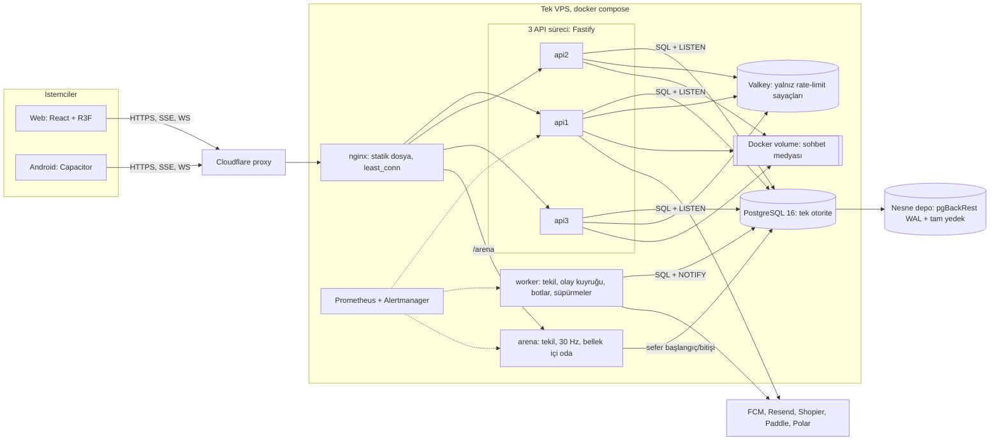
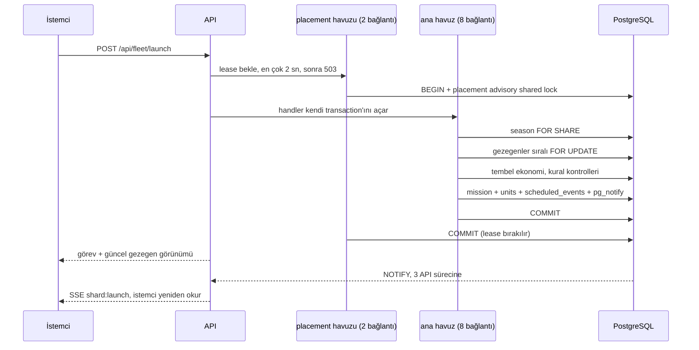
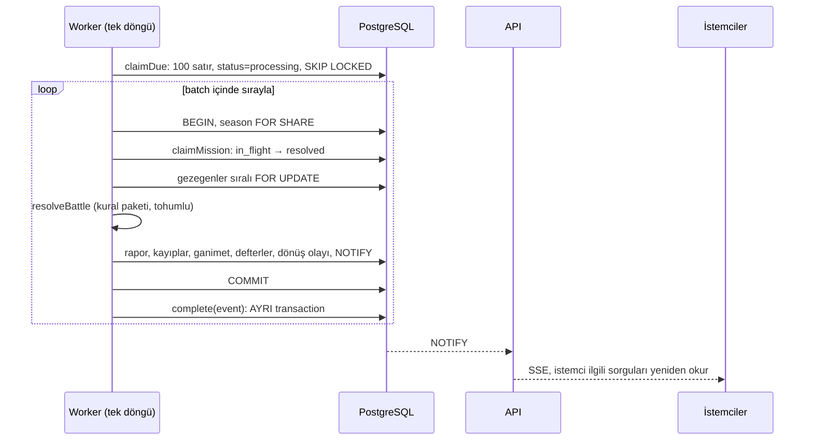

# A. Mevcut Mimari Denetimi (FAZ 1)

- **Tarih:** 2026-11-05
- **Taban:** `master` `b0053dd3` + çalışma ağacındaki 312 değişiklik (155 değişmiş, 157 yeni dosya; başlangıç galaksisi işi ve 0228–0235 migration'ları dahil).
- **Yöntem:** Yalnızca kod, şema, testler ve dağıtım dosyaları okundu. `docs/` altındaki eski dokümanlara ve eski analiz raporlarına bakılmadı. Kod değiştirilmedi. FAZ 1 sırasında canlı sisteme bağlanılmadı. Sonradan iki kaynak eklendi: §10, owner'ın prod donanımında koşturduğu yük testlerinin ölçülen sayılarını kullanır; [canlı ölçüm](canli-olcum-2026-11-05.md) ise S1 onayıyla alınan salt okunur ölçümdür.

## Etiketler

| Etiket | Anlamı |
| --- | --- |
| `[KOD]` | Kodda okundu, kanıtı dosya:satır olarak verildi. |
| `[SAYIM]` | Bu denetimde script ile sayıldı. |
| `[KAYNAK]` | Dış birincil kaynaktan doğrulandı (bkz. Kaynaklar). |
| `[ARİTMETİK]` | Kod değerlerinden hesaplandı, ölçülmedi. |
| `[HİPOTEZ]` | Yapı kodda var, gerçek etkisi ölçülmedi. |
| `[ÖLÇÜM]` | Owner'ın prod donanımındaki yük testinde ölçüldü; rapor tarihi verilir (§10). |
| `[BİLİNMİYOR]` | Repodan öğrenilemez; canlıdan ölçülmeli veya owner'a sorulmalı. |

## 1. Oyun, koddan anlaşıldığı hâliyle

**Çekirdek.** Hesap (`accounts`) bir sezonda tek komutan (`players`) açar. Komutanın korunan bir başkenti ve Core 9/13/16'da açılan en fazla üç kolonisi olur (`constants.ts`, `MULTI_WORLD`). Galaksi diske dizilmiş dünyalardan oluşur: 1000 komutan slotu, 100 bot adresi ve 130 tarafsız dünya.

**Ekonomi tembel hesaplanır.** Tick döngüsü yoktur. Üretim, gezegen kilitlendiğinde `last_tick_at`'ten şimdiye hesaplanır (`advanceEconomy`). Üretim önce tampona gider, toplanınca depoya geçer. Baskın depoyu, tamponu ve kasa tabanını ayrı kurallarla okur.

**Filo bahistir.** 26 gövde, 3 karşı-sınıf döngüsü (Skirmisher / Lance / Bulwark) artı destek sınıfından oluşur. Gemi gönderilince savunmadan çıkar. Uçuşun konumu saklanmaz; istemci `depart_at` ve `arrive_at`'ten çizer. Varış anında sunucu savaşı `seededFrom(missionId)` tohumuyla çözer, raporu yazar ve dönüş ayağını planlar.

**Bilgi oyunun kendisidir.** Dünyalar keşfedilene kadar gizlidir (fog). Teleskop, radar ve probe görüşü üretir; savaş raporu yeni istihbarat olur. Filtre sunucu sorgusunda uygulanır, istemciye gizli veri gitmez.

**Oynanış yüzeyi.** Madencilik ve enkaz, korsanlar, ticaret ve galaksiler arası konvoy, anıtlar (dalgalar, garnizon, anıt savaşları), radyasyon bombası, Death Star/EMP ve önleyiciler, bilinmeyen sinyaller, koloni arızaları ve sadakat. Klanlar: sohbet, hazine, depo, ortak savaş, savunma desteği, ateşkes. Sıralamalar: Dominion, Honor, Wealth. Tatil modu, "Silent Space" bekleme odası, ücretli bildirim cüzdanı, kozmetikler ve ödemeler.

**Sezon.** Süre 60 gündür (`economy-profile.ts`, `season-60-v1`). Sonunda sezon dondurulur, sonuç arşivlenir ve 70 dünya tablosu tek transaction'da silinir (`servers.ts:487`). Hesap, Legacy, kozmetik ve sezon sonuçları kalır.

**Bot komutanlar.** Oyuncu gibi davranır, aynı servislerden geçer, istemciye işaret gitmez. Galaksi başına tavan 100'dür.

### Mevcut ve planlı özellik ayrımı

| Özellik | Kod durumu | Canlı durumu |
| --- | --- | --- |
| Ana galaksi, savaş, klan, sezon | Commit'li | `[BİLİNMİYOR]` hangi commit'in koştuğu canlıdan okunmalı |
| Yarık / Komutan Gemisi arenası (30 Hz, tek oda, 100 koltuk) | Commit'li, `ARENA_ENABLED` ile kapalı başlar | `[BİLİNMİYOR]` |
| Başlangıç galaksisi / koloni gemisi (`vessels`, `starter_*`) | **Commit'lenmemiş**, `STARTER_GALAXY_ENABLED` ile kapalı başlar | Canlıda olmaması beklenir, doğrulanmalı |
| Paddle, Polar, Shopier | Üçü de kodda, bayraklarla kapalı başlar | `[BİLİNMİYOR]` |

## 2. Sistem haritası

### Bir oyuncu yazması: filo gönderme

### Bir zamanlanmış olay: varış ve savaş

## 3. Sayılarla sistem

| Alan | Değer | Etiket |
| --- | --- | --- |
| Sunucu kodu | 357 TS dosyası, 89.788 satır; `services/` 218 dosya + `starter` 27 + `bots` 11 | `[SAYIM]` |
| Web kodu / kural paketi | 182.052 satır / 31.373 satır | `[SAYIM]` |
| HTTP rotası | yaklaşık 297 (118 GET, 179 yazma) | `[SAYIM]` |
| Tablo / sütun / enum | 168 / 1.800 / 17 | `[SAYIM]` |
| JSON sütunu | 184 | `[SAYIM]` |
| `real` (float4) sütunu | 120 | `[SAYIM]` |
| Foreign key | 355 (230 NO ACTION, 91 CASCADE, 34 SET NULL) | `[SAYIM]` |
| İndeks / CHECK | 357 / 215 | `[SAYIM]` |
| FK'siz `*_id` sütunu | 112 (bir kısmı bilinçli) | `[SAYIM]` |
| Migration | 236 (0000–0235) | `[SAYIM]` |
| Partition | 0; tablo bazlı autovacuum/fillfactor ayarı 0 | `[SAYIM]` |
| `.transaction(` çağrısı | 263 | `[SAYIM]` |
| `for('update')` | 246 | `[SAYIM]` |
| `lockSeason` çağrısı | 63 | `[SAYIM]` |
| Olay türü | ana kuyruk 46, başlangıç kuyruğu 7 | `[SAYIM]` |
| Test dosyası | sunucu 505 (113.650 satır), web 808, kural 212, araçlar 56 | `[SAYIM]` |
| Bağımlılık | 2.060 kenar; **83 dosyalık tek runtime import döngüsü**; `schema.ts`'i 258 dosya, `planet.ts`'i 178 dosya import eder; 43 servis `worker/*` import eder | `[SAYIM]` |

Teknoloji: Node 22, TypeScript, Fastify 5, Drizzle + postgres.js, PostgreSQL 16, Valkey 9, React 19, three.js / R3F, TanStack Query, Capacitor 8.

## 4. Mevcut tutarlılık garantileri

| Modül | Bugünkü mekanizma | Tür |
| --- | --- | --- |
| Kaynak harcama | `planets` satırı `FOR UPDATE`, tembel tick kilit içinde (`planet.ts:494`) | Pesimist, güçlü |
| Bina, gemi, araştırma | Aynı kilit; tamamlanma olayı beklenen zamanla korunur (`expectedReadyAt`) | Pesimist + idempotent tüketici |
| Filo gönderme | Sıralı gezegen kilidi; olay aynı transaction'da yazılır | Güçlü, transactional outbox etkisi |
| Filo varışı, savaş | `claimMission` durum geçişi + gezegen kilitleri + tohumlu RNG | En az bir kez teslim + idempotent işleme |
| Eşzamanlı saldırılar | Gezegen kilidi; `resolve_at, ref_id, id` sırası (tek worker varsayımıyla) | Tek yazar + sıralama |
| Dominion | Sayaç + olay defteri, `assertDominionLedgers` | Güçlü |
| Klan hazinesi | Bakiye + `clan_treasury_events` defteri, CHECK'ler | Güçlü |
| Gezegen kaynakları, gemi sayıları | Defter yok, DB'de `>= 0` CHECK yok | Yalnız uygulama kilidi |
| Yeniden deneme | Bazı rotalarda `idempotency-key` + `request_log` | Kısmi |
| Görünür konum | Sunucuda saklanmaz, zamandan türetilir | Türetilmiş |
| Traffic, galaksi okumaları | Replika içi önbellek, NOTIFY ile geçersizleşir; LISTEN koparsa önbellek atlanır (`projections.ts:154`) | Olaysal, kopunca güçlüye döner |
| Presence | Dakikada en çok bir damga, kilitliyse atlanır | Olaysal, kayıp kabul |
| Sohbet | Tek satır insert + okuma tetikleyici olay | Olaysal teslim, güçlü kayıt |

**Ağ bölünmesi.** Tek PostgreSQL düğümü olduğu için sistem fiilen CP'dir. API veritabanına ulaşamazsa yazamaz. Veri bölünmesi senaryosu yoktur, çünkü replika yoktur.

## 5. Korunması gereken güçlü yönler

1. **Saf, deterministik kural paketi.** `@astera/rules` saat, I/O ve `Math.random` kullanmaz. Sunucu, simülatör ve istemci aynı kuralı okur.
2. **Tick'siz model.** Tembel ekonomi ve zaman damgalı uçuşlar sayesinde binlerce filo için konum yazısı gerekmez. Bu ölçeklenebilirliğin ana kazancıdır.
3. **Dayanıklı zamanlama.** Olay, sebep olduğu değişiklikle aynı transaction'da yazılır. Yeniden başlatmada gecikmiş olaylar sırayla işlenir.
4. **Kilit disiplini.** Sezon → sıralı gezegen düzeni var; kilitlenme ve yarış testleri mevcut (`concurrency.test.ts`, `launch-races.test.ts`).
5. **Tutarlı olay yayını.** `pg_notify` transaction içindedir, geri alınan iş duyurulmaz. SSE içeriği veri taşımaz, sızıntı yüzeyi çok küçüktür.
6. **Sunucu otoritesi.** Fog sorguda uygulanır. Arena yalnız girdi alır, simülasyon sunucudadır.
7. **Ödeme sınırı.** Ham gövde imza doğrulaması, webhook tekrar tabloları ve iade kayıtları var.
8. **Yedekleme.** pgBackRest ile şifreli WAL arşivi (`archive_timeout=60`), günlük tam yedek ve arşiv alarmları var.
9. **Gözlem.** Rota, olay türü, gecikme ve event-loop metrikleri; `pg_stat_statements`, `auto_explain`, Prometheus alarmları.
10. **Teknoloji sadeliği.** Tek veritabanı, tek dil, modüler monolit. API süreçleri medya hariç neredeyse durumsuz.

## 6. Bulgular

Şiddet, owner'ın öncelik sırasına göre verildi: önce veri bütünlüğü, sonra gecikme ve throughput. "Kanıt" gerçeği, "Etki" sonucu gösterir. Bu bölüm çözüm dayatmaz; çözümler FAZ 3–4'te alternatifleriyle karşılaştırılacak. Bulguların yük testleriyle karşılaştırması §10'dadır.

### Kritik

**K1. Tüm oyuncu yazmaları küme genelinde 6 eşzamanlı işe sınırlı.** `[KOD]` `[ARİTMETİK]`
- Kanıt: Beyaz liste dışındaki her kimlikli istek, API başına 2 bağlantılık placement havuzundan bir açık transaction tutar (`placementGate.ts:102-128,176-216`; `docker-compose.prod.yml:30`). Üç replika, en çok 6 eşzamanlı handler demektir. Kuyrukta 2 sn bekleyen 503 alır (`placementGate.ts:93`).
- Etki: Tavan, handler süresine bağlıdır: 50 ms'de yaklaşık 120, 200 ms'de yaklaşık 30 yazma/sn. Her yazma 2 bağlantı tüketir, biri boşta transaction'da bekler. Yük testinde bütün 5xx'ler bu kuyruktan geldi, ama CPU doyduğunda; CPU boşken 503 gözlenmedi `[ÖLÇÜM]` (§10).
- Ek risk: `POST /api/vacation` ve komutan transferi aynı anahtarda exclusive kilit alır (`placementGate.ts:188-192`, `commanderTransfer.ts:58`). PostgreSQL'de bekleyen exclusive isteğin arkasına yeni shared istekler sıralanır, yani tek oyuncunun işlemi galaksinin yazmalarını kısa süre durdurabilir. `[HİPOTEZ]`

**K2. Oyunun kalbi tek iş parçacığında sıralı, ve dış ağ çağrısı bekliyor.** `[KOD]`
- Kanıt: Worker olayları `for ... await` ile tek tek işler (`loop.ts:372-449`). `paid_alert` olayı döngü içinde FCM'e HTTP isteği atar (`notificationCenter.ts:270`), `fcm.ts` içinde timeout veya abort sinyali yoktur, token başına sırayla bekler. Worker bağlantılarında `lock_timeout` ve `statement_timeout` da yoktur (`app.ts:188-194`, yalnız `ROLE=api`). Botlar ve süpürmeler aynı event loop ve aynı 12 bağlantılık havuzu paylaşır.
- Etki: Yavaş tek bir olay veya takılan FCM, arkasındaki tüm savaşları geciktirir. İkinci worker bugün güvenli bir çıkış değildir: sıra garantisi tek tüketiciye dayanır (`queue.ts:44-47`).
- Ölçüm: Canlıda bir olay ortalama 129 ms sürüyor (`build_complete` p50 174 ms ve 48 deyim). Sıralı worker'ın tavanı saniyede ~7–8 olay. T2'de yetmeyebilir; worker hiç yük testinden geçmedi (canlı ölçüm). `[ÖLÇÜM]` `[ARİTMETİK]`

**K3. Veritabanı, bütünlüğün son savunma hattı değil.** `[KOD]` `[KAYNAK]`
- Kanıt:
  - `planets.alloy`, `crystal`, tamponlar `real` (float4), `deuterium` ise `double` (`schema.ts:1449-1464`). float4 en az 6 ondalık basamak hassasiyet verir; 16.777.216 üzerinde tam sayılar kaybolur; 4–8 milyon bandında adım 0,5'tir. Depo formülü Vault 20 ile 40. seviye rafineride yaklaşık 4,8 milyon, 60. seviyede 11,7 milyon verir. `[SAYIM]` Bu seviyelere gerçekten ulaşılıp ulaşılmadığı canlıdan okunacak. `[BİLİNMİYOR]`
  - `planets` kaynak sütunlarında ve `units.count`'ta `>= 0` CHECK yok (`missions` ve `units` için CHECK sayısı 0).
  - `setUnits` negatif sayıyı sessizce 0 yapar (`planet.ts:938,941`). Fazla düşüm hata vermek yerine gemiyi yok eder.
  - Kaynak ve gemi için defter yok; Dominion ve klan hazinesinde var. Geçmişe dönük "kaynak çoğaldı mı?" sorusu cevaplanamaz.
  - Uçuştaki filo iki biçimde durur: `units` satırı ve `missions.fleet` JSON'u. `units.location` metni `pirate:<id>`, `trade:<id>`, `wave:<id>` gibi FK'siz referans taşır (`schema.ts:1794`).
- Etki: Bugünkü kilitler ve testler çift harcamayı önlüyor; canlı bir hata kanıtı bulmadım. Ancak bir sonraki kod hatasını veritabanı durdurmaz ve iz bırakmaz. Owner'ın "mimari seviyede önleme" şartını karşılamıyor.

**K4. Tek sunucu, kesintili dağıtım, doğrulanmamış geri dönüş.** `[KOD]`
- Kanıt: Tüm servisler tek host'ta (`docker-compose.prod.yml`), replika veya failover yok. Dağıtım bütün uygulama rollerini durdurur, migration yapar, sonra başlatır (`deploy.sh:138-162`). Repoda otomatik restore tatbikatı yok. Sohbet medyası yerel Docker volume'unda, günlük `tar` ile yedeklenir (`backup.sh`), yani medya kayıp penceresi yaklaşık 24 saattir. Prometheus ve Alertmanager de aynı host'ta; host ölürse bu alarmlar çalmaz. Repoda dış uptime kontrolü görünmüyor.
- Etki: Disk veya host kaybında kurtarma manuel olur ve süresi bilinmez. RPO yaklaşık 1 dk iyi görünüyor, ancak RTO ölçülmemiş. `[BİLİNMİYOR]`

**K5. Sezon geçişi tek dev transaction, sıra elle tutuluyor.** `[KOD]`
- Kanıt: `wipeAllServers` 70 tabloyu `DELETE` ile tek transaction'da siler (`servers.ts:487`). Partition yok. 230 NO ACTION FK yüzünden sıra elle yazılmıştır ve kod yorumları aynı hatanın en az dört kez kesintiye yol açtığını anlatıyor (`debris_fields`, `research_orders`, `player_rivals`).
- Etki: 60 günlük veri tek transaction'da silinir. Süre ve WAL hacmi veriyle büyür, başarısızlık sezon geçişini durdurur. `[BİLİNMİYOR]` gerçek süre.

### Yüksek

**Y1. PostgreSQL ayarı repoda yok.** `[KOD]` `[KAYNAK]` Compose yalnız arşiv ve eklenti parametrelerini verir (`docker-compose.prod.yml:150-161`), 4 GiB limit tanımlar. `shared_buffers`, `work_mem`, WAL ve autovacuum ayarı repoda yoktur. PostgreSQL varsayılanı 128 MB'dir, belgeler %25 ile başlamayı önerir. 31 Ekim'de canlıda varsayılan değerlerdeydi (§10). 5 Kasım'da `ALTER SYSTEM` ile ayarlanmış bulundu: `shared_buffers` 1 GB, `work_mem` 8 MB. Ayar repoda değil, veri dizininde duruyor (canlı ölçüm). `[ÖLÇÜM]`

**Y2. Her yazmada küresel NOTIFY kilidi riski.** `[KAYNAK]` `[HİPOTEZ]` PostgreSQL 16'da NOTIFY yapan transaction commit sırasında sunucu geneli bir kilit alır ve commit sonrasına kadar tutar. Astera'da neredeyse her oynanış transaction'ı NOTIFY yapar (yaklaşık 300 yayın noktası, tetikleyiciler, replika başına 1 Hz kalp atışı). Bu, bildirim yapan commit'leri WAL flush süresine bağlı olarak sıraya sokar. Kaynaklar etkinin yük tipine bağlı olduğunu da söylüyor, yani ölçmeden karar verilmemeli. Bakılacak: `pg_stat_activity` içinde `wait_event='object'`. Yük testi: ≤200 test oyuncusunda görülmedi (§10).

**Y3. Tek sezon satırında `FOR SHARE`.** `[KOD]` `[HİPOTEZ]` 63 çağrı noktası aynı `seasons` satırını paylaşımlı kilitler (`planet.ts:448-474`). Birden çok kilit sahibi MultiXact üretir ve kilitleme disk yazısı doğurabilir. FK kontrollerinin `FOR KEY SHARE` kilitleri de eklenir. Bakılacak: `pg_stat_slru`, `MultiXact*` wait event'leri. Yük testi: maliyet, sezon satırını yazan `spawn_gate_through` güncellemesinde görüldü; ≤200'de kuyruk yok (§10).

**Y4. "Git yeniden oku" modeli ve bağlantı başına sunucu sorgusu.** `[KOD]` SSE veri taşımaz, istemciyi okumaya gönderir. Her bağlantı için sunucu 5 saniyede bir traffic görünümü hesaplayıp JSON imzası üretir (`session.ts:345-359`, `trafficWake.ts:73`). Bu maliyet bağlantı × görünür uçuş ile büyür. Her replika tüm galaksilerin tüm olaylarını işler. Sıra numarası, ACK ve kaçırılan olayı yeniden oynatma yoktur (bilinçli tercih): yeniden bağlanan istemci her şeyi baştan okur. Aktivite kapısı, coalescer ve single-flight önbellek bunu hafifletir, ama model doğrusal maliyetlidir. Yük testi: olay kaynaklı okumalar API CPU'sunun ~%28'i (§10).

**Y5. Uygulama veritabanına süper kullanıcı olarak bağlanıyor, tüm sırlar her süreçte.** `[KOD]` `[KAYNAK]` `DATABASE_URL` `POSTGRES_USER` kullanır (`docker-compose.prod.yml:28`), resmi imaj bu kullanıcıyı superuser yapar. Migration'larda rol veya `GRANT` yoktur. Bir SQL enjeksiyonu tüm izin kontrollerini atlar. Ödeme ve e-posta sırları arena ve worker dahil tüm süreçlere geçirilir (`*api-environment`). Not: `sql.raw` yalnız kapalı listeden değer alıyor; enjeksiyon noktası bulmadım.

**Y6. Kritik yazmalarda idempotency anahtarı yok.** `[KOD]` `/api/fleet/launch`, `/api/fleet/transfer`, `/api/planet/build`, `/api/planet/upgrade`, `/api/mining/launch` anahtar almıyor (`routes/planet.ts:236,463,513`, `routes/mining.ts:246`). İstemci bunları otomatik yeniden denemez (`client.ts:518`), ama yanıtı kaybedip tekrar basan oyuncu iki kez öder (örneğin gemi inşası). Veri bozulmaz; niyet çift uygulanır.

**Y7. Çökme sonrası 5 dakikalık sessiz gecikme.** `[KOD]` `claimDue` en çok 100 satırı `processing` yapar; süreç ölürse bu satırlar ancak 5 dk sonra geri döner (`queue.ts:146`, `env.ts:258`). Yeniden başlatma bunu kısaltmaz. Worker'ın bellek limiti 768 MiB'tır, OOM senaryosu gerçekçidir.

**Y8. Geç işlenen olay, işlendiği andaki duruma göre çözülür.** `[KOD]` Handler'lar `event.resolveAt` yerine `clock.now()` kullanır: savunan `loadLocked(tx, target, clock)` ile şimdiye kadar üretir (`handlers.ts:890`), dönüş `clock.now()`'dan başlar (`handlers.ts:739`). `loop.ts` yorumundaki "altı saatlik geçmiş doğru çözülür" iddiasının yalnız sıra kısmı doğrudur. Gecikme yağmalanabilir kaynağı ve kalkanı değiştirir.

**Y9. Uçuş kavramı 12 tabloya dağılmış.** `[SAYIM]` `missions`, `mining_runs`, `pirate_raids`, `trade_runs`, `intergalactic_convoy_runs`, `monument_waves`, `monument_probes`, `clan_support_waves`, `clan_war_contributions`, `radiation_bomb_flights`, `unknown_signals`, `vessel_missions`. Her biri `fleet`, `tech`, `damage`, durum ve zaman sütunlarını tekrar eder. `loadTrafficSnapshot` 10 ayrı okuma yapar (`traffic.ts`); terk, geri alma ve transfer kodları hepsini elle listeler. Yeni uçuş türü onlarca yere dokunur.

**Y10. Tablo büyümesi yönetilmiyor.** `[KOD]` `[KAYNAK]` `scheduled_events` satırları `done` olup sezon sonuna kadar kalır; `events_due_idx` kısmi değildir ve `status` indeksli olduğu için geçişler HOT güncelleme olamaz (`schema.ts:2695`). `request_log` tam yanıt JSON'u saklar ve sezon sonuna kadar silinmez. `planets` satırı 41 sütun + 2 JSON ile her tembel tick'te yeniden yazılır; `fillfactor` ayarı yok. Rastgele UUID birincil anahtarlar yaygın. Ölçüm: index'ler veriden büyük (176 MB'a 96 MB). `notifications`ın 24 bin satırına 61 MB index düşüyor. `scheduled_events` güncellemelerinin yalnız %3,4'ü HOT. `[ÖLÇÜM]`

**Y11. Modül sınırı yok.** `[SAYIM]` 83 dosyalık import döngüsü, düz `services/` klasörü, 43 servisin worker import etmesi, 3.229 satırlık `handlers.ts`, 3.308 satırlık `clanWar.ts`. Çalışma zamanı sorunu değildir, ancak kademeli geçişi ve modül çıkarmayı zorlaştırır.

**Y12. Analitik kurtarma işi veritabanının en büyük tüketicisi.** `[KOD]` `[ÖLÇÜM]` `recoverAnalyticsCommands` (`analyticsFacts.ts:10`) son 30 günün komut tablolarını `UNION ALL` ile tarar. Her API dakikada bir ve her başarılı POST'tan sonra çalıştırır; yalnız aynı API'de üst üste binme engellenir (`app.ts:215-219`, `analyticsRecorder.ts:7-12`). Canlıda 8 günlük PG süresinin %44'ü bu iş (ortalama 132 ms). Maliyeti yazma hızı ve 30 günlük veriyle birlikte büyür.

### Orta

- **O1. 3NF sapmaları.** `[KOD]` Tekrarlayan gruplar JSON'da (`fleet`, `damage`, `tech`, `loot`); `units.location` birleşik değer; `planets.x/y/z` slot'tan türetilebilir; `players.wealth` önbellek; `planets.player_id` fiziksel adı, kod adıyla (`controllerPlayerId`) farklı; ölü sütunlar duruyor (`recovery_relief_at`, `disrupted_until`). Bir kısmı doğru tercih olabilir (savaş raporu değişmez anlık görüntü); tablo tablo ayrılacak.
- **O2. Oturumlar.** `[KOD]` Web refresh token'ı 30 gün ve durumsuzdur. Her yenilemede yenisi verilir, ama eskisi süresi dolana kadar geçerli kalır (`routes/auth.ts:49-53,123-140`). Tek token iptal edilemez; yalnız `authVersion` artışı hesabın tüm oturumlarını kapatır. Cihaz bazlı iptal yalnız native'de var. Tüm tokenler tek HS256 anahtarı kullanır; anahtar değişimi herkesin oturumunu kapatır.
- **O3. Valkey düşerse giriş de düşer.** `[KOD]` Oynanış limitleri açık kalır, ama giriş ve kayıt limitleri `skipOnError:false` (`app.ts:320,326,391`). Bilinçli tercih, ama sayaç kesintisi giriş kesintisi demektir.
- **O4. Çoklu hesap tespiti bulamadım.** `[KOD]` Sezon ödüllü PvP'de kaynak aktarma (pushing) riski vardır. Tasarım kararı gerekiyor (bkz. B).
- **O5. Arena tek oda.** `[KOD]` Durum bellekte, tek süreçte, 100 koltuk, JSON mesajlar. Çökmede açık seferler geri çağrılır (`recallOpen`). Bugünkü kapsam için uygun; çoklu oda istenirse yeniden tasarım gerekir.
- **O6. Ücretli bildirimde en çok bir kez teslim.** `[KOD]` Ücret commit edilir, push sonra atılır (`notificationCenter.ts:~268-270`). Commit ile push arasında çökme, parası kesilmiş ama gitmemiş bildirim demektir.
- **O7. Dağıtık izleme yok.** `[KOD]` Bugünkü tek host ölçeğinde kabul edilebilir.
- **O8. 312 dosya commit'lenmemiş.** `[SAYIM]` Migration 0228–0235 dahil büyük iş yalnız çalışma ağacında. Şema planının tabanı belirsizleşiyor (bkz. B, S6).
- **O9. Prod makinesi paylaşılıyor.** `[ÖLÇÜM]` Aynı 6 vCPU'da stage yığını (3 API, worker, arena, PG, Valkey) ve izleme de çalışıyor. Prod PG kümesinde oyuncu verisi içeren iki eski kopya duruyor (219 MB ve 189 MB). Disk %81 dolu.
- **O10. Canlıda deadlock var.** `[ÖLÇÜM]` Toplam 90; son 5 günde 2. İkisi de `update players set wealth` ile `players ... for update` arasında. `wealth` önbellek sütunu (O1), kilit sırası tutarsız.

## 7. Arıza senaryoları: bugünkü davranış

| Senaryo | Bugün ne olur | Veri riski | Eksik |
| --- | --- | --- | --- |
| DB bağlantısı kopar | API 5xx, worker 1 sn'de bir dener, LISTEN yeniden bağlanır, önbellek atlanır | Commit edilmiş veri güvende | Oyuncuya özel durum ekranı sınırlı |
| Valkey düşer | Oynanış sürer, giriş/kayıt hata verir | Yok | Giriş kesintisi (O3) |
| SSE/API süreci düşer | nginx diğer replikaya geçer, istemci backoff ile bağlanır, tüm okumaları yeniler | Yok | Toplu yeniden okuma dalgası (Y4) |
| Aynı işlem iki kez | Anahtarlı rotada tek yanıt; anahtarsız rotada iş kuralı korursa 409, korumazsa iki kez uygulanır | Niyet çiftlenir | Y6 |
| İki worker aynı filoya | `SKIP LOCKED` + `claimMission` ikinciyi etkisiz kılar | Yok | Sıra garantisi kalkar (K2) |
| Sunucu savaş ortasında kapanır | Transaction geri alınır, olay 5 dk sonra yeniden işlenir, tohum aynı | Yok | 5 dk gecikme (Y7), sonuç zamana bağlı (Y8) |
| Harcama yarıda kalır | Transaction atomik | Yok | — |
| Varışta timeout | 5 deneme, sonra `abandon` filoyu serbest bırakır, savaş olmaz | Oyun sonucu kaybolur | Worker'da kilit timeout'u yok (K2) |
| İstemci/sunucu uyuşmazlığı | `x-placement` 409, `x-server-time` ile saat düzeltmesi, güvenlik ağı okumaları | Yok | — |
| Ağ kesilip gelir | Backoff, token yenileme, tam yeniden okuma | Yok | Yeniden oynatma yok, bilinçli |
| Kuyruk birikir | Olaylar geç işlenir, alarm çalar, API lease 503 verebilir | Sonuç kayması (Y8) | Geri basınç yok |
| Dağıtımda aktif oyuncu | Tüm uygulama durur, istemci bakım/hata görür, arena seferleri geri çağrılır | Yok | Sıfır kesinti yok (K4) |

Mobil yaşam döngüsü: `appStateChange`, `networkStatusChange` ve `visibilitychange` dinleniyor (`platform/activity.ts`, `platform/network.ts`). SSE sessizlik süresi dolunca bağlantı yenileniyor, token yenileniyor, açılışta okumalar tazeleniyor. Android'de arka plana geçen WebView'de bağlantının kopacağı varsayılmalı; mevcut tasarım buna uyuyor. Cloudflare okuma zaman aşımı 125 sn, 25 sn'lik SSE kalp atışı bunun altında. Cloudflare yayınlarında da uzun bağlantılar kesilebilir, yeniden bağlanma şart.

## 8. Test altyapısı

**Var:** Birim, entegrasyon, kural özellik testleri (fast-check); yarış testleri; worker kurtarma testleri; LISTEN yeniden bağlanma testi (`event-bus-reconnect.test.ts`); kendi yük aracı (`tools/capacity.mjs`, gerçek HTTP + SSE, canlıyı reddeder).

**Yok veya repoda göremedim:** CI'da yük testi; DB/Valkey kesintisi üzerinden uçtan uca arıza enjeksiyonu; yedekten geri yükleme tatbikatı; migration geri alma testi; kaynak ve filo korunum değişmezi için sürekli denetim.

## 9. Bu denetimin sınırları

§10 owner'ın yük testlerini, [canlı ölçüm](canli-olcum-2026-11-05.md) ise S1 onayıyla alınan salt okunur ölçümü kullanır. Hâlâ **bilinmeyenler**:
- sezon sonu veri boyutu
- worker'ın yük altındaki davranışı
- kayıt dalgası
- geri yükleme süresi

## 10. Yük testleriyle karşılaştırma

**Kaynak.** Owner'ın prod donanımında, oyun bakımdayken koşturduğu testler: `reports/capacity-run-2026-10-31.md`, `-11-03`, `-11-04`, `-11-05` ve testleri yürüten oturumun özeti. Yalnız ölçülen sayıları kanıt olarak aldım; raporların önerilerini plan tabanı yapmadım. Parantezdeki tarih raporun tarihidir.

**Koşullar ve geçerlilik sınırları.**
- 6 paylaşımlı vCPU / 12 GB VPS; 3 API + worker + PG; dolu galaksi tohumu (2.000 hesap); `--scenario real`, ×2 etkinlik. Üreteçler aynı makinede ~1,2 çekirdek yiyor.
- Her seviye temiz tohumdan başladı. Sezon sonu şişmesi ve büyük tablolar testte yok, yani Y10 görünmez.
- Tek koşunun p95'i oynak: aynı kod iki gecede 200 oyuncuda 2.688 ve 1.224 ms verdi. CPU/istek kararlı; karar ona dayanmalı.
- "200 oyuncu", oyuncu başına ~0,9 istek/sn atan test oyuncusudur. Canlıda ölçülen 0,327 istek/sn küçük galaksiden gelir; dolu galakside olay okumaları bunu artırır.

**Ana ölçümler (11-05, 200 test oyuncusu, kod `b0053dd3`).** `[ÖLÇÜM]`

| Ölçü | Değer |
| --- | --- |
| Duvar | 3 API toplam ~2,5 çekirdek (süreç başına ~%83); her seviyede aynı |
| API maliyeti | `4,35 + 2,23 × deyim` ms (R² 0,79); ortalama 4,7 deyim, ~13,8 ms/istek |
| PG maliyeti | `0,29 + 1,05 × deyim` ms, ~4,7 ms/istek; toplam 0,85 çekirdek |
| Boş istek | Aynı API ağır iş yokken 605 istek/sn; gerçek karışımda süreç başına ~60. On katlık fark uygulama işinde |
| Hata | 5xx'lerin tamamı `RETRYABLE` kira kuyruğu (94/94) |
| Olay kaynaklı okumalar | İsteklerin ~%42'si, API CPU'sunun ~%28'i |
| Boştaki akışlar | 250 SSE toplam 0,16 çekirdek |

**Bulgularım ve ölçüm.**

| Bulgu | Ölçüm | Durum |
| --- | --- | --- |
| K1 kira havuzu | 5xx'lerin tamamı bu kuyruk: 4.204/4.205 (11-03), 1.937/1.939 (11-04), 94/94 (11-05). 12 okuma rotası kiradan çıkınca 5xx 283 → 94. 503'ler CPU doyunca çıktı; kira tutan transaction'lar CPU bekleyen API'yi bekliyordu (`ClientRead`, 10-31). | **Doğrulandı.** Hata kaynağı, kapasite duvarı değil. Vacation/transfer exclusive kilidi test edilmedi. |
| K2 worker | Gecikme ölçülmedi. Savaş koşusunda 95 iniş işlendi, süre tablosu yok. | Kapsam dışı |
| K3 bütünlük | Yük testi ölçemez. | Kapsam dışı |
| K4 tek host | Her dakikanın ilk 6 sn'sinde `fsync` p95 146 ms (kalan 11), bellek taraması p95 134 ms (kalan 32); kaynak VM dışı, paylaşımlı çekirdek. Üreteç ve izleme aynı makinede. | **Güçlendi.** |
| K5 sezon geçişi | Test edilmedi. | Kapsam dışı |
| Y1 PG ayarı | Canlı (10-31): `shared_buffers` 128 MB (11 GB makinede), `work_mem` 4 MB, `effective_cache_size` 4 GB, `max_connections` 100. PG ≤200'de 0,82–0,92 çekirdek. | **Doğrulandı, öncelik düştü.** Bugünkü darboğaz değil; büyük veride etkisi ölçülmedi. |
| Y2 NOTIFY kilidi | ≤200'de görülmedi. Laptop ölçümünde NOTIFY'lı ve NOTIFY'sız tasarım aynı commit tavanında (243–1.078 ve 334–954 commit/sn); tavan disk flush'ı. Testteki yazma hızı ~5–6 istek/sn. | **≤200'de çürütüldü, Orta'ya iner.** VPS'te flush takılmada 146 ms'ye çıktığı için yüksek yazma hızında yeniden ölçülmeli. `[HİPOTEZ]` |
| Y3 sezon satırı | Maliyet yazanda çıktı: `update seasons set spawn_gate_through` ortalama 329 ms (10-31), 466 / 1.718 ms (11-04, 200 / 250 oyuncu), örneklerin %9–14'ünde bekliyor, bekleyen en çok 1–2 (11-05). 11-04'te `monuments` okumaları bu yazmanın arkasında sıraya girdi; paylaşımlı kilit kaldırıldı (`monumentView.ts:211-213`). Yazma hâlâ sezon satırında (`spawnGate.ts:94`). MultiXact ölçülmedi. | **Mekanizma doğrulandı, ≤200'de kuyruk yok.** Yazma hızıyla büyür. |
| Y4 yeniden okuma modeli | Olay kaynaklı okumalar isteklerin ~%42'si, API CPU'sunun ~%28'i. Bağlantı başına sunucu trafik kontrolü (`session.ts:295`, `soon()`) API CPU'sunu %6 artırdı, okuma p95'i 2,8 katına, trafik p95'ini 8,6 sn'ye çıkardı. Canlı karışımda (11-02) tam yeniden okuma patlamaları isteklerin %34,6'sı (oturum özeti; ham veriyi görmedim). | **Doğrulandı, tahminimden büyük.** Kapasitenin ikinci büyük kalemi. Maliyet bağlantı sayısından değil, oyuncu × olaydan geliyor. |
| Y5–Y9, Y11 | Yük testi ölçemez. | Kapsam dışı |
| Y10 şişme | Temiz tohum bu etkiyi gizler. | Kapsam dışı; testlerin geçerlilik sınırı |
| O3 Valkey | Valkey'li hız sınırı istek başına ~0,2 ms ekliyor. | Performans sorunu değil; erişilebilirlik konusu olarak kalır |

**Kaçırdıklarım.**
1. **Asıl duvar, istek başına API CPU'su.** Ben yapıyı ve kilitleri saydım, çalışma zamanı maliyetini modellemedim. Birincil maliyet sürücüsü deyim sayısı. Tek deyim 100/sn'de Drizzle ile 1,38 ms, ham `postgres.js` ile 0,33 ms; gruplu gönderim deyim başına %50–60 ucuz; `.prepare()` küçük kazanç. En büyük eksiğim bu.
2. **Yerleşim yeniden kontrolü:** istek başına 0,87 deyim, bütün deyimlerin %21'i, API CPU'sunun ~%13'ü (`placementGate.ts:199,249`). Kiranın kilit tarafını gördüm, deyim maliyetini görmedim.
3. **Ağır rotalar:** `planets` 12,9, `rewards` 12,7, `monuments` 17,5, `session/return` 17,2 deyim. `collect` 11-03'te 77 sorguydu, bugünkü değeri ölçülmedi. `/api/galaxy` yanıtı 193 KB.
4. **Node bayrakları:** `--experimental-async-context-frame` −%7,2 CPU/istek; `--max-semi-space-size=64` −%8,6, ama GC duraklaması p99 85–200 ms.
5. **`/health` veritabanına soruyor** (`select 1` ve kuyruk gecikmesi, `health.ts:116-121`): 25 ms, aşırı yükte 20 sn. Docker sağlık kontrolü bu adresi kullanıyor (`docker-compose.prod.yml:130`).
6. **`UNSAFE_TRANSACTION`** bir kez görüldü (`GET /api/planets/:id`, 11-03). Kök neden bulunmadı; repoda ham `BEGIN` yok.
7. **`soon()` altında trafik rotasında 15 sn zaman aşımları.** Aday neden `asyncCache.ts` dolumunun kendini zincirlemesi; kanıtlanmadı.
8. **API'ler tavanın altında eşit yük almıyor** (api2 ~yarısı, `least_conn`). Nedeni bilinmiyor.
9. **Kayıt ve onboarding dalgası hiç ölçülmedi.** `RATE_LIMIT_SIGNUP_MAX` 18.

10-31'deki iki bulgu kodda artık düzelmiş: presence koşullu tek `update` (`presence.ts:61-63`), prod derlenmiş JS koşuyor (`Dockerfile:118`).

**Plana etkisi.**
1. **Kapasite önce istek yolu sorunu, veritabanı sorunu değil.** PG ≤200'de 0,85 çekirdek. Veritabanı yeniden tasarımının (E) gerekçesi bütünlük ve büyümedir (K3, K5, Y9, Y10), bugünkü throughput değil. Deyim sayısını düşürmek iki tarafa da yarar.
2. **Gerçek zamanlı model (F) bir kapasite kalemidir.** Olay başına galaksi düzeyinde tek hesap gerekir. Bağlantı başına sunucu hesabının daha kötü çıkması (`soon()`) bu yönü destekliyor.
3. **Bütünlük kalemleri yük testinde görünmez** (K2, K3, Y6, Y8). Kapasite işinden ayrı bir hat olarak planlanmalı.
4. **T1 ve T2'nin çekirdek karşılığı** B'deki "Ölçülen kapasite" tablosunda.
5. **Hâlâ ölçülmesi gerekenler:**
   - Savaş yükünde worker gecikmesi.
   - Yüksek yazma hızında commit ve NOTIFY.
   - Sezon sonu büyüklüğünde veritabanı: şişme ve sorgu planları.
   - Bugünkü canlı `pg_settings`.
   - Kayıt dalgası.
   - Geri yükleme süresi.

## Kaynaklar

- [PostgreSQL 16: NOTIFY](https://www.postgresql.org/docs/16/sql-notify.html)
- [Recall.ai: Postgres LISTEN/NOTIFY does not scale](https://www.recall.ai/blog/postgres-listen-notify-does-not-scale) (commit kilidini kaynak koddan alıntılıyor; düzeltme commit'inin sürümünü doğrulayamadım)
- [DBOS: Postgres LISTEN/NOTIFY Actually Scales](https://dbos.dev/blog/postgres-listen-notify-scalability) (karşı görüş, toplu commit)
- [pgsql-hackers: LISTEN/NOTIFY performance considerations](https://postgrespro.com/list/thread-id/2743933)
- [PostgreSQL 16: Sayısal tipler](https://www.postgresql.org/docs/16/datatype-numeric.html)
- [PostgreSQL 16: Explicit locking](https://www.postgresql.org/docs/16/explicit-locking.html)
- [AWS: Multixacts in PostgreSQL](https://aws.amazon.com/blogs/database/multixacts-in-postgresql-usage-side-effects-and-monitoring/)
- [PostgreSQL 16: Kaynak ayarları](https://www.postgresql.org/docs/16/runtime-config-resource.html)
- [PostgreSQL 16: Rol özellikleri](https://www.postgresql.org/docs/16/role-attributes.html)
- [Docker Hub: postgres](https://hub.docker.com/_/postgres)
- [Cloudflare: Connection limits](https://developers.cloudflare.com/fundamentals/reference/connection-limits/)
- [Cloudflare: WebSockets](https://developers.cloudflare.com/network/websockets/)
- [DBOS: Making Postgres queues scale](https://dbos.dev/blog/making-postgres-queues-scale)
- [Even Realities: Background lifecycle](https://hub.evenrealities.com/docs/build/background-lifecycle) (Android WebView davranışı, ikincil kaynak)
