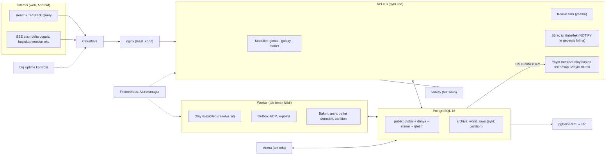
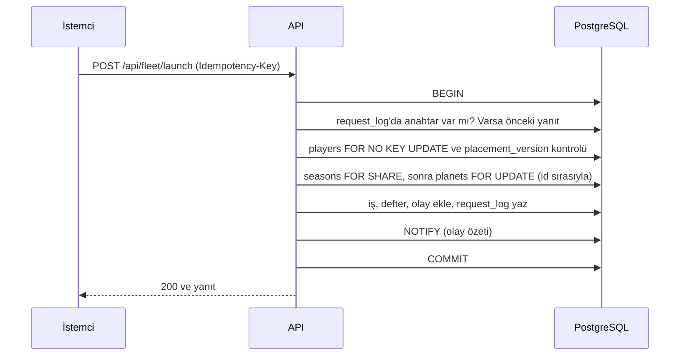

# D. Hedef Mimari (FAZ 4)

- **Dayanak:** [C. ADR'ler](C-adr-alternatifler.md), owner 2026-11-06'da kabul etti.
- **Kapsam:** Bu belge bütün resmi verir. Ayrıntılar: E veritabanı, F gerçek zamanlı, G tutarlılık, H güvenlik, I performans, J altyapı.
- **Kısıt:** Bugünkü VPS (Contabo Cloud VPS 6) korunur. Önce yazılım.

## Bugün ve hedef

| Katman | Bugün | Hedef | ADR |
| --- | --- | --- | --- |
| Süreçler | 3 API, worker, arena, PG, Valkey; stage aynı makinede | Aynı süreçler; stage kullanılmadığında kapalı | 02, 10 |
| Kod yapısı | Düz `services/`, 83 dosyalık döngü | `global`, `galaxy`, `starter`, `platform` modülleri; galaksi → global yalnız arayüzden | 01 |
| Okuma | Ortalama 4,7 deyim; her istekte ayrı yerleşim kontrolü | Önbellek isabetinde 0 deyim; ağır rotalar ≤ 5 deyim, tek gidiş-dönüş | 03 |
| Yazma | Kira havuzu (API başına 2) ve paylaşımlı advisory kilit | Tek transaction'da komut zarfı | 05 |
| Gerçek zamanlı | Olay → "git yeniden oku" | Olay başına süreç içinde tek hesap; veri taşıyan SSE | 04 |
| Worker | Sıralı; kilit, zaman aşımı ve kurtarma yok; `clock.now()` ile çözüm | Tek örnek kilidi, açılışta kurtarma, zaman aşımları, outbox, `resolve_at`; ölçülürse galaksiye göre paralel | 06 |
| Veri bütünlüğü | `real`, CHECK yok, defter yok | `double precision`, CHECK ≥ 0, kaynak ve gemi defteri | 07 |
| Veri saklama | 75 dosyada 299 silme noktası; geçmiş verisi de kalıcı siliniyor | Geçmiş sınıfı önce arşive (`archive.world_rows`); geçici durum silinir | 08 |
| Analitik | Her POST'ta 30 günlük tarama | İmleçli artımlı okuma, günde bir tam mutabakat | 09 |
| Güvenlik | Uygulama superuser, bütün sırlar her süreçte | Çalışma rolleri superuser değil; rol başına sır | 11 |
| Dağıtım | Hepsini durdur, migration, başlat | Expand-contract ve sırayla yeniden başlatma | 12 |

## Bileşen haritası



## Modül sınırları

| Modül | İçerik | Kural |
| --- | --- | --- |
| `global` | Hesap, oturum, ödeme (Polar, Shopier), kozmetik, Legacy, sezon sonuçları, analitik, duyurular | Galaksi verisine yazmaz |
| `galaxy` | `players` ve FK kapanışındaki bütün dünya tabloları; klan ve sohbet (sezon başına) | Global'e yalnız arayüz fonksiyonlarıyla erişir (ör. ödül verme, Legacy olgusu) |
| `starter` | Başlangıç galaksisi tabloları (`vessels`, `starter_*`) | Ana galaksiye geçiş tek arayüzden (G §6) |
| `platform` | Kuyruk, yayın merkezi, önbellek, komut zarfı, idempotency, arşiv yardımcısı, metrikler | İş kuralı içermez |

Sınırı bir import kuralı testi korur. Paddle kodu kaldırılır, geçmiş sipariş verisi kalır (S13).

## Akışlar

### Okuma (önbellek isabeti ve ıska)

```mermaid
sequenceDiagram
  participant C as İstemci
  participant A as API
  participant M as Süreç önbelleği
  participant P as PostgreSQL
  C->>A: GET /api/mining/field
  A->>M: Oturum, komutan, yerleşim sürümü, saha
  alt hepsi geçerli (NOTIFY ile güncel)
    M-->>A: veri
    A-->>C: 200 (0 deyim)
  else ıska
    A->>P: Tek sorgu; yerleşim kontrolü aynı sorgunun içinde
    P-->>A: satırlar
    A->>M: doldur (single-flight)
    A-->>C: 200
  end
```

### Yazma (komut zarfı)



### Zamanlanmış olay ve yayın

```mermaid
sequenceDiagram
  participant W as Worker
  participant P as PostgreSQL
  participant A as API yayın merkezi
  participant C as İstemciler
  W->>P: Vadesi gelenleri al (SKIP LOCKED)
  W->>P: İşleyici transaction: durumu resolve_at anına ilerlet, sonucu yaz, defter, NOTIFY
  P-->>A: NOTIFY (her API bir kez alır)
  A->>A: Herkese açık deltayı bir kez hesapla
  A->>A: Sisli kısım: yalnız menzili kapsayan izleyiciler
  A-->>C: SSE çerçevesi (bağlantı sıra no, tür, veri)
  C->>C: Deltayı önbelleğe uygula; boşluk veya yeniden bağlanmada tam okuma
```

## Büyüme yolu

1. **Bugünkü makine:** I'deki yazılım adımları. Her adımdan sonra ölçüm.
2. **Gözle görülür iyileşmeden sonra (owner kararı):** adanmış çekirdek, ardından uygulama/DB ayrımı. LISTEN/NOTIFY makineler arası çalışır; ek bileşen gerekmez.
3. **T3:** Yeni galaksiler yeni sunucuda. Bunu mümkün kılan, modül sınırı ve galaksiler arası işlemlerin iki adımlı tasarımı.

## Bilinçli olarak eklenmeyenler

Mikroservis, Kubernetes, harici mesaj kuyruğu, harici önbellek katmanı, ikinci veritabanı ve dil değişikliği eklenmiyor. Her biri ölçülen bir darboğaz göstermeden eklenmez.
