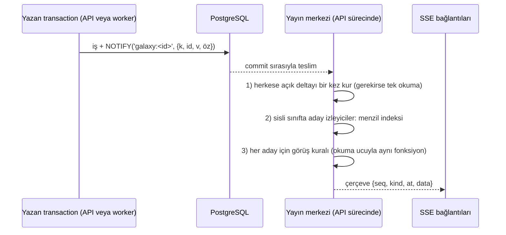

# F. Gerçek Zamanlı ve Olay Mimarisi (FAZ 4)

- **Dayanak:** ADR-04.
- **Hedefler (S9):**
  - Oyuncunun kendi varış sonucu ≤ 1 sn.
  - Başkasının görünür hareketi ≤ 3 sn.
  - Sohbet ≤ 1 sn.
  - Sıralama ≤ 30 sn.
  - Olay kaynaklı okumalar isteklerin %10'unun altında. Bugün %42.

## 1. Bugün

- SSE, veri taşımayan "bir şey oldu" sinyalleri gönderiyor (`useEventStream.ts:111`). İstemci ilgili ekranları yeniden okuyor.
- Ana konular: `shard:mining`, `shard:pirate`, `shard:launch`, `shard:arrival`, `shard:world`, `shard:impact`, `shard:season`, `shard:rollover` ve oyuncu kanalı.
- Taşıma: PostgreSQL LISTEN/NOTIFY → her API süreci → SSE.
- Ölçülen maliyet:
  - Olay okumaları isteklerin %42'si, API CPU'sunun %28'i.
  - Bağlantı başına sunucu hesabı (`soon()`) daha da pahalı çıktı.
  - Boştaki bağlantı ucuz: 250 bağlantı 0,16 çekirdek.

## 2. Olay sınıfları

| Sınıf | Örnek | Kime | Taşıdığı |
| --- | --- | --- | --- |
| Kişisel | Kendi varışın, inşa bitti, rapor | Yalnız sahibinin bağlantıları | Değişen nesnenin yeni hâli |
| Galaksi, herkese açık | Asteroit sahası değişimi, korsan konumu, galaksi olayı | Galaksideki bütün bağlantılar | Delta |
| Galaksi, sisli | Başkasının filosu (trafik) | Yalnız onu görebilen izleyiciler | İzleyiciye göre filtrelenmiş delta |
| Sosyal | Klan, sohbet, DM | Üyeler | Mesaj (bugünkü gibi) |
| Global | Sezon, geçiş, bakım | Herkes | Sinyal; sonra tam okuma (bugünkü gibi) |

## 3. Akış

1. **NOTIFY yükü.**
   - Alanlar: tür, nesne kimliği, sürüm ve küçük bir özet. PostgreSQL yük sınırı 8.000 bayt.
   - Özet yetmezse yayın merkezi nesneyi süreç başına bir kez okur. Üç API, olay başına üç okuma demektir. Bugün bu sayı oyuncu sayısı kadar.
2. **Tek kural, iki yer.** Sisli veriyi filtreleyen fonksiyon, okuma ucunun (`/api/galaxy/traffic`) kullandığı projeksiyon fonksiyonunun aynısıdır. Delta ile tam okuma aynı sonucu vermek zorunda.
   - Görüş kuralı değişmez. Sonradan gelen görüş değişimi tele gitmez (owner kuralı).
3. **Aday izleyici.**
   - Yayın merkezi, bağlı izleyicilerin sensör kapsamını bellekte tutar. Kapsam, sensör ve radar olaylarıyla güncellenir.
   - Kural yalnız kapsamı olayı içeren izleyicilerde çalışır. `soon()`'un hatası, her bağlantı için bütün trafiği yeniden hesaplamaktı.
4. **Çerçeve.**
   - Alanlar: `seq` (bağlantıya özgü, artan), `kind`, `at` (sunucu zamanı), `data`.
   - SSE `id:` alanı `seq` taşır.

## 4. Sıra, kayıp ve yeniden bağlanma

- **Bir bağlantı içinde** SSE TCP üstünde sıralı ve kayıpsızdır.
- **PostgreSQL'den API'ye** LISTEN bağlantısı içinde teslim commit sırasıyla ve kayıpsızdır. Kayıp yalnız bağlantı koparsa olur.
- **LISTEN koparsa:** O API'deki bütün akışlara `resync` gönderilir. İstemci tam okur; bugünkü güvenli yol budur. Kalp atışı bunu bugünkü gibi algılar.
- **İstemci koparsa:** `Last-Event-ID` ile yeniden bağlanır.
  - Aynı süreç ve son 30 sn'lik halka tamponda ise eksikler yeniden gönderilir.
  - Değilse `resync`. Yeniden bağlanma nginx'te başka API'ye düşebilir; o durumda da `resync`.
- **Veritabanında galaksi sıra sayacı yok.** Bilinçli tercih: tek satırlık sayaç, olay üreten bütün transaction'ları galaksi başına sıraya sokardı (Y3 benzeri sıcak satır).

## 5. İstemci

- Her tür için bir uygulayıcı fonksiyon vardır. TanStack Query önbelleğine `setQueryData` ile birleştirir.
- Nesneler sürüm taşır. Eski sürümlü delta yok sayılır.
- Güvenlik ağı okuması kalır, ama aralığı uzar (ör. 60 sn). Kaç kez gerçek fark bulduğu metrik olarak sayılır; fark oranı ölçülür.
- Arka plandan dönüşte ve ağ değişiminde bugünkü tam okuma kalır (`platform/activity.ts`).

## 6. Geçiş sırası

Her tür ayrı bir bayrakla açılır. Bayrak kapalıyken bugünkü sinyal yolu çalışır.

| Sıra | Tür | Neden ilk | Kabul |
| --- | --- | --- | --- |
| 1 | `mining/field` | En büyük okuma payı (%27,7); herkese açık | Delta uygulanmış durum = tam okuma (özellik testi); saha okuması %80 azalır |
| 2 | `pirates` | Herkese açık; ikinci büyük pay | Aynı |
| 3 | Trafik (`launch`, `arrival`) | Sisli; en zor | Görüş kuralı testleri hem okuma ucunda hem yayında geçer; başkasının hareketi p95 ≤ 3 sn |
| 4 | Kişisel olaylar | Kendi ekranının yeniden okuması | Varış sonucu ≤ 1 sn |

## 7. Ölçü ve alarm

- **Yayın merkezi:** olay başına süre, aday izleyici sayısı, çerçeve sayısı, `resync` sayısı ve nedeni.
- **İstemci:** güvenlik ağı okumasının fark bulma oranı, uçtan uca gecikme. `at` ile istemci saati arasındaki fark, sunucu saati düzeltmesiyle ölçülür.
- **Alarmlar:**
  - LISTEN kopuşu (bugün var).
  - `resync` oranı taban değerin üç katını aşarsa.
  - Yayın merkezi olay işleme p95 > 50 ms.

## 8. Çoklu makine

Uygulama ve DB ayrıldığında veya API ikinci makineye çıktığında model değişmez. Her API kendi LISTEN bağlantısını açar. NOTIFY hacmi olay sayısıyla sınırlı, oyuncu sayısıyla değil. Harici aracı (Redis, NATS) ancak NOTIFY ölçülebilir darboğaz olursa değerlendirilir. Bugün ≤ 200 oyuncuda darboğaz değil (A §10).
