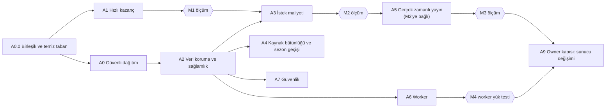

# K. Uygulama ve Geçiş Yol Haritası (FAZ 5)

- **Dayanak:** C (kabul, 2026-11-06), D–J (kabul, 2026-11-06).
- **Kısıt:** Bugünkü VPS. Önce yazılım.
- **Taban:** Başlangıç galaksisi işinin commit'lendiği master (S6).

## Genel kurallar

1. **TDD her aşamada zorunlu** (CLAUDE.md §3): önce test, FAIL, kod, PASS, inceleme, regresyon. Aşağıdaki "Testler" satırı, koddan önce yazılacak testlerdir.
2. **Bir aşama = ayrı commit(ler).** Her aşama tek başına geri alınabilir.
3. **Canlıya çıkış yalnız owner o turda söylerse olur.** Migration ve yeniden başlatma da öyle.
4. **Ölçüm kapıları** (M1–M4), oyun bakımdayken ve owner onayıyla koşar. Aynı araç kullanılır, birincil ölçü CPU/istek (I §5).
5. **Uzun ekonomi ve sezon testleri** yalnız owner açıkça isterse koşar.
6. **Davranış değiştiren yayın işleri** bayrakla gelir. Bayrak kapalıyken bugünkü yol çalışır.

## Sıra ve bağımlılık

- A4, A6 ve A7, A3 ve A5 ile paralel yürüyebilir. Ortak dosyalarda (`planet.ts`, `handlers.ts`) sıra, commit sırasıyla korunur.
- **Son tarih yalnız A2.1'de** (inceleme düzeltmesi). Sezon geçişi 2026-12-27 15:33 UTC. O güne kadar sezon silmesi geçmiş verisini önce arşive kopyalamalı. A4'ün geri kalanı son tarihe bağlı değil; sıkıştırılmaz.
- **İnceleme sonrası değişiklikler (2026-11-06):**
  - A0.0 eklendi.
  - M1, worker ve kayıt dalgası testlerini de kapsıyor.
  - A3.0 eklendi.
  - A3.3 ve A5 ölçüme bağlı oldu.
  - A4.3 `TRUNCATE` yerine `REINDEX` oldu.

---

## A0. Taban ve güvenli dağıtım

### A0.0 Kod tabanı (ön koşul, owner ve diğer oturumlar)

- **Durum (2026-11-06):**
  - Canlı `62a3f65b` (`origin/master`) çalıştırıyor.
  - Yerel master `b0053dd3`, origin'i içermiyor: iki yanda 1 ve 2 ayrık commit.
  - Çalışma ağacında 732 değişmiş dosya var (FAZ 1'de 312'ydi). Başlangıç galaksisi işi ve başka oturumların işi bunların içinde.
- **Sahibi:**
  - Başlangıç galaksisi üzerinde çalışan oturum, iş bitip dağıtım zamanı gelince commit eder (owner, 2026-11-06).
  - Blueprint uygulaması o dağıtımdan sonra başlar.
  - Ayrışma ve `watch.soon()` uyarısı o oturuma iletildi (2026-11-06).
- **İş:**
  1. Başlangıç galaksisi işi commit'lenir.
  2. Yerel ve origin master birleştirilir.
  3. `watch.soon()` geri alınır (A1.1). Bu, birleşmeden sonraki ilk commit'tir.
  4. Tek bir taban commit'i belirlenir. Bütün aşamalar onun üstüne kurulur.
- **Neden ilk:**
  - Plan `planet.ts`, `handlers.ts` ve `servers.ts` gibi aynı dosyalara dokunuyor. Başkasının commit'lenmemiş işinin üstünde çalışmak yasak (hafıza kuralı).
  - Ayrışmış master'dan dağıtım, canlıdaki galaksi işini düşürür.
- **Kabul:** `git status` temiz. Yerel master = origin master. Canlıya çıkacak commit belli.

### A0.4 Kullanılmayan yük envanteri (owner, 2026-11-06)

- **Amaç:** Wealth'e benzeyen yapıları bulmak: her istekte veya yazmada hesaplanan, saklanan, ama hiçbir kararın, ekranın veya raporun okumadığı mantık.
- **Kural:** Envanter yalnız rapor üretir. **Wealth dışında hiçbir şey owner'ın madde madde onayı olmadan silinmez.**
- **Zamanı:** A0.0 sonrası, temiz tabanda. Kod değiştirmez, A1 ile paralel yürüyebilir.
- **Bakılacaklar:**
  - Yazılıp hiç okunmayan sütunlar ve JSON alanları (şema + kod araması).
  - Sunucunun gönderip istemcinin kullanmadığı API alanları (`apps/web` araması).
  - Canlıda hiç çağrılmayan rotalar (rota metrikleri).
  - Etkisi olmayan olay türleri ve sürekli kapalı özellik bayrakları.
  - Hiç taranmamış index'ler: canlıda 34 tane, 2,5 MB.
  - Yazma başına tekrarlanan pahalı hesaplar (deyim sayacı ile).
- **Çıktı:** Her madde için dört bilgi: ne olduğu, bugünkü maliyeti (deyim, CPU veya disk), kanıt (dosya:satır, metrik) ve silmenin riski. Owner her maddeye ayrı karar verir.
- **Kabul:** Rapor `docs/system-blueprint/` altında; onaylanan maddeler ilgili aşamaya TDD ile eklenir.

### A0.1 Sırayla yeniden başlatma ve kesintisiz dağıtım

- **İş:** `deploy/deploy.sh`, oturumların elle uyguladığı yolu otomatik yapar: API'yi nginx'ten çek, yeniden başlat, `/readyz` ile bekle, havuza geri koy; en son worker. Migration ayrı adım, expand-contract.
- **Dosyalar:** `deploy/deploy.sh`, `deploy/nginx/astera.conf`, `docker-compose.prod.yml`.
- **Bağımlılık:** A1.3 (`/readyz`). Aynı aşamada yapılabilir.
- **Risk:** Betik hatası dağıtımı durdurur. Önce stage'de prova; stage o gün açılır, sonra durdurulur.
- **Öncelik:** Yüksek. Sonraki her aşamanın çıkışı buna dayanıyor.
- **Migration:** Yok.
- **Testler:** Betiğin `--dry-run` çıktısı için birim test (sıra, bekleme, geri dönüş komutu). Stage'de dağıtım provası; dış yoklama ile hata penceresi ölçülür.
- **Kabul:** Toplam hata penceresi ≤ 30 sn; API başına 0 hatalı istek.
- **Geri dönüş:** Önceki imaj ve `runtime-compose.private.json` sabitlemesi; bugünkü yöntem.

### A0.2 PostgreSQL ayarları repoda

- **İş:** `postgresql.auto.conf`'taki değerler (canlı ölçüm) compose `command: -c` satırlarına taşınır.
- **Dosyalar:** `docker-compose.prod.yml`, `.env.production.example`.
- **Bağımlılık:** Yok.
- **Risk:** Değerler aynı olduğu için davranış değişmez. `shared_buffers` PG yeniden başlamadan uygulanmaz; bir sonraki planlı PG yeniden başlatmasına bırakılır.
- **Öncelik:** Orta.
- **Migration:** Yok.
- **Testler:** Compose dosyasını okuyan birim test: ayar listesi beklenen değerlerle aynı.
- **Kabul:** `pg_settings.source` = `command line`; değerler değişmemiş.
- **Geri dönüş:** Satırları sil; `auto.conf` zaten duruyor.

### A0.3 Stage kuralı

- **İş:** Stage kullanılmadığında durur (owner, 2026-11-06). 2026-11-06'da durduruldu.
- **Kullanım:** `docker start astera-postgres-stage astera-valkey-stage`, sonra `docker start astera-api1-stage astera-api2-stage astera-api3-stage astera-worker-stage astera-arena-stage`. İş bitince ters sırayla `docker stop`.
- **Kabul:** Prod çalışırken stage kapalı.

---

## A1. Hızlı kazanç

### A1.1 `watch.soon()` geri alınır (P1)

- **İş:** Akış başına sunucu trafik kontrolü kaldırılır. `b0053dd3`'teki kira değişikliği (12 okuma rotası kirasız) kalır.
- **Dosyalar:** `apps/server/src/routes/session.ts:295` ve `trafficWatch` tanımı; ilgili testler.
- **Bağımlılık:** Yok.
- **Risk:** Düşük. Canlıda bu kod yok; yalnız yerel master'da.
- **Öncelik:** Çok yüksek. Canlıya çıkmadan önce yapılmalı.
- **Migration:** Yok.
- **Testler:** Akış açıkken trafik değişince sunucunun ek sorgu atmadığını doğrulayan test; mevcut uyanma testleri yeşil.
- **Kabul:** M1'de API CPU/istek C200 düzeyinde (11,0 ms civarı).
- **Geri dönüş:** Commit'i geri al.

### A1.2 Analitik imleci (P2, ADR-09)

- **İş:** Dakikalık ve POST sonrası koşu, yalnız imleçten sonraki satırları okur. Tamamlanan siparişlerin sonuç olguları ayrı yoldan gelir: ya tamamlanma imleci ya da tamamlanmayı yazan worker transaction'ı (E §7). 30 günlük tam tarama günde bir mutabakat olarak kalır.
- **Dosyalar:** `apps/server/src/services/analyticsFacts.ts`, `analyticsRecorder.ts`, `apps/server/src/db/schema.ts` (`analytics_cursors`).
- **Bağımlılık:** Yok.
- **Risk:** Geç commit edilen satırı kaçırmak. 30 sn gecikme ve günlük mutabakat bunu karşılar.
- **Öncelik:** Çok yüksek. Canlı PG süresinin %44'ü.
- **Migration:** `analytics_cursors` tablosu ekle (kesintisiz).
- **Testler (önce):**
  - Geç commit edilen komut bir sonraki koşuda yakalanır.
  - Aynı satır iki kez olgu üretmez.
  - Mutabakat, imlecin kaçırdığı satırı bulur.
  - Sorgu `*_analytics_order_idx` index'ini kullanır (`EXPLAIN` testi).
- **Kabul:** Canlıda bu işin PG süresindeki payı < %5; olgu sayısı eski yolla aynı.
- **Geri dönüş:** Eski fonksiyon bayrakla açık kalır; tablo zararsız.

### A1.3 `/livez` ve `/readyz` (P3)

- **İş:**
  - `/livez`: süreç canlı, DB'ye gitmez; Docker sağlık kontrolü bunu kullanır.
  - `/readyz`: tek `select 1`; nginx ve dağıtım betiği bunu kullanır.
  - Bağlantı ve kuyruk istatistikleri yalnız `/metrics`'te. `/health` uyumluluk için `/readyz`'e yönlenir.
- **Dosyalar:** `apps/server/src/routes/health.ts`, `docker-compose.prod.yml` (healthcheck), `deploy/nginx/astera.conf`.
- **Bağımlılık:** Yok.
- **Risk:** Düşük.
- **Öncelik:** Yüksek.
- **Migration:** Yok.
- **Testler:** `/livez` hiç deyim atmaz (deyim sayacıyla, `db/client.ts`); `/readyz` tek deyim atar; DB kapalıyken `/readyz` 503 döner, `/livez` 200 döner.
- **Kabul:** Boşta worker sağlık süresi p95 < 10 ms (bugün 150 ms).
- **Geri dönüş:** Healthcheck satırını geri al.

### A1.4 Node 24 LTS (P4)

- **İş:** İmaj `node:24-alpine`; `engines` güncellenir.
- **Dosyalar:** `Dockerfile` (satır 20), kök ve `apps/*` `package.json`.
- **Bağımlılık:** Yok.
- **Risk:** Bağımlılık uyumsuzluğu. Tam test kümesi ve stage provası.
- **Öncelik:** Orta-yüksek.
- **Migration:** Yok.
- **Testler:** Tam sunucu ve web kümesi Node 24'te yeşil; yerel kapasite denemesi.
- **Kabul:** M1'de CPU/istek düşüşü ölçülür (beklenti ~%7).
- **Geri dönüş:** Önceki imaj.

### M1. Ölçüm kapısı

A1 sonrası aynı bakım penceresinde:
- **N200.** Beklenti: API ms/istek 13,8 → ~11.
- **`PLACEMENT_POOL_MAX` 2 → 4 denemesi.** Hiç ölçülmedi. Tek satırlık değişiklik. 503'leri ne kadar azalttığı A3.3'ün gerekli olup olmadığını gösterir.
- **Worker yükü** (A6.3 buraya alındı). Olay hızı 1 → 20/sn merdiveni. Worker T1'de doyuyorsa API işinin değeri ve sırası değişir; bu erken bilinmeli.
- **Kayıt dalgası.** Araca kayıt ve onboarding rotaları eklenir; `RATE_LIMIT_SIGNUP_MAX` denenir. Reklam kampanyasından önce zorunlu.

Karar: A3'ün kapsamı ve A6.4'ün gerekip gerekmediği.

---

## A2. Veri koruma ve sağlamlık

### A2.1 Arşiv ve `archiveThenDelete` (ADR-08, E §4) — son tarih 2026-12-27

- **İş:**
  - **Envanter.** 75 dosyadaki 299 silme noktası taranır. Her tablo "geçmiş" veya "geçici durum" olarak işaretlenir. Geçmiş listesi owner'a onaylatılır.
  - `archive` şeması ve `world_rows` tablosu (aylık bölüm), tek yardımcı fonksiyon.
  - Geçmiş sınıfını silen her yol bu yardımcıdan geçer: koltuk geri alma (`reclaim.ts`), başlangıç galaksisi temizliği (`starter/retention.ts`) ve envanterde çıkan diğerleri.
  - Sezon geçişindeki silme de (`servers.ts:487`) geçmiş sınıfını **önce arşive kopyalar**.
- **Dosyalar:** `apps/server/src/db/schema.ts`, yeni `apps/server/src/platform/archive.ts`, `services/reclaim.ts`, `services/starter/retention.ts`, `services/servers.ts`, worker bakımı (bölüm açma).
- **Bağımlılık:** Yok.
- **Risk:**
  - Silmeye ek yazma. Hacim küçük (koltuk başına yüzlerce satır).
  - Sezon geçişinde kopyalama süresi; bugünkü veriyle saniyeler.
- **Öncelik:** Çok yüksek. Bugün veri her gün kalıcı siliniyor.
- **Migration:** Şema, tablo ve ilk iki aylık bölüm (kesintisiz).
- **Testler (önce):**
  - Koltuk geri alma sonrası silinen her satır arşivde, birebir JSON.
  - Arşiv yazılamazsa silme de geri alınır (aynı deyim).
  - Katalog testi: her tablonun sınıfı var. Geçmiş sınıfını silen her kod yolu yardımcıdan geçer.
  - Bölüm yoksa bakım açar.
- **Kabul:** Canlıda bir gün sonra silme sayısı = arşiv satırı sayısı.
- **Geri dönüş:** Yardımcıyı bayrakla kapat; arşiv tablosu kalır.

### A2.2 Worker hijyeni (ADR-06, E §5)

- **İş:**
  - Tek örnek advisory kilidi; açılışta `processing` → `pending`.
  - Worker rolünde `statement_timeout`, `lock_timeout` ve `idle_in_transaction_session_timeout` (`app.ts:188-194` worker'a genişler).
  - Kısmi index'ler; "sonraki uyanma" sorgusunda literal koşul.
  - Bir günden eski `done` satırlar arşive.
- **Dosyalar:** `apps/server/src/worker/loop.ts`, `worker/queue.ts`, `app.ts`, `db/schema.ts`.
- **Bağımlılık:** A2.1 (biten olayların arşivi).
- **Risk:** Kilit bağlantısı koparsa worker durmalı; testle sabitlenir.
- **Öncelik:** Yüksek.
- **Migration:** `CREATE INDEX CONCURRENTLY`, sonra eski index'leri düşür.
- **Testler (önce):**
  - İki worker açılır, yalnız biri iş alır.
  - Ölen worker'ın satırları yeni açılışta hemen döner.
  - Uzun süren deyim zaman aşımına düşer ve olay yeniden dener.
  - Sorgu planı kısmi index'i kullanır.
- **Kabul:** Yeniden başlatma sonrası gecikme < 5 sn (bugün 5 dk'ya kadar); `scheduled_events` index boyutu bekleyen satır sayısıyla orantılı.
- **Geri dönüş:** Kod geri; index'ler zararsız.

### A2.3 Outbox: FCM ve ücretli bildirim (O6)

- **İş:** `outbox_jobs` tablosu. Ücretli bildirim ücretle aynı transaction'da outbox'a yazılır. Ayrı döngü zaman aşımıyla (AbortSignal) gönderir. `paid_alert` olayı artık ağ çağrısı yapmaz.
- **Dosyalar:** `apps/server/src/services/notificationCenter.ts:~268-270`, `services/fcm.ts`, `worker/loop.ts`, `db/schema.ts`.
- **Bağımlılık:** A2.2.
- **Risk:** Çift bildirim. `dedupe_key` ile önlenir.
- **Öncelik:** Yüksek. Takılan FCM bugün bütün savaşları geciktirebilir (K2).
- **Migration:** Tablo ekle.
- **Testler (önce):**
  - Takılan FCM, olay döngüsünü bekletmez.
  - Commit ile gönderim arasında çökme, bildirimi kaybetmez.
  - Aynı bildirim iki kez gitmez.
- **Kabul:** Olay döngüsünde dış ağ çağrısı yok (kod araması testi).
- **Geri dönüş:** Bayrakla eski yol.

### A2.4 Kilit sırası ve deadlock (O10, G §2)

- **İş: Wealth tamamen kaldırılır** (owner, 2026-11-06: "silelim gitsin").
  - 36 dosyadaki 90 `recomputeWealth` / `recomputePlayerWealth` çağrısı silinir.
  - Bu hesabın içinden çağrılan Honor gözlemi (`observeHonorOwner`) aynı olaylarda, G §2 sırasıyla ayrı çağrılır.
  - Sezon sonu ve koltuk geri almadaki `bestWealth` kaydı kalkar.
  - Kural paketindeki `wealth()` fonksiyonu yalnız başka kullanan kalmazsa silinir. Bugün istemcideki onboarding sahte dünyaları da kullanıyor.
  - Kilit sırası bir yardımcıda toplanır.
- **Ek dosyalar:** `apps/server/src/services/planet.ts:985-1145`, çağıran 36 dosya, `services/servers.ts:539,570`, `services/reclaim.ts:434,858`, `services/planetView.ts:617`, `apps/web/src/api/schemas.ts:1181`, `packages/rules/src/score.ts`.
- **Migration (expand-contract):**
  1. Yazma durur. API `score.wealth` alanını bir sürüm boyunca `0` olarak döner, çünkü istemci şeması bu alanı zorunlu tutuyor.
  2. İstemci alanı isteğe bağlı yapar.
  3. Alan ve `players.wealth` sütunu sezon geçişinde düşer.
- **Testler (ek):**
  - Honor gözlemleri önceki yolla aynı olaylarda ve aynı sonuçla oluşur.
  - Wealth kaldırıldıktan sonra yazma başına deyim sayısı düşer (rota başına deyim testi).
  - İstemci, alan yokken de yanıtı ayrıştırır.
- **Dosyalar:** `apps/server/src/services/planet.ts`, `worker/handlers.ts`, wealth hesaplatan rotalar.
- **Bağımlılık:** Yok.
- **Risk:** Kilit sırası değişikliği yeni bekleme yaratabilir; yarış testleri.
- **Öncelik:** Yüksek.
- **Migration:** Yok.
- **Testler (önce):** Canlı günlükteki çifti (`update players set wealth` ile `select season_id from players ... for update`) iki eşzamanlı transaction'la yeniden üreten test FAIL eder, düzeltmeden sonra PASS.
- **Kabul:** Canlıda 30 gün deadlock 0 (`pg_stat_database.deadlocks` artmaz).
- **Geri dönüş:** Commit'i geri al.

### A2.5 Idempotency anahtarları (Y6)

- **İş:**
  - Beş rota anahtar alır: `fleet/launch`, `fleet/transfer`, `planet/build`, `planet/upgrade`, `mining/launch`.
  - İstemci her basışta tek anahtar üretir, yeniden denemede aynısını gönderir.
  - `request_log` 48 saatten eski satırları siler.
- **Dosyalar:** `apps/server/src/routes/planet.ts:236,463,513`, `routes/mining.ts:246`, `services/idempotency.ts`, `apps/web/src/api/client.ts`, ilgili mutation hook'ları.
- **Bağımlılık:** Yok.
- **Risk:** Eski istemci anahtarsız gelir. Geçiş süresince anahtar isteğe bağlı, sonra zorunlu.
- **Öncelik:** Yüksek.
- **Migration:** Yok.
- **Testler (önce):** Aynı anahtarla iki istek tek kez ücret alır, aynı yanıtı döner; farklı gövdeyle aynı anahtar `409`.
- **Kabul:** Beş rotanın hepsi anahtarlı; çift ücret testi yeşil.
- **Geri dönüş:** Anahtar zorunluluğu kapatılır.

### A2.6 Yedek, medya ve dış alarm (J §4–5)

- **İş:**
  - Aylık otomatik geri yükleme tatbikatı (geçici konteyner, satır sayısı karşılaştırması, süre metriği).
  - Medya için saatlik R2 eşitleme.
  - Dış uptime kontrolü `/readyz`'e.
  - Ölü adam kontrolü.
  - Disk %85 alarmı.
- **Dosyalar:** `deploy/backup.sh`, yeni `deploy/restore-drill.sh`, `deploy/monitoring/*`, crontab örneği.
- **Bağımlılık:** A1.3.
- **Risk:** Tatbikat diski doldurabilir. Geçici konteyner ve iş bitince silme; disk kontrolü önce yapılır.
- **Öncelik:** Yüksek.
- **Migration:** Yok.
- **Testler:** Betiklerin `--dry-run` testi; ilk tatbikat elle izlenir.
- **Kabul:** Tatbikat süresi ve sonucu metrikte; medya kayıp penceresi ≤ 1 saat.
- **Geri dönüş:** Cron satırını kaldır.

---

## A3. İstek maliyeti

### A3.0 Okurken yazan GET rotalarının envanteri

- **İş:**
  - 118 GET rotasının yalnız 34'ü kira dışı listede (`placementGate.ts:44`). Gerçekten yazan GET'ler bulunur; örnekler: `/api/galaxy` teleskop onayı, `monuments` uzlaştırması.
  - Yazma işi ya ayrı bir komuta ya da worker'a taşınır. Ya da GET yazmaz hâle gelir.
  - Yazmayan GET'ler kira dışı listeye girer.
- **Neden:** Okurken yazan rota önbellekten dönemez ve kira tutar. A3.1 ve A3.3 bu envanter olmadan eksik kalır.
- **Testler (önce):** Her GET rotası için "deyimler yalnız `SELECT`" testi. İstisnalar adıyla listelenir; liste yalnız küçülebilir.
- **Kabul:** İstisna listesindeki her rotanın taşınma kararı yazılı.

### A3.1 İsabette sıfır deyim (P5)

- **İş:**
  - Yerleşim kontrolü (`placementGate.ts`, istek başına 0,87 deyim) okumanın kendi sorgusuna biner.
  - Oturum (`accounts.auth_version`), komutan ve asteroit satırları süreç içi önbellekte; mevcut NOTIFY ile geçersiz kılınır (G §7).
- **Dosyalar:** `apps/server/src/services/placementGate.ts`, `services/asyncCache.ts`, `stream/bus.ts`, auth eklentisi, saha servisleri.
- **Bağımlılık:** M1.
- **Risk:** Önbellek tutarlılığı. Yazmalar önbelleği karar girdisi olarak kullanmaz (G §1).
- **Öncelik:** Çok yüksek.
- **Migration:** Yok.
- **Testler (önce):**
  - `placement-read.test.ts` yarışları yeni yolda da geçer.
  - Taşınmadan sonra eski yerleşimle okuma `409` alır.
  - Önbellek, NOTIFY kopukken atlanır.
  - Rota başına deyim sayısı testi: önbellek isabetinde 0.
- **Kabul:** N200'de ortalama deyim/istek ≤ 3.
- **Geri dönüş:** Önbellek bayrağı.

### A3.2 Ağır rotalar (P6)

- **İş:** `planets`, `planets/:id`, `planet`, `rewards`, `monuments`, `session/return` ≤ 5 deyim. Bağımsız sorgular aynı bağlantıda gruplu gönderilir. Gruplama yolu önce bir prototiple ölçülür: `postgres.js` dizi dönüşü ya da `Promise.all`.
- **Dosyalar:** `apps/server/src/routes/planet.ts`, `services/planetView.ts`, `routes/rewards*`, `services/monumentView.ts`, `routes/session.ts`.
- **Bağımlılık:** A3.1.
- **Risk:** Yanıt şeması değişmemeli. Mevcut contract testleri (`contract.test.ts`) bunu korur.
- **Öncelik:** Yüksek.
- **Migration:** Gerekirse index; `CONCURRENTLY`.
- **Testler (önce):** Rota başına deyim sayısı testi (≤ 5); yanıt şeması testleri değişmeden yeşil.
- **Kabul:** U1 tablosunda bu rotaların API ms'i yarıya iner.
- **Geri dönüş:** Commit'i geri al.

### A3.3 Komut zarfı, kira havuzu kalkar (P7, ADR-05) — M2'ye bağlı

- **Koşul (inceleme):**
  - Bu iş yaklaşık 179 yazma rotasına dokunur.
  - A3.1–A3.2 CPU'yu düşürünce kiranın tutulma süresi de kısalır.
  - M1'deki havuz 4 denemesi ve M2 sonrası `RETRYABLE` hâlâ görülüyorsa yapılır. Görülmüyorsa yalnız kilit sırası yardımcısı (A2.4) kalır.
- **İş:** Yazma rotaları tek yardımcıdan geçer (G §2):
  1. Idempotency.
  2. Sezon.
  3. Oyuncular, sürüm kontrolü ile.
  4. Gezegenler.
  5. İş.
  6. Defter ve olay.

  Taşınma, tatil ve transfer sürümü artırır. `PLACEMENT_POOL_MAX` ve paylaşımlı advisory kilit kaldırılır.
- **Dosyalar:** `services/placementGate.ts`, `services/commanderTransfer.ts:58`, vacation rotası, bütün yazma rotaları (`routes/*.ts`), `env.ts`, `docker-compose.prod.yml`.
- **Bağımlılık:** A2.4, A2.5.
- **Risk:** Geniş dokunuş. Rota rota taşınır; kira yolu son rota taşınana kadar durur.
- **Öncelik:** Yüksek.
- **Migration:** Yok.
- **Testler (önce):**
  - Taşınma ile eşzamanlı yazma: ya önce biter ya `409`.
  - Tatil sırasında yazma reddedilir.
  - `placement-locks.test.ts` ve `transfer-placement-wait.test.ts` yeni modelle yeniden yazılır.
  - Yük testinde `RETRYABLE` sayılır.
- **Kabul:** M2'de `RETRYABLE` 0.
- **Geri dönüş:** Rota başına bayrak; kira yolu son adıma kadar kodda.

### A3.4 Spawn kapısı kendi tablosunda (Y3, E §6)

- **İş:** `spawn_gate_through` `season_spawn_gates` tablosuna taşınır, expand-contract ile.
- **Dosyalar:** `services/spawnGate.ts:94,128`, `services/spawnGateRead.ts`, `db/schema.ts`.
- **Bağımlılık:** Yok.
- **Risk:** Okuyucuların hepsi taşınmalı; tip denetimi ve arama testi.
- **Öncelik:** Orta.
- **Migration:**
  1. Tablo ekle ve iki yere yaz.
  2. Okumayı taşı.
  3. Sütunu sonraki sezon geçişinde düşür.
- **Testler (önce):** Kapı kararları eski yolla aynı; sezon satırı yalnız dondurma ve geçişte yazılır.
- **Kabul:** `update seasons set spawn_gate_through` çağrısı 0.
- **Geri dönüş:** Okuma eski sütuna döner; sütun 3. adıma kadar yazılmaya devam ediyor.

### M2. Ölçüm kapısı

Beklenti: API ms/istek ≤ 9, `RETRYABLE` 0. Sonuç owner'a raporlanır.

---

## A4. Kaynak bütünlüğü ve sezon geçişi

### A4.1 Kaynak tipleri, CHECK, clamp (ADR-07, E §2)

- **İş:** Listelenen `real` sütunlar `double precision` olur; `>= 0` kısıtları eklenir; `setUnits` clamp yerine hata verir (`planet.ts:938,941`).
- **Dosyalar:** `db/schema.ts`, `services/planet.ts`; kaynak düşen bütün çağrılar.
- **Bağımlılık:** A2.4.
- **Risk:** Bugün sessizce sıfırlanan hatalar görünür olur. Önce testler; canlıda hata metriği izlenir.
- **Öncelik:** Yüksek.
- **Migration:** Tip değişikliği ve kısıt; tablolar küçük. Kısa bakımda veya sezon geçişinde.
- **Testler (önce):**
  - Fazla düşüm `GameError` verir.
  - 16.777.216 üstünde değer kaybolmaz.
  - Kısıt negatif yazmayı reddeder.
  - Kural paketi özellik testleri yeşil.
- **Kabul:** Canlıda kısıt ihlali 0; clamp kodu yok.
- **Geri dönüş:** Kısıtı düşür. Tip geri dönüşü gerekmez; `double`, `real`'in üst kümesi.

### A4.2 Kaynak ve gemi defteri (E §3)

- **İş:** `economy_ledger` ve `unit_ledger`. Kaynak ve gemi değiştiren bütün yollar tek yardımcı fonksiyondan yazar. Günlük denetim ve alarm.
- **Dosyalar:** `db/schema.ts`, `services/planet.ts` (ekonomi çekirdeği), `worker/handlers.ts`, ödül, ticaret ve madencilik servisleri.
- **Bağımlılık:** A4.1.
- **Risk:** Atlanan bir yol denetimde sapma üretir. Bu tam olarak istenen sonuç; yolu bulmayı sağlar.
- **Öncelik:** Yüksek.
- **Migration:** Tablolar ekle.
- **Testler (önce):** Rastgele komut dizisi (fast-check) sonrası `stok = başlangıç + Σ defter`, gemiler için de aynısı; her neden kodu en az bir testte.
- **Kabul:** Canlıda 7 gün boyunca denetim sapması 0.
- **Geri dönüş:** Yazım bayrakla kapanır; tablolar kalır.

### A4.3 Sezon geçişi: şişme ve FK kuralı (E §4, G §5)

- **İş:**
  - Geçişten sonra dünya tablolarına `REINDEX TABLE CONCURRENTLY` (sahip rolüyle tek seferlik adım).
  - Kalıcı tablolardan dünya tablolarına giden FK'ler kaldırılır. Bilinen: `return_applications → players`. Sütun kalır, yalnız FK düşer.
  - `TRUNCATE` reddedildi (E §4).
- **Dosyalar:** `services/servers.ts:470-...`, `worker/handlers.ts:2744`, `cli/season.ts:764`, `db/schema.ts`.
- **Bağımlılık:** A2.1.
- **Risk:** `REINDEX CONCURRENTLY` disk ister (index boyutu kadar). Disk kontrolü önce yapılır.
- **Öncelik:** Orta. Son tarihe bağlı değil.
- **Migration:** FK düşürme (expand-contract).
- **Testler (önce):**
  - Katalog testi: kalıcı tablodan dünya tablosuna FK yok.
  - Geçiş sonrası `return_applications` satırları duruyor.
  - `season-wipe-faults.test.ts` ve `vacation-season-wipe.test.ts` yeşil.
- **Prova:** R2'den geri yüklenmiş geçici kopyada tam geçiş ve `REINDEX`, süre ölçümü (owner onayıyla).
- **Kabul:** Geçişten sonra dünya tablolarının index boyutu veriyle orantılı.
- **Geri dönüş:** `REINDEX` adımı atlanır. FK geri eklenebilir.

### A4.4 Hesap silmede arşiv anonimleştirme (H §5)

- **İş:** `accountDeletion.ts` silme akışına arşivdeki oyuncu satırlarının ad alanlarını temizleme adımı eklenir.
- **Bağımlılık:** A2.1.
- **Öncelik:** Yüksek. Yasal yükümlülük.
- **Testler (önce):** Silinen hesabın adı arşivde yok; oyun olguları duruyor.
- **Kabul:** Test yeşil.
- **Geri dönüş:** Yok; adım yalnız temizler.

---

## A5. Gerçek zamanlı yayın (F) — M2'ye bağlı

**İnceleme notu.** A3.1, olay kaynaklı okumaların deyimlerini de sıfırlar. Örneğin saha okuması 2,3 deyimden 0'a iner. Kalan maliyet istek başına sabit, ~4 ms. Bu yüzden A5'in kazancı M2'den sonra yeniden hesaplanır. Önce daha basit ara adım denenir:

- **A5.0 Galaksi başına hazır yanıt.** Herkese açık okumaların (saha, korsanlar) yanıtı, galaksi ve sürüm başına bir kez serileştirilip süreç içinde tutulur. Olaydan sonraki yüzlerce okuma aynı tamponu döner.
  - İstemci değişmez.
  - Kabul: saha ve korsan rotalarının API ms'i ≤ 2.
  - Ancak bu adımdan sonra olay okumaları hâlâ API CPU'sunun %10'undan fazlaysa delta yayınına (A5.1+) geçilir.
  - Sisli trafik bu yolla çözülemez; A5.4 ayrıca değerlendirilir.

Her alt aşama ayrı bayrakla ve ayrı ölçümle gelir.

| Alt aşama | İş | Dosyalar | Testler (önce) | Kabul |
| --- | --- | --- | --- | --- |
| A5.1 | Yayın merkezi, çerçeve (`seq`, `kind`, `at`, `data`), halka tampon, `resync`; bayrak kapalı | `apps/server/src/stream/*`, `routes/session.ts`, `apps/web/src/session/useEventStream.ts` | Kopma, `Last-Event-ID`, `resync`; LISTEN kopunca bütün akışlara `resync` | Bayrak kapalıyken davranış aynı |
| A5.2 | `mining/field` deltası | Saha servisi, web saha sorgusu | Delta dizisi uygulanmış durum = tam okuma (özellik testi) | Saha okuması %80 azalır |
| A5.3 | `pirates` deltası | Korsan servisi, web | Aynı | Korsan okuması %80 azalır |
| A5.4 | Trafik deltası (sisli) | `services/traffic.ts`, görüş kuralları (`docs/review-sight.md` kuralları koddan doğrulanır) | Okuma ucu ve yayın aynı projeksiyon fonksiyonunu kullanır; görmemesi gereken izleyiciye çerçeve gitmez | Başkasının hareketi p95 ≤ 3 sn; trafik okuması %80 azalır |
| A5.5 | Kişisel olaylar | Worker olay yayınları, web | Kendi varış sonucu ekranda ≤ 1 sn | Aynı |

- **Bağımlılık:** M2.
- **Risk:** Delta ile tam okumanın ayrışması. Güvenlik ağı okuması ve fark metriği ile sınırlanır.
- **Geri dönüş:** Tür başına bayrak.
- **M3:** Olay kaynaklı okuma payı < %10; API ms/istek bir kez daha ölçülür.

---

## A6. Worker

| Alt aşama | İş | Dosyalar | Testler (önce) | Kabul |
| --- | --- | --- | --- | --- |
| A6.1 | `resolve_at` ile çözüm (Y8, owner kabul); tembel tick geri sarılmaz | `worker/handlers.ts:739,890`, `services/planet.ts` (`loadLocked`) | Geç işlenen varış, zamanında işlenenle aynı sonucu verir; gezegen ileri bir ana taşınmışsa geri gidilmez ve sayılır | Testler yeşil; metrik canlıda |
| A6.2 | Olay başına deyim azaltma ve gruplama | `worker/handlers.ts`: `build_complete` (48), `mining_return` (62), `mission_arrival` (27), `monument_arrival` (85) | Olay başına deyim sayısı testleri; davranış testleri değişmeden yeşil | Olay ortalaması ≤ 60 ms |
| A6.3 | Worker yük senaryosu (**M1'de koşar**; araç işi A1 ile birlikte yapılır) | `tools/capacity-*.ts` | Araç birim testi | 1 → 20 olay/sn merdiveni raporu |
| A6.4 | Galaksiye göre paralel işleme (**yalnız M4 gerekli derse**) | `worker/loop.ts`, `queue.ts` | Galaksi içi sıra; iki galaksi aynı anda; transfer olayı | T1 olay hızında gecikme p95 ≤ 1 sn |

- **M4:** Worker yük testi. A6.4'ün gerekip gerekmediğine karar verir.

---

## A7. Güvenlik

| Alt aşama | İş | Dosyalar | Testler (önce) | Kabul |
| --- | --- | --- | --- | --- |
| A7.1 | Çalışma rolleri ve yetkiler (E §8); servisler sırayla yeni rolle | Rol oluşturma betiği (parolalar repoda değil), `docker-compose.prod.yml`, `app.ts` | Uygulama rolüyle DDL reddedilir; arşivden silme reddedilir; tam küme yeni rolle yeşil | Canlıda superuser bağlantısı yalnız migration'da |
| A7.2 | Rol başına sırlar (H §2) | `docker-compose.prod.yml`, `.env.production.example` | Her rolün env şeması yalnız kendi sırlarını ister (`env.ts`) | Worker ve arena ödeme sırlarını görmez |
| A7.3 | Refresh token ailesi ve `kid` (H §3) | `routes/auth.ts:49-53,123-140`, `db/schema.ts` | Eski token tekrar gelince aile iptal; anahtar değişiminde oturum kapanmaz | Testler yeşil |
| A7.4 | Paddle kaldırma (S13) | `paddle*` dosyaları, env, rotalar | Geçmiş sipariş verisi okunur; Paddle rotası 404 | Kod yok, veri duruyor |
| A7.5 | Valkey düşerse süreç içi yedek sınırlayıcı (O3) | `app.ts:320,326,391` | Valkey kapalıyken giriş çalışır ve sınırlıdır | Test yeşil |

---

## A8. Modül sınırları (sürekli)

- **İş:** `global`, `galaxy`, `starter`, `platform` klasörleri. Dosyalar **yalnız başka bir aşamada dokunulduklarında** taşınır; toplu taşıma yapılmaz (CLAUDE.md, yalnız gerekli yerleri değiştir).
- **Testler (önce):** Import kuralı testi: `galaxy → global` yalnız arayüzden. Bugünkü ihlaller başlangıç listesi olarak kaydedilir; liste yalnız küçülebilir.
- **Kabul:** İhlal listesi her aşamada küçülür; import döngüsü (bugün 83 dosya) küçülür.

## A9. Owner kapısı (sonra)

- **Sunucu değişimi:** M1–M3 sonuçları owner'a sunulur. Owner'ın kuralı: gözle görülür iyileşme görülmeden değişiklik yok. Seçenekler C, ADR-10'da.
- **Uygulama/DB ayrımı ve galaksi grubu başına sunucu:** yalnız ölçülen ihtiyaçla.
- **Claude ile olay müdahalesi (S4):** O gün seçenekler araştırılıp sunulur.
- **PostgreSQL ayar denemeleri** (I §6): ölçüm kapılarında, birer birer.

## Özet takvim önerisi

| Sıra | Aşamalar | Not |
| --- | --- | --- |
| 0 | A0.0 | Ön koşul: temiz ve birleşik taban (başlangıç galaksisi oturumu, kendi dağıtımında) |
| 1 | A1.1, A1.3, A1.2, A2.1; paralel A0.4 envanteri | Küçük işler. Veri kaybı (son tarihli) ve en büyük DB tüketicisi kapanır |
| 2 | A0.1, A2.2, A2.3, A2.5, A2.4 (wealth kaldırma) | Güvenli dağıtım ve sağlamlık |
| 3 | A1.4, araç işi (worker ve kayıt senaryoları), M1 | Node 24 ve ilk ölçüm; worker ve kayıt testleri dahil |
| 4 | A3.0, A3.1, A3.2, A3.4, M2 | İstek maliyeti |
| 5 | Karar noktası: A3.3 ve A5.0 / A5.1+ | M2 sonucuna göre |
| 6 | A4.1, A4.2, A4.3, A4.4 | Bütünlük; son tarihe bağlı değil. A4.2 planın en büyük refactor'ü |
| 7 | A6.1, A6.2, gerekirse A6.4 | Worker |
| 8 | A7 | 4–7 ile paralel yapılabilir |
| 9 | A2.6, A0.2 | Arada, küçük operasyon işleri |
