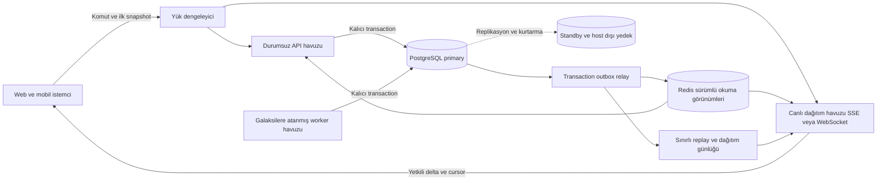

# Astera altyapısını binlerce aktif oyuncuya ölçeklemek

**Mevcut yapının 1.000 eşzamanlı, yoğun aktif oyuncuyu güvenilir biçimde kaldırdığı kanıtlanmış değil.** Kaynak incelemesi, bu sayıda kesin çalışamayacağını da göstermiyor; kapasiteyi belirleyen iş miktarını büyüten somut tasarım noktaları gösteriyor. 5.000 aktif oyuncu için mevcut yerleşimi yalnız daha fazla API container’ıyla büyütmeyi önermiyorum. En uygun yön; PostgreSQL’i kalıcı yazma otoritesi olarak korumak, tekrar sorgulamayı sürümlü okuma görünümleri ve doğrudan canlı güncellemelerle azaltmak, worker işlerini galaksi sınırında bölümlemek ve uygulama ile DB kaynaklarını ayırmak. **Toplam 5.000 oyuncunun birkaç galaksiye dağılmasıyla aynı galakside 5.000 oyuncu farklı kapasite hedefleridir.** Bu değerlendirme performans ve sistem tasarımıyla sınırlıdır; oyun mekaniklerinde değişiklik önermemektedir.

İncelenen dosya [Astera-Mimari.html](/home/yildirim/Desktop/Astera-Mimari.html). Dokuz diyagramın veri tanımları incelendi; HTML’ye gömülü 345 kaynağın 341’i mevcut çalışma ağacıyla aynı, dördü farklı çıktı. İlgili çağrı zincirleri güncel kaynak ve testlerden doğrulandı; bu karşılaştırma bütün 345 dosyanın satır satır denetlendiği anlamına gelmez. Üretimdeki anlık sürüm, donanım kullanımı ve gerçek yapılandırma bu çalışmada uzaktan doğrulanmadı. Yeni yük testi çalıştırılmadı. [Kaynak karşılaştırması](</home/yildirim/Desktop/Coding/MyProjects/blindspace/research_notes/Astera eşzamanlı oyuncu kapasitesi/mimari_kaynak_karsilastirma.json>).

**Bağlı oyuncu sayısı tek başına kapasite ölçüsü değildir.** 1.000 açık bağlantının yanında saniyedeki komut, okuma, bildirim, alıcı, kuyruk işi ve taşınan byte miktarı gerekir. Mevcut yapı üç API, tek worker, PostgreSQL ve Valkey’i aynı hostta çalıştırıyor. Bu roller birbirinden ayrılmış olsa da CPU, RAM, disk ve arıza alanını paylaşıyor. Dosyadaki varsayılan bağlantı bütçesi `3 × (8 ana + 2 placement + 1 LISTEN) + 12 worker = 45` PostgreSQL bağlantısı; ayrı gerçek zamanlı oda rolü çalışırsa ana havuzundan en fazla iki daha ekleniyor. Bunlar açık bağlantı sayımı değil, yapılandırılmış üst bütçeler. Bir bağlantı farklı oyuncuların isteklerine sırayla hizmet edebilir; **45 bağlantı, 45 oyuncu sınırı değildir.** [Compose](/home/yildirim/Desktop/Coding/MyProjects/blindspace/docker-compose.prod.yml:20), [LISTEN bağlantısı](/home/yildirim/Desktop/Coding/MyProjects/blindspace/apps/server/src/stream/bus.ts:533).

Eldeki en anlamlı eski ham kapasite sonucu **24 Ağustos 2026’daki farklı bir sürümde 300 hesap/300 SSE bağlantısını, 90 saniyelik gözlemi ve 10 saniyede 100 komutu** kapsıyor. Sonuç yedi eski kabul koşulunu geçmiş; çalışma ağacı da değiştirilmiş olarak işaretli. Bu, bugünkü 1.000 veya 5.000 aktif oyuncunun kanıtı değil. Mevcut test aracının kullanıcı tavanı 600, bağlantı tavanı 750; DB doğrulaması hâlâ iki galaksi × 300 koltuk beklerken seed güncel 1.000 koltuk varsayımını kullanıyor. Ayrıca `busy` profilindeki ortalama dört dakikada bir komut, sürekli yoğun etkileşimi temsil etmiyor. **Önce kapasite ölçüm aracını güncel mimariye uydurmak gerekiyor.** [Eski ham sonuç](/home/yildirim/Desktop/Coding/MyProjects/blindspace/artifacts/capacity/smoke-300-100-launch-metric.json), [tavan ve profiller](/home/yildirim/Desktop/Coding/MyProjects/blindspace/tools/capacity.mjs:99), [300 koltuk doğrulaması](/home/yildirim/Desktop/Coding/MyProjects/blindspace/tools/capacity.mjs:1170).

**En büyük ölçek riski, küçük bir değişikliğin çok sayıda HTTP ve SQL işine dönüşmesi.** SSE teslimi bağlantı başına DB kontrolü yapıyor; istemci bildirimi alınca yeniden GET başlatabiliyor; polling ve zamanlayıcılar da aynı verilere dönüyor. Bunların her biri tek başına kabul edilebilirken birlikte iş çoğaltıyor. Aşağıdaki tablo, koddan hesaplanan taban miktarları gösterir; ölçülmüş throughput veya sunucunun taşıyabildiği üst sınır değildir.

| Varsayım ve maliyet | 1.000 aktif oyuncu | 5.000 aktif oyuncu |
|---|---:|---:|
| Her oyuncunun traffic sorgusu aktif; yalnız 5 saniyelik timer | 200 GET/sn | 1.000 GET/sn |
| Her oyuncuda bir SSE; yalnız 25 saniyelik ping’in DB kontrolü | 40 SELECT/sn | 200 SELECT/sn |
| Tek galakside her alıcıya 10 ayrı bildirim/sn teslimi varsayımı | 10.000 teslim kontrolü/sn | 50.000 teslim kontrolü/sn |

Son satır gerçek üretim olay hızı değildir; mevcut kodun alıcı sayısıyla çarpılan işini gösterir. Genel formül galaksiler için `Σ(bağlı alıcı × galaksi bildirimi/sn)`; kişisel/global olaylar ve native oturumun ek kontrolleri ayrıca gelir. İstemcideki yenileme birleştirmesi, frame tesliminden önce yapılmış bu DB kontrollerini azaltmaz. [5 saniyelik sorgu](/home/yildirim/Desktop/Coding/MyProjects/blindspace/apps/web/src/api/queries.ts:451), [frame başına kontrol](/home/yildirim/Desktop/Coding/MyProjects/blindspace/apps/server/src/routes/session.ts:229), [ping](/home/yildirim/Desktop/Coding/MyProjects/blindspace/apps/server/src/routes/session.ts:265).

| Öncelikli alan | Kaynakta kesin olan davranış | Ölçek açısından sonuç ve gerekli değişiklik |
|---|---|---|
| SSE teslimi | Mesaj ve ping, her alıcı için oturum/yerleşim SELECT’i yapıyor. | Güvenli yetki iptali ve yerleşim bariyeri korunarak doğrulamayı toplulaştırmak veya sürümlü bağlantı yetkisiyle yönetmek gerekiyor. Kontrolü silmek çözüm değil. [Kod](/home/yildirim/Desktop/Coding/MyProjects/blindspace/apps/server/src/routes/session.ts:211) |
| Bildirim → GET | Mesaj çoğunlukla değişen alanı taşımıyor; ilgili query’leri yeniletiyor. | Normal canlı akışta küçük, yetkili veri değişiklikleri gönderilmeli. Tam yanıt üretimi ve indirme tekrarları azalmalı. [Yönlendirme](/home/yildirim/Desktop/Coding/MyProjects/blindspace/apps/web/src/session/shardEvents.ts:59) |
| Tam görünüm üretimi | Liste ve detay çok sayıda yardımcı okuma yapıyor. | Ortak bağlamı paylaşmak, tabloları toplu okumak ve aynı olayda liste/detay tekrarını azaltmak gerekiyor. 26 Ekim sınırlı sentetik ölçümünde dört nesneli liste 113, detay 41 SQL ifadesiydi; yeni yük ölçümü değil. [Ölçüm kapsamı](/home/yildirim/Desktop/Coding/MyProjects/blindspace/docs/architecture-performance-audit-2026-10-26.md:76) |
| Cache izolasyonu | Bir galaksinin bazı olayları bütün galaksilerin private cache setlerini temizliyor. | Galaksi/sezon ve bağımlılık sürümüyle hedefli invalidation gerekli. Aksi hâlde farklı galaksilere dağıtmak bile yeniden yükleme maliyetini tam ayırmıyor. [Temizleme](/home/yildirim/Desktop/Coding/MyProjects/blindspace/apps/server/src/services/projections.ts:318) |
| Cache kapasitesi | Her private cache API başına 1.024 entry; ortak cache 16 sezon varsayımı taşıyor. | 5.000 hesap rastgele API’lere dağıldığında sürekli eviction ve yeniden hesaplama riski var. Entry sayısına ek byte, dolum süresi ve erişim yerelliği ölçülmeli. [Sınırlar](/home/yildirim/Desktop/Coding/MyProjects/blindspace/apps/server/src/env.ts:237) |
| Kişisel projeksiyon | Ortak snapshot cache’ten gelse de oyuncuya özel görünüm CPU’su tekrar çalışıyor. | Okuyucudan bağımsız parçaları bir kez üretmek; yetkili alıcı indeksini ve sürümlü özel görünümü ayırmak gerekiyor. Ham tabloları Redis’e taşımak bu CPU işini kaldırmaz. [Okuma yolu](/home/yildirim/Desktop/Coding/MyProjects/blindspace/apps/server/src/routes/galaxy.ts:385) |
| Placement admission | Bazı authenticated handler’lar iki bağlantılı ayrı havuzu handler boyunca tutuyor. | Bu sınıfta API başına iki, üç API’de altı eşzamanlı lease sınırı var. Bütün GET’lere uygulanmıyor. Bekleme ve handler süresi ayrılmalı; havuzu körlemesine büyütmeden lease süresi azaltılmalı. [Gate](/home/yildirim/Desktop/Coding/MyProjects/blindspace/apps/server/src/services/placementGate.ts:102) |
| Worker | Bütün galaksilerin due işleri tek worker’da sırayla bekleniyor. | Bir işin uzaması bağımsız galaksileri de geciktirebilir. Galaksiye atanmış iş sahipliğiyle paralellik kurulmalı. [Döngü](/home/yildirim/Desktop/Coding/MyProjects/blindspace/apps/server/src/worker/loop.ts:281) |
| Ortak host | API, worker ve DB aynı kaynakları ve arıza alanını paylaşıyor. | CPU/IO yarışını azaltmak ve bakım/arıza toleransı için DB ile uygulama hostları ayrılmalı. Bu bir donanım kapasitesi garantisi değil. [Topoloji](/home/yildirim/Desktop/Coding/MyProjects/blindspace/docker-compose.prod.yml:134) |

Bu mekanizmalar doğrulandı; **hangi oyuncu sayısında doygunluk oluşturdukları ölçülmedi.** Örneğin placement sınıfında ortalama handler süresi `T` saniyeyse altı slotun kaba üst servis hızı `6/T` olur; 100 ms varsayımıyla 60 istek/sn, 300 ms varsayımıyla 20 istek/sn. Bunlar gerçek süreler değildir. Benzer biçimde tek worker’ın sınırı batch sayısından çıkarılmaz: dolu ve başarılı batch’ler sonraki poll beklenmeden tüketiliyor. Gerçek sınır iş başına CPU/SQL/kilit süresi ve gelen iş hızıdır. [Worker drenajı](/home/yildirim/Desktop/Coding/MyProjects/blindspace/apps/server/src/worker/loop.ts:437).

Mevcut iyi parçalar korunmalı. Sınırlı LRU, aynı anahtara tek yükleme, cache dolarken invalidation yarışını ele alma ve bus sağlıksızken cache’i bypass etme var. İstemci çakışan yenilemeleri birleştiriyor; eski snapshot’ın yeniyi ezmesine karşı koruma bulunuyor. SSE bekleme ve socket buffer’ları sınırlı. Konumlar her frame ağdan gelmiyor; istemci rota ve zaman verisini kullanıyor. Böylece hedef, her hareketi Redis’e ve sokete daha sık yazmak değil, aynı temel veriyi tekrar kurmayı ve indirmeyi azaltmak olmalı. [Cache](/home/yildirim/Desktop/Coding/MyProjects/blindspace/apps/server/src/services/asyncCache.ts:45), [yenileme birleştirme](/home/yildirim/Desktop/Coding/MyProjects/blindspace/apps/web/src/api/refreshQueries.ts:16), [snapshot koruması](/home/yildirim/Desktop/Coding/MyProjects/blindspace/apps/web/src/api/planetCache.ts:21).

**Önerdiğim mimari, ortak iş kurallarını koruyan modüler backend ve ayrı ölçeklenebilen okuma, yazma, worker ve canlı dağıtım rolleridir.** Kritik yazma PostgreSQL transaction’ında tamamlanır. Aynı transaction, komut kimliği/sonucu, ilgili durum sürümü ve dağıtılacak outbox kaydını da kalıcılaştırır. Relay bu kaydı Redis okuma görünümlerine ve canlı dağıtım hattına uygular. İstemci ilk snapshot’tan sonra yalnız yetkili değişiklikleri alır. Buradaki ayrım ayrı deployment rolleri gerektirebilir; bütün modülleri farklı mikroservislere bölmek gerekmez.

Redis burada yeniden oluşturulabilir hızlı okuma katmanıdır. Ortak veri bir kez hazırlanmalı; her alıcıya tam görünümü yeniden hesaplayıp göndermek aynı masrafı gateway’e taşır. Alıcıya göre değişen alanlar sunucuda yetkilendirilir; galaksi/alan/hesap abonelikleri yalnız ilgili değişiklikleri taşır. Küçük ve sık kullanılan bellek içi L1 cache’ler korunabilir; pahalı ortak görünümlerde Redis L2 paylaşımı ölçülür. Her yerel cache hit’ini zorunlu Redis ağ isteğine dönüştürmek amaç değildir.

**Başarı yanıtı ile kalıcı kayıt arasındaki sözleşme açık olmalı.** Redis’e yazıp daha sonra DB’ye aktarmak, aradaki çökme penceresini kaldırmaz. Redis’in `everysec` AOF ayarı yaklaşık bir saniyelik veri kaybını kabul eder; Redis Stream’e kayıt eklemek de kullanılan kalıcılık/failover ayarlarından bağımsız güvence değildir. Bu nedenle önerim kritik yazmalarda DB otoritesini korumak. Outbox relay tekrar teslim yapabilir; tüketici aynı event’i ikinci kez uygulamamalı. Sıradan artan bir ID’nin farklı transaction’ların commit sırası olduğu varsayılmamalı; ilgili durumun sürümü yetkili yazma sınırında atanmalı. Mevcut projede özel bir outbox örneği var, fakat genel replay altyapısı yok. [Redis kalıcılığı](https://redis.io/docs/latest/operate/oss_and_stack/management/persistence/#how-durable-is-the-append-only-file), [mevcut outbox örneği](/home/yildirim/Desktop/Coding/MyProjects/blindspace/apps/server/src/services/commanderTransfer.ts:362).

Mevcut Valkey servisi 64 MiB anahtar bütçesi, `allkeys-lru` ve kapalı kalıcılıkla rate-limit için kurulmuş. Bu ayarla kritik durum veya tek kalıcı olay günlüğü tutulmamalı. Redis Pub/Sub da bağlantı koparken kaçan mesajları sonradan teslim eden bir kayıt değildir. Yeniden bağlantıda cursor sonrası replay veya taze snapshot gerekir; Redis kaybolduğunda görünümler DB’den yeniden kurulmalı ve eski/boş durum güncelmiş gibi sunulmamalı. [Valkey ayarları](/home/yildirim/Desktop/Coding/MyProjects/blindspace/docker-compose.prod.yml:157), [Pub/Sub teslimi](https://redis.io/docs/latest/develop/pubsub/#delivery-semantics).

SSE ve WebSocket bu tasarımın taşıma seçenekleridir. Nginx dosyasında HTTP/2, upstream keepalive ve JSON gzip zaten var; her fetch yeni TCP/TLS bağlantısı açıyor varsayımı yanlış. HTTP/2 header sıkıştırması ve bağlantı paylaşımı maliyeti azaltır. SSE de açık bağlantıdan `data/id` taşıyabilir; her mesaj yeni HTTP header seti oluşturmaz. **1.000 için REST komutları + veri taşıyan SSE ile başlanabilir.** Komutları da tek bağlantıda taşımak tercih edilirse WebSocket gateway uygundur; iki durumda da yetki, tekrar güvenli komut, sıra, bounded queue ve yeniden eşitleme sözleşmesi gerekir. [Nginx](/home/yildirim/Desktop/Coding/MyProjects/blindspace/deploy/nginx/astera.conf:44), [HTTP/2](https://www.rfc-editor.org/rfc/rfc9113.html), [SSE standardı](https://html.spec.whatwg.org/multipage/server-sent-events.html).

Yeni canlı sözleşmede snapshot’ın revision/cursor’ı ile abonelik arasındaki aralık kapatılmalı. İstemci eski/tekrar sürümü atmalı, boşlukta replay veya snapshot istemeli. Oturum iptali ve yerleşim değişiminde eski yetkiyle özel veri gönderilmemeli; yalnız uzun TTL’li doğrulama cache’i yeterli değildir. Sağlıklı canlı akışta polling azaltılır; bağlantı veya sürüm kaybında kontrollü fallback kalır. Zamanla değişen görünümler de zamanlayıcıyla güncellenmeli; yalnız DB yazı olaylarına bağlanarak timer’ları bir anda kaldırmak doğru olmaz. [Mevcut stream parser](/home/yildirim/Desktop/Coding/MyProjects/blindspace/apps/web/src/api/client.ts:1426), [ilk bağlantı eşitlemesi](/home/yildirim/Desktop/Coding/MyProjects/blindspace/apps/web/src/session/useEventStream.ts:319).

**1.000’e hazırlıkta önce birim iş maliyeti düşürülmeli.** Bildirim teslimindeki SQL çarpanı, galaksiler arası cache temizleme ve liste/detay tekrarları ilk uygulama alanları. Ortak bağlam/tablolar toplu okunmalı; transaction içinde zaten yüklenmiş veri yeniden sorgulanmamalı. Saf yanıt üretiminin transaction dışına taşınmış olması korunmalı; kalan snapshot okumaları aynı tutarlılık garantisiyle azaltılmalı. Placement kuyruğu, DB pool beklemesi ve SQL/CPU/serialization süreleri ayrı ölçülmeli. DB kaynaklarını uygulamadan ayırmak bu aşamada hem performans izolasyonu hem işletim kararlılığı sağlar; tek hostun yeterliliği yalnız ölçümle kabul edilebilir.

**5.000 toplam oyuncuda galaksi, iş sahipliği ve cache izolasyonunun temel ölçek birimi olmalı.** Başlangıçta ortak PostgreSQL primary korunabilir; worker’lar belirli galaksilere atanır, her galaksinin tek geçerli sahibi olur. Kalıcı lease ve fencing, eski worker’ın sahiplik devrinden sonra yazmasını engeller. Periyodik bakımın tekil sahipliği ayrıca tanımlanır. Sadece `SKIP LOCKED` kullanarak birkaç worker daha açmak, aynı tutarlılık alanındaki işlerin sırasını garanti etmez. Birden fazla galaksiye dokunan altyapı işlemleri için açık handoff/fence sözleşmesi gerekir; bunları fiziksel DB’lere bölmek mevcut atomik işlemleri dağıtık koordinasyona dönüştürür. Bu nedenle DB sharding ilk adım olmamalı. [Mevcut global claim](/home/yildirim/Desktop/Coding/MyProjects/blindspace/apps/server/src/worker/queue.ts:26), [sıra](/home/yildirim/Desktop/Coding/MyProjects/blindspace/apps/server/src/worker/queue.ts:42), [PostgreSQL SKIP LOCKED](https://www.postgresql.org/docs/16/sql-select.html#SQL-FOR-UPDATE-SHARE).

Bu aşamada API ve canlı dağıtım havuzları farklı hostlarda bağımsız büyüyebilir. Replika ekledikçe DB bağlantı bütçesi yeniden hesaplanmalı; bugünkü havuzlarla on API’nin teorik bütçesi worker hariç 110’a ulaşır. PgBouncer gerektiğinde kullanılabilir, fakat LISTEN bağlantıları transaction pooling dışında tutulmalıdır. Read replica önce gecikmeye toleranslı geçmiş/analitik okumalar için düşünülmeli; komut sonrası güncel okuma primary’den veya sürüm bariyerinden gelmelidir. Kararlılık için ayrı application arıza alanları, DB standby, host dışı yedek, WAL arşivi ve restore/failover provası gerekir. Kabul edilebilir veri kaybı ve toparlanma süresi (RPO/RTO) ayrıca tanımlanmalı; asenkron standby tek başına sıfır kayıplı failover garantisi vermez. Bunlar belirli CPU/RAM’in 5.000 kişiye yeteceği iddiası değildir. [PgBouncer özellik matrisi](https://www.pgbouncer.org/features.html), [PostgreSQL replikasyonu](https://www.postgresql.org/docs/16/warm-standby.html), [PITR](https://www.postgresql.org/docs/16/continuous-archiving.html).

Aynı galakside 5.000 hedeflenirse ortak olayın alıcısı ve görünüm yoğunluğu ayrıca büyür. Aynı kişi başına olay oranında bütün galaksiye yayın yaklaşık karesel teslim artışı oluşturabilir; bu bütün sistemin karesel olduğu iddiası değildir. Tam galaksi DTO’su, kişisel projeksiyon ve mobil parse/scene maliyeti ayrıca değerlendirilir. İstemcide LOD, instancing ve 32 DOM label sınırı var; bazı aday taramaları bütün nesneleri dolaştığından bunlar tek başına 5.000 nesne performans kanıtı değildir. Mevcut 1.000 koltuk varsayılanı da eşzamanlı aktiflik garantisi veya evrensel toplam 2.000 oyuncu tavanı değildir. [Galaksi DTO’su](/home/yildirim/Desktop/Coding/MyProjects/blindspace/apps/server/src/routes/galaxy.ts:211), [istemci LOD](/home/yildirim/Desktop/Coding/MyProjects/blindspace/apps/web/src/galaxy/PlanetField.tsx:227), [kapasite override](/home/yildirim/Desktop/Coding/MyProjects/blindspace/apps/server/src/services/season.ts:126).

Değişiklikleri aşağıdaki sırayla somutlaştırmak uygun. Bu liste uygulama planıdır; ürün kodunda henüz bu değişiklikler yapılmadı.

| Sıra | Değişecek dosya/alan | Somut amaç |
|---|---|---|
| P0 | [capacity.mjs](/home/yildirim/Desktop/Coding/MyProjects/blindspace/tools/capacity.mjs:99), `capacity-client.mjs`, seed CLI, capacity Compose/preflight | 300/600/750 varsayımlarını kaldırmak; gerçek istemci okuma örüntüsü, güncel topoloji ve aynı sürüm/fixture ile ölçmek. |
| P1 | [session.ts](/home/yildirim/Desktop/Coding/MyProjects/blindspace/apps/server/src/routes/session.ts:183), `stream/bus.ts`, stream registry | Güvenli teslim doğrulaması, yetkili payload, cursor ve bounded queue. |
| P1 | [projections.ts](/home/yildirim/Desktop/Coding/MyProjects/blindspace/apps/server/src/services/projections.ts:318), `asyncCache.ts` | Galaksiye özel invalidation, revision anahtarları, seçici L1/L2 ve byte/fill/eviction ölçümü. |
| P1 | [planetView.ts](/home/yildirim/Desktop/Coding/MyProjects/blindspace/apps/server/src/services/planetView.ts:132), ilgili route ve okuma yükleyicileri | Ortak context, batch sorgu, sürümlü okuma görünümü, liste/detay tekrarını azaltma. |
| P1 | `api/client.ts`, şemalar, `useEventStream.ts`, `shardEvents.ts`, `refreshQueries.ts`, `planetCache.ts` | Delta uygulama, snapshot/cursor eşitleme ve normal canlı akıştan gereksiz GET kaldırma. |
| P1 | [placementGate.ts](/home/yildirim/Desktop/Coding/MyProjects/blindspace/apps/server/src/services/placementGate.ts:102), `app.ts`, `db/client.ts` | Yetki bariyerini koruyarak lease/transaction ve pool bekleme süresini azaltma. |
| P1–P2 | [queue.ts](/home/yildirim/Desktop/Coding/MyProjects/blindspace/apps/server/src/worker/queue.ts:26), `worker/loop.ts`, DB şeması/migration | Galaksi sahipliği, fencing, tekrar güvenli tüketim, genel outbox/revision/receipt sözleşmesi. |
| P2 | Production Compose, Nginx, health/metrics ve yedekleme | Rol/host izolasyonu, bağlantı bütçesi, gerektiğinde gateway ayrımı, restore/failover. |

**Kapasite kabulü, aynı sürümde 1.000 ardından 5.000 gerçekçi aktif istemciyle yapılmalı.** Ayrı yük üreticisinden gerçek proxy/TLS yolu kullanılmalı; yalnız açık socket değil, periyodik okuma, canlı veri uygulama ve komutlar çalışmalı. Farklı kayıt/geçmiş büyüklükleri, cache soğuk/sıcak koşulları, birkaç hedefte 50/100/200 eşzamanlı komut ile dağınık yük ayrı test edilmeli. Yeniden bağlantı fırtınası, token yenileme, ortak NAT, API/worker restart ve Redis/DB kesintisinden toparlanma da kabulün parçası olmalı. Ölçüm sırası kademeli yük, yoğunluk patlaması ve ardından bellek/kuyruk büyümesini gören süreli yük olmalı; bu incelemede bunlar çalıştırılmadı.

Mevcut runner hedefleri başlangıç SLO adayı olarak kullanılabilir: komut p95 ≤400 ms/p99 ≤800 ms, commit’ten gözlenebilir duruma p95 ≤1 sn/p99 ≤2 sn, worker gecikmesi p95 ≤1 sn/p99 ≤2 sn. **Bunlar sağlanmış sonuçlar değil, kabul önerileri.** Kritik route başına gecikme, DB pool beklemesi, SQL fingerprint, cache yeniden kurma, event-loop/GC, RSS, sıkıştırılmış byte, yavaş bağlantı kapanması ve en eski bekleyen iş yaşı izlenmeli. Başarı sayımıyla birlikte tekrar uygulanan komutun tek sonuç üretmesi, seçilen arıza modelinde kabul edilmiş yazının kaybolmaması, yetkisiz verinin gönderilmemesi ve kesinti sonrası görünümün yakınsaması doğrulanmalı. [Mevcut hedefler](/home/yildirim/Desktop/Coding/MyProjects/blindspace/tools/capacity.mjs:1395), [altyapı kapıları](/home/yildirim/Desktop/Coding/MyProjects/blindspace/tools/capacity.mjs:1464).

CPU/RAM veya container sayısı satın alma kararı bu ölçümlerden çıkmalı. İlk yatırım, kullanıcı başına tekrar edilen işi azaltmak ve galaksilerin birbirinin cache/kuyruk maliyetini tetiklemesini engellemek olmalı. Bu sınırlar kurulduğunda yeni host eklemek öngörülebilir kapasite artışı sağlar; kalıcı veri güvenliği, canlı dağıtım ve yeniden bağlantı da aynı tasarımın ölçülebilir parçaları olur.
