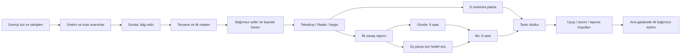

# Starter galaksi: akış, tempo ve oyuncunun geri dönme nedeni

**İnceleme tarihi:** 7 Kasım 2026. **Kapsam:** prologdan starter’a ilk giriş, onarım/üretim, sonda ve maden döngüsü, ilk gün açılışları, savaş/parça/motor/yakıt ve ana galaksiye iniş. Bu bir ürün incelemesidir; burada önerilen değişiklikler uygulanmadı.

## 1. Ana teşhis

Starter’ın güçlü bir başlangıç vaadi var: **hurda gemiyi ben çalıştırdım; şimdi onu onarıp daha büyük bir dünyaya götüreceğim.** Prologdaki kontrol → görsel sonuç → sahiplenme ilişkisi bu vaadi destekliyor. Sorun, aynı neden–sonuç zincirinin sonraki saatlere eşit açıklıkta taşınmaması.

Mevcut ritim yaklaşık şu biçimde ilerliyor:

1. Somut eylemlerle gemiyi bulma ve sahiplenme.
2. Yeniden karşılama, yeni bir eğitim sayacı, sık onarım/kasa/mesaj sonuçları.
3. İlk bilgi toplama ve ilk gerçek sefer.
4. Öğreticinin geri çekilmesiyle kaynak ve daha uzun kuyruk süreleriyle yüzleşme.
5. Birbirinden ayrı küçük sistem açılışları, ilk savaş ve parça arayışı.
6. İki uzun motor onarımı; ardından yakıt, olası sezon engeli ve taşıma kararı.
7. Ana galakside ikinci bir öğrenme sıçraması.

**En önemli tempo riski, yalnız sayaçların uzunluğu değil; oyuncunun algıladığı ilerleme, gerçekten yapabildiği iş ve bir sonraki dönüş nedeni arasındaki kopukluk.** İlk aşamada çok sayıda sonuç sık geliyor; son aşamada aynı ilerleme yüzdesinin küçük bir bölümü çok uzun sürüyor. Bazı durumlarda hedef satırı kullanılamayan bir işi öneriyor; bazı durumlarda da hâlâ anlamlı maden kararı varken oturumu bitirmeye çağırıyor.

Bu inceleme “oyuncular bu yüzden kesin bırakıyor” sonucu vermez. Aşağıdaki sorunlar koddan ve sınırlı canlı gözlemden saptanan ürün riskleridir; terk oranı ve retention etkisi ölçülmedi.

### Önce ele alınması gerekenler

| Öncelik | Sorun | Oyuncunun karşılaşabileceği sonuç | İlk müdahale adayı |
| --- | --- | --- | --- |
| P0 | Kuyruktaki motorların bitmiş sayılmasıyla erken yakıt hedefi | Henüz kullanamayacağı tanka, gövde ve itki sırasına bağlı olarak 16 saate yakın süre yönlendirilebilir | Tamamlanmış durum ile kuyruk planını ayırmak |
| P0 | Tempo testlerinden bazılarının seri kuyruğu/seferi gerçeğe uygun modellememesi | Geliştirme ekibi ilk oturumun akıcılığına gereğinden fazla güvenebilir | Seri emir, gerçek sefer ve ilk kullanım zamanlarını ayrı doğrulamak |
| P1 | İlk oturum sonundaki kaynak eşiği ve rehberin geri çekilmesi | “Oyun bitti mi, beklemem mi gerekiyor, tekrar maden mi göndermeliyim?” belirsizliği | Yapılabilir tek anlamlı alternatif + bilinçli ayrılma seçeneği |
| P1 | Rehber kapalı uçuş beklemesi ve rehbere bağlı bildirim teklifi | Ne zaman/ne için döneceğini anlamak zorlaşabilir | Rehber tercihi ile dönüş planını ayırmak |
| P1 | Son yakıtta stok/havuz/üretim durumlarının ayrılmaması | Kaynak mevcutken bile devre dışı düğmeyle karşılaşma | Topla → yeterli olmasını bekle → yükle durumları |
| P1 | Sezon takvim engelinin finalde belirginleşmesi | Günlerce hazırlanıp hazırken tekrar beklemek | Mevcut takvim engelini motor yatırımı öncesinde göstermek |
| P2 | İlk hızlı %45 ile iki motorun yalnız %10 katkısı | Kalan yol konusunda hatalı beklenti | Aşama ve gerçek kalan koşulları birlikte göstermek |
| P2 | Ödül/mesaj hiyerarşisi ve ilk oturum sonrası görsel devir | Küçük işlemler büyük kazanımlarla yarışır; yönlendirme niteliği düşer | Önemli kazanımı sonraki karara bağlamak |

P0 burada güvenlik veya veri kaybı derecesi değildir: tempo hakkında doğru davranışı ve doğru değerlendirmeyi engelleyen önceliktir. Bütün öneriler ayrı ürün kararlarıdır; süre, üretim veya maden arzını değiştirmek otomatik sonuç değildir.

## 2. Ne gerçekten incelendi?

Üç kanıt türü ayrı kullanıldı:

- **Canlı gözlem:** 350×812, DPR 2, mobil/dokunmatik Chromium ve SwiftShader ile prolog ve gerçek yeni starter hesabının ilk galaksi görünümü. Dört ekran görüntüsü açılıp incelendi. Kayıt formunun tamamlanması UI testi değildir; hesap ve enlist gerçek API üzerinden yapıldı.
- **Kod ve statik hesap:** Güncel çalışma ağacındaki kurallar, gerçek sunucu emir/sefer davranışı, tutorial, hedef seçimi ve geçiş ekranları. Küçük hesaplar doğrudan formüller ve sekiz üretim aralığı kullanır; uzun oyun/ekonomi/sezon simülasyonu çalıştırılmadı.
- **Dış araştırma:** Birincil çalışmalar, yazar/üniversite tam metinleri ve resmî geliştirici rehberi. Laboratuvar sonucu, sahadaki deney, korelasyon ve Astera’ya yapılan tasarım çıkarımı birbirinin yerine kullanılmadı.

Canlı yürüyüş 87. saniyede 5177 bağlantısının kesilmesiyle durdu. Sonraki salt-okunur kontrolde 5177 ve 3199 dinleyicileri görünmedi; araştırma bu süreçleri başlatmadı veya durdurmadı. **İlk gerçek onarımlar, yeni hesaptaki sonda/maden uçuşu ve çok günlük sıçrama bu yürüyüşte tamamlanmadı.** Bu sonraki aşamaların bulguları kod/hesap kanıtıdır. Ortam kesintisi, oyunun normal tempo sorunu diye sınıflandırılmadı. Önceki batch4 görselleri reboot öncesine aittir; yeni gözlem olarak sunulmadı.

Prologun claim noktasına otomasyonda 49 saniyede ulaşılması insanın okuma, keşif veya oturum süresini ölçmez. SwiftShader da gerçek telefon GPU performansının ölçümü değildir. Araştırma için tek yeni yerel hesap kullanıldı; modüller, kaynaklar veya saat DB fixture’iyle hızlandırılmadı. Kimlik bilgileri bu rapora alınmadı. [Canlı log][C30], [yürüyüş betiği][C31].

İncelenen görseller: [ilk prolog][I1], [sahiplenme eşiği][I2], [ilk starter görünümü][I3], [ilk koç görünümü][I4]. Son iki görüntü yazı animasyonu sırasında alındığı için bitmiş konuşma yerleşiminin kabul kanıtı değildir.

## 3. Oyuncunun karşılaştığı yol

| Aşama | Oyuncunun gördüğü/öğrendiği | Gerçek tempo kaynağı | Kopma riski |
| --- | --- | --- | --- |
| Prolog | Güç, ateşleme, üretim, yama, sinyal, gemiyi sahiplenme | Eylem ve kısa animasyonlar | Kayıt sonrasında aynı başlangıcın tekrar anlatılması |
| İlk gerçek gemi | Üretimi toplama, onarım, kasa | 10–90 saniyelik erken emirler | Kamera, kart, kaynak, kapı ve mesajın aynı anda öğrenilmesi |
| İlk sonda | Bilgi göndermek ve raporu açmak | Uçuş + rapor okuma | Bilginin hemen bir oyuncu tercihine bağlanmaması |
| Tersane ve ilk Kazıcı | Araç kazanma, hedef seçme, kaynak getirme | Seri onarım + gerçek gidiş/dönüş | İlk stratejik döngü kurulurken öğreticinin kapanışı |
| Anten 2 / Hangar 2 | Sohbet, kapasite ve araştırma açılışı | Kaynak, eylem fact’i, 20/30 dakikalık emirler | Kaynak eksiğini “yapacak iş yok” sanma |
| Teleskop / Radar / Aegis | Hareketi görme, uyarı, ilk savunma | 40–60 dakikalık emirler + gerçek temas/akın | Dersin okunmasıyla mekaniğin kullanılmasının karışması |
| Motor hazırlığı | İlk savaş raporu, üç parça, gövde | Önkoşullar ve 8 saatlik gövde | Gizli eylem kapısı; parça avı bitince anlamın azalması |
| İtki ve yakıt | Son 8 saat, D birikimi, tank | Seri motor hattı; kısmen örtüşen D üretimi | Erken/yanlış tank hedefi, havuz-stok ayrımı |
| Kalkış | Uçuşları toplama, hedef sezon, taşıma | Mevcut uçuşlar, takvim ve uygun yer | Son anda yeni bekleme veya yatırım kaybı sürprizi |
| İniş | Gemi yerine ana gezegen ve yeni sistemler | Yeni hedefler ve kademeli ipuçları | Starter’daki yetkinlik hissinden tekrar acemiliğe düşüş |

Bu aşamalar sabit “birinci saat/ikinci gün” vaatleri değildir. Kaynak, hedef rekabeti, oturum sıklığı ve oyuncu seçimi gerçek takvimi değiştirir.

Şema bağımlılık ve örtüşme mantığını gösterir; ölçülmüş süre veya tek zorunlu sıra grafiği değildir. Özellikle parça avı gövdenin bitmesini, D birikimi de iki motorun bitmesini beklemek zorunda değildir.

### 3.1 Onarım yolunun gerçek süreleri

Kodda `required` işaretli tavsiye yolunun maliyetleri aşağıdadır. Onarım hattı **seridir**: üç emirlik kuyruk, üç emrin aynı anda çalışması demek değildir. Tersane, araştırma ve Onarım İstasyonu ayrı hatlar olduğu için bazı işler gerçekten örtüşebilir. [Merdiven][C1], [sunucu kuyruğu][C2], [diğer emirler][C3].

| Onarım | Alaşım / kristal | Kendi süresi | Önemli kapı veya sonuç |
| --- | --- | --- | --- |
| Rafineri 2 | 154 / 20 | 10 sn | Üretim artışı, kasa |
| Kristal Ocağı 1 | 44 / 33 | 10 sn | Kristal üretimi |
| Anten 1 | 250 / 120 | 30 sn | Ocak 1; sonda/istihbarat, kasa |
| Kristal Ocağı 2 | 77 / 58 | 1 dk | Önceki ocak |
| Rafineri 3 | 548 / 69 | 1 dk 30 sn | Önceki rafineri, kasa |
| Depo 1 | 300 / 150 | 2 dk | Kapasite ve korunan kaynak |
| Tersane 1 | 800 / 300 | 3 dk | Anten 1 + Rafineri 3; 1 Kazıcı, 2 Ok, kasa |
| Kristal Ocağı 3 | 274 / 206 | 5 dk | Önceki ocak, kasa |
| Anten 2 | 600 / 350 | 20 dk | İlk sonda raporu; sohbet, son kasa |
| Hangar 2 | 1000 / 350 | 30 dk | İlk maden dönüşü + Tersane; araştırma |
| Teleskop 1 | 700 / 500 | 40 dk | Tersane; çevrede hareket |
| Rafineri 4 | 886 / 111 | 1 saat | Rafineri 3 |
| Radar 1 | 500 / 380 | 1 saat | Teleskop; uyarı |
| Döteryum Tesisi 1 | 400 / 300 | 1 saat | 20 D hibesi; ücretli akın yakıtı başlar |
| Aegis 1 | 315 / 237 | 45 dk | Radar; savunma/ilk akın |
| Döteryum Tesisi 2 | 800 / 600 | 2 saat | Tesis 1 + Ocak 2 |
| Motor gövdesi | 2200 / 1100 | 8 saat | Üretim/anten/hangar ve ilk savaş raporu |
| İtki montajı | 1800 / 1200 | 8 saat | Gövde ve 3 parça |

**Toplam:** 18 işaretli onarım, **11.648 A / 6.084 K**, **23 saat 28 dakika 20 saniye** seri emir süresi. İlk sekiz onarım **13 dakika 20 saniye**; motorlar toplam **16 saat**, yani bu sürenin yaklaşık **%68,2’si**. [Statik hesap][A1].

Bu toplam **kanıtlanmış en erken sıçrama süresi değildir**. Kaynaklar ve eylem kapıları ek süre yaratabilir; ayrıca `required` etiketi bütün API kapılarıyla aynı anlama gelmiyor. Depo 1, motor/tank/kalkış önkoşullarında bulunmuyor; statik kurallara göre Depo 1 atlanıp %95 göstergeyle sıçrama mümkün olabilir. Bu dal canlı hesapta denenmedi. “Zorunlu” yorumu ile gerçek kapının tutarlılığı ayrıca düzeltilmelidir. [Etiket/kapılar][C1], [yakıt ve hazır olma][C4].

### 3.2 Sayaç kadar önemli olan kaynak saati

Açılışta 930 A, 300 K, çalışan Rafineri 1 ve havuzda 60 A var. Altı kasa toplam 1750 A / 1190 K veriyor; sonuncusu Anten 2’de. Erken ödüller bu nedenle hem öğrenmeyi hem erken faturaları taşıyor; geç motorlarda aynı kasa ritmi devam etmiyor. [Başlangıç][C5], [kasalar][C6].

Mevcut formüllerde yaklaşık üretimler:

| Durum | Saatlik üretim |
| --- | --- |
| Rafineri 3 | 248,18 A |
| Rafineri 4 | 360,74 A |
| Kristal Ocağı 3 | 99,27 K |
| Döteryum Tesisi 1 | 1,904 D |
| Döteryum Tesisi 2 | 4,374 D |

Bu değerler mevcut profil/çarpanlardan türetilmiştir; bütün gelecek denge sürümlerine ait sabit vaatler değildir. [Ekonomi profili][C7], [üretim][C8], [hesap][A1].

**İlk büyük kaynak eşiği için örnek:** Anında toplama ve kasa açma, tek 65 A/40 K sonda, ek harcama olmadan ilk sekiz seri onarım ve tek normal dolu maden dönüşü varsayılırsa 13 dk 20 sn sonunda yaklaşık **257,26 A / 325,83 K** kalıyor. Anten 2’nin 600/350 fiyatına yalnız pasif üretimle ulaşmak için yaklaşık **82,9 dakika daha** gerekiyor. İlk maden geliri hiç yoksa örnek fark **114,3 dakika** oluyor. [Sekiz aralık hesabı ve bütün varsayımlar][A2].

Bu, oyuncunun zorunlu olarak 83 dakika boş duracağı anlamına gelmez. Normal 200 kargoluk bir dönüş yaklaşık 130 A/70 K getirir; üç ek dolu dönüş bu örnekteki alaşım açığını kapatabilir. Sabit 150–300 mesafe örneğinde Kazıcı seferi toplam 1,8–3,6 dakikadır; hareketli kaya, mevcut boş alan ve ortak arz gerçek sonucu değiştirir. İlk kaya kişiye ayrılmış kaynak değildir. [Cevher dağılımı][C9], [uçuş/dönüş][C10].

Buradaki tasarım sorusu şudur: **Oyuncu bu seçeneğin varlığını, değerini ve zorunlu olmadığını anlayabiliyor mu?** Süreyi kısaltan oyun mevcutken yalnız “geri gel” denmesi de, oyuncuyu durmadan maden göndermeye zorlamak da zayıf çözümlerdir.

### 3.3 Yakıt ve motor saatlerini iki kere saymamak

Tank 90 D ister; ilk tesisin 20 D hibesi sonrasında kalan 70 D, tesis 2 üretiminde yaklaşık **16 saat** eder. Tesis 2 motorlardan önce tamamlanırsa bu süre iki motorun 16 saatiyle örtüşebilir. “16 saat motor + sonra kesin 16 saat yakıt” hesabı yanlıştır. Akın yakıtı aynı stoğu kullanır ve bunu değiştirebilir; sonda/maden için aynı tüketim varsayılmamalıdır. [Tank][C4], [akın maliyeti][C11], [hesap][A1].

Üretim havuzu yaklaşık **14,7 saatlik üretimde** dolar. Günde tek oturum yapan biri için 24 saat aralığının yaklaşık 9,3 saatinde yeni birikim durabilir. Bu mevcut stokun kaybı değildir; yeni üretimin durmasıdır. “Günde bir rahatça dön” vaadi kurulacaksa bu kapasite ve gerçek ilerleme beklentisi birlikte değerlendirilmelidir. Daha sık girmeyi ödüllendirme ile istemediği kontrol sıklığına itme arasındaki tercih bir denge kararıdır. [Kapasite][C12], [birikim][C13].

## 4. Akışı bozan somut noktalar

### F1 — Çalışan motor yerine kilitli yakıtın sıradaki iş olması

`nextRequiredStep` kuyruk sonundaki geleceği hesaba katıyor. Gövde ve itki sıraya girdiğinde kalan onarım yokmuş gibi sonuç çıkabiliyor; `shipObjective` bunun üzerine yakıtı seçiyor. Gerçek tank kapısı ise itkinin gerçekten tamamlanmasını istiyor. Sunucu itki emrini gövdenin arkasına kabul edebildiği için yanlış hedef gövdenin kalanıyla birlikte **16 saate yakın** sürebilir. Bu kaynak akışıyla doğrulanan olası durumdur; canlı final hesabında görülmedi. [Hedef seçimi][C14], [kuyruk kabulü][C2], [gerçek kapı][C4].

**Oyuncu etkisi:** Ekranın önerdiğini yapamamak; “bir şeyi kaçırdım” düşüncesi veya işlevsiz düğmeye tekrar dönmek.

**Öneri:** Tamamlanmış durum ile planlanan durumu ayrı kullanmak. Motor sürerken gerçek kalan süre ve sonraki aşama; yalnız kullanılabilir olduğunda tank eylemi. Kabul: gövde+itki kuyrukta, yalnız itki çalışıyor, itki bitmiş fakat tesis eksik ve her şey hazır durumlarında hedef doğru olmalı.

### F2 — Son yakıtta “topla”, “üretimi bekle” ve “yükle” ayrımı yok

Genel hedef girdisi A/K stok ve havuzunu biliyor, D durumunu aynı biçimde bilmiyor. Panel yükleme için stoktaki D’ye bakıyor. D havuzda hazırken hedef tanka yönlendirip düğmeyi devre dışı bırakabilir. [Objective girdisi][C14], [yakıt paneli][C15].

**Öneri:** 90 D havuzda/0 stok; 80 stok/10 havuz; üretim eksiği ve dolu tankı ayrı ele almak. Yeni ödül gerekmiyor; mevcut kaynağın bulunduğu yer ile doğru kontrol görünür olmalı. Uzun final bekleyişinin ardından anlaşılmayan son bir durak oluşmamalı.

### F3 — Hızlı yükselen yüzde, son yolun ağırlığını taşımıyor

Gösterge her adımı eşit sayıyor. Başlangıç rafinerisi + ilk sekiz onarım **%45**; iki sekiz saatlik motor toplam yalnız **%10**. Tüm işaretli onarımlar bitince yakıt yüklenmediyse yüzde **95**. Bu adım sayısı olarak açıklanabilir, kalan zaman olarak açıklanamaz. [Yüzde hesabı][C16].

**Öneri:** Onarım, motor, parça ve yakıtı gerçek aşamalar olarak okutmak; yüzdeye sessiz bir süre vaadi yüklememek. Sadece süre ağırlıklı yeni bir yüzdeye geçmek de kaynak/rekabet farkını çözmez. Oyuncuya “sıçramaya ne kaldı?” sorulduğunda doğru koşulları sayması daha iyi kabul ölçütüdür.

### F4 — İlk bağımsız döngüden hemen sonra erken kapanış çağrısı

15 dakikayı aşan birikim/onarım için genel satır “şimdilik bu kadar” diline geçiyor. Boş Kazıcı ve uygun maden var mı, rapordan seçilebilecek bir hedef var mı, bu hesapta incelenmiyor. Kaynak tablosundaki 82,9 dakikalık pasif fark ile birkaç gerçek seferin değeri bu nedenle aynı oyuncuya çok farklı iki deneyim yaratabilir. [Hedef satırı][C17], [hesap][A2].

**Öneri:** “İstersen ayrıl; şu sonuç hazır olacak” ile “şimdi yapılabilir değerli bir seçenek var” birlikte anlaşılabilmeli. Uygun saha/araç yoksa bunu da dürüstçe söylemek gerekir. Varsayımsal sürekli grind görevi eklemek çözüm değildir.

### F5 — Away durumunda dolaşabilmek, başka iş yapabilmek anlamına gelmiyor

4–6. bölümlerde genel kapı gevşese de `SPEND` koruması sürüyor. `roaming` durumunda onarım, sonda ve maden gibi işaretlenmiş kontroller engellenebiliyor; NPC’yi çipe indirmek bu guard’ı kaldırmıyor. Bu önceki brifte bilerek istenmişti: **uygulama ihlali değil, tempo açısından tekrar değerlendirilmesi gereken bir tasarım tercihi.** Rehberi kalıcı kapatmak bu kilitleri kaldırıyor. [Koç/guard][C18], [önceki brif][C32].

**Öneri:** Beklemede önerilen gerçek eylemle koruma uyumlu olsun. Bütçe tüketmeyen güvenli sefer veya hazır raporun keşfi gereksiz engellenmesin; korunacak bütçe ve risk anlaşılır olsun. Her harcamayı açmak ile her harcamayı sessizce yutmak arasında ürünün mevcut kontrolleriyle çözüm aranmalı.

### F6 — Rehbersiz uçuşta dönüş köprüsü zayıflıyor

`mineFlying`/`probeFlying` gibi tutorial wait durumunda kısa hedef “Waiting” olabilir. `repairWait` yoksa `StarterWaitLine` görünmüyor; koç ve AwayChip de kapalıysa aynı yüzeyde uçuşun dönüş zamanı/sonucu kayboluyor. Bu, bütün uzun onarımların bozulduğu iddiası değildir: mevcut ROAD onarım wait’leri erken 10/30/90 saniye ve 3 dakikadır. [Kısa hedef][C17], [bekleme satırı][C19], [tutorial hesabı][C20].

**Öneri:** Rehberden bağımsız tek bir uçuş → dönüş zamanı → sonraki karar bağlantısı. “Hangi araç, ne zaman, neyle döner?” soruları koç kapalıyken de yanıt bulmalı. Elde kesinleşmemiş ganimet garanti gibi yazılmamalı.

### F7 — Rehber tercihi, bu akıştaki bildirim teklifini de kaldırıyor

`GameShell`, rehber atlanmışsa `StarterAftercare` render etmiyor. Aftercare içindeki native push izin teklifi de kayboluyor. Bu, üründe başka hiçbir bildirim ayarı olmadığı anlamına gelmez; incelenen dönüş fırsatının rehber tercihiyle bağlandığı anlamına gelir. [GameShell][C21], [Aftercare][C22].

**Öneri:** NPC istememek ile kendi seçtiği uzun işin hatırlatılmasını istememek ayrı tercihler olsun. İzin, anlamlı bir iş başlatıldıktan sonra bağlamlı ve isteğe bağlı sunulsun. İzin kabulü dönüş başarısı sayılmamalı; kullanıcı sonuçla gerçekten devam ediyor mu ölçülmeli.

### F8 — İlk oturumun görsel dili sonraki aşamalara devrolmuyor

Gerçek düğmeye bağlı nabız ve ShipHero sistem ışığı, tutorial eylem kaynağını kullanıyor. İlk haul/veda sonrası ROAD’un done/away durumuna geçmesiyle genel sonraki onarımlar aynı niteliği otomatik devralmıyor. Hedef satırı mevcut, fakat ilk oturumda öğrenilen “parlayan gerçek kontrol beni ilerletir” dili zayıflıyor. [ROAD][C23], [pulse][C24], [ShipHero][C25].

**Öneri:** Yeni görev sistemi üretmeden mevcut genel objective’nin gerçek kullanılabilir kontrolle bağını korumak. Özellikle Anten 2, ilk savaş sonucu, parça seçimi, motor ve son yakıt kritik devir noktalarıdır. Ekranda tek hedef kuralı korunmalı.

### F9 — Güçlü sahiplenmeden sonra başlangıç yeniden başlıyor

Prologun 5/5 ilerlemesinden sonra koç 1/8, iki ayrı karşılama, onarım yüzdesi ve yakıt yolu geliyor. İlk altı bölümde ROAD’da 31 okuma/iş/bekleme konumu bulunuyor; otomatik geçişler olduğu için bu **31 zorunlu tıklama değildir**. [Prolog][C26], [ROAD][C23].

**Risk:** Öğrenilen ilk eylemlerin yeniden açıklanması ve farklı ölçeklerin zihinde tek ilerleme sanılması. Sahiplenme zirvesinin ardından “bir eğitim daha” hissi oluşabilir.

**Öneri:** Prologdan gerçek gemiye geçişte yalnız yeni farkı anlatmak. İki karşılama/tekrar toplama öğretisinin her biri oyuncuya yeni bilgi katıyor mu sorgulamak. Metin tamamlatma ve ekran kapatma, gerçek kazanımla aynı vurgu seviyesinde olmamalı.

### F10 — İlk bilgi toplama, stratejik seçime geç bağlanıyor

İlk sonda raporu Tersane ve saldırı açılmadan okutuluyor; oyuncu ganimet/filo bilgisi gördükten sonra yeniden onarım/kasa zincirine dönüyor. Bilgi → karşılaştırma → karar döngüsü o anda tamamlanmıyor. [Öğretim sırası][C23], [özellik kapıları][C27].

**Öneri:** İlk raporun yanıtladığı somut soruyu görünür kılmak; sonraki uygun hedef seçiminde o bilgiyi kullandırmak. Henüz açık olmayan saldırıyı zorla yaptırmak gerekmez. İkinci benzer durumda oyuncu hedefi neden seçtiğini anlatabiliyor mu ölçülmeli.

### F11 — Sensör dersi okunması, mekaniğin görüldüğü anlamına gelmiyor

Teleskop/Radar açılışında gerçek halka ve yayımlanmış temas kullanılması güçlü. Ancak temas yoksa fallback işaretiyle Next adımları ack edilebiliyor. “Ders görüldü” ile hareketi gerçekten tanıma/uyarıyı kullanma farklı olaylar. [Ders seçimi][C28], [ders adımları][C23].

**Öneri:** Boş göğe sahte araç eklememek; ilk gerçek uygun olayda kısa, ihtiyaca bağlı hatırlatma düşünmek. Sonraki serbest bölümlere tekrar zorunlu kilit koymamak. Kontrol: oyuncu sonda, teleskop ve radarın hangi farklı soruyu yanıtladığını ayırt edebiliyor mu?

### F12 — İlk savaş kapısının zamanlaması kısa oturumlara görünmez yük ekliyor

Motor için ilk savaş raporu gerekir; normal yol Aegis sonrası gelen korsan akınıdır. Gözcü Radar’dan, akın Aegis’ten sonra açılır; son 10 dakikada görülmüş olma ve aktif görev koşulları vardır. Çevrimdışıyken Aegis’i bitiren oyuncu döndüğünde henüz gözcü aşamasını yaşayabilir. [NPC koşulları][C29], [motor önkoşulu][C1].

**Öneri:** Beklenen olay ve bundan sonra açılacak işi anlatmak. Sadece eksik fact adı değil, “neden şu an yok ve hangi olaydan sonra olacak?” bilgisi gerekli. Akın sıklığını artırmak veya çevrimdışı güvenliğini değiştirmek bu incelemenin otomatik önerisi değildir.

### F13 — Parça avı, iki uzun motorun tamamını anlamlı kılmayabilir

Parçalar gövde yapılabilir olunca görünür; ilk 8 saatle örtüşebilmesi iyi. Üç parça için enkazdan toplama ile karakolda kesin zafer arasında gerçek risk tercihi var; ortak hedefe başka biri önce varabilir. Ancak üç parça erken bitince kalan motor süresinde yeni zorunlu keşif kalmaz. [Parça kapısı][C27], [dağıtım][C33], [toplama][C10].

Geç aşamadaki araştırma/gemi yatırımlarının değeri de açık olmalı: araştırmalar ana gezegene taşınmıyor, filo taşıma sınırı var. “Beklerken başka bir şey üret” önerisi, sıçramada kaybolacak harcamayı saklarsa güveni azaltabilir.

**Öneri:** Mevcut kısa risk/fırsat ile bilinçli offline sonucu görünür kılmak. Parça toplandıktan sonra oyuncunun ertesi dönüşte beklediği somut dönüşümü göstermek. Yeni sonsuz görev zinciri veya sürekli online kalma zorunluluğu eklememek.

### F14 — Hazır finalin arkasında sezon ve taşıma kapıları var

Tank dolsa da uçuşlar dönmeden kalkış yok. Uygun ana galaksi bulunmayabilir. Sezonun son beş günündeki engel, gemi hazırken yaklaşık beş güne varan takvim bekleyişi doğurabilir. Panel bunu en görünür biçimde son aşamada söyler. [Kalkış][C34], [hedef seçimi][C35], [panel][C15].

Taşınanlar en fazla 2000 A/1000 K/50 D ve altı sağlam gemi; araştırma ve gövde geliştirmeleri yeni gezegene taşınmıyor. Fazlalıkların onaydan önce gösterilmesi iyi bir korumadır. [Taşıma][C36], [araştırma kapsamı][C3].

**Öneri:** Takvim engelini motor yatırımından önce anlaşılır kılmak; “onarım bitti” ile “bugün kalkabilirim”i ayırmak. Son yatırımın neden yapıldığını ve taşınabilirliğini karar öncesinde göstermek. Final zirvesi beklenmedik ret ekranıyla bitmemeli.

### F15 — İniş, tamamlanmanın ardından ikinci bir bilgi yığınına dönüşebilir

Starter birçok ana sistemi kapalı tutuyor. İniş kartı savaş temposu, kalkan, yokluk, çekirdek, açılan sistemler ve bildirimler gibi başlıkları bir arada sunuyor. Sonraki ipuçları gün aralığına göre seçiliyor; ilgili gün girmeyen kişi kritik bir ipucunu görmeden geçebilir. [İniş kartı][C37], [ipuçları][C38].

**Öneri:** Ana galaksiye ulaşmayı ilk bağımsız gezegen eylemine bağlamak. Gemiyle kazanılan bilgi hangisinde işe yarıyor, yeni olan tek karar ne, açık olsun. İpuçlarının takvimden ziyade gerçekten ihtiyaç duyulan durumu da dikkate alması incelenmeli.

### F16 — Tempo testleri, oynanış temposunun tamamını kanıtlamıyor

İlk oturum testi onarımı `now + duration` ile bitirirken gerçek sunucu önceki emrin sonuna ekliyor. Rafineri 3 + Depo 1 + Tersane 1 paralel yorumda en uzun 3 dakika, gerçek seri hatta **6,5 dakika** eder. Aynı test ilk Kazıcı sonucunu gerçek uçuşu beklemeden, Tersane açıldığı turda +150 A/+50 K verebiliyor; normal örnek ambar ve dönüş davranışı bununla aynı değil. [İlk oturum modeli][C39], [gerçek kuyruk][C2], [gerçek maden][C10].

Çok günlük pacing testi seri `tail`i doğru tutuyor; ona aynı paralel hatayı yüklememek gerekir. Fakat sonda/maden/savaş fact’leri ve bazı sefer/parça gelirlerini sadeleştirerek veriyor; kayıp, rekabet, gerçek korsan geliş koşulu ve yakıt kararını bütünüyle temsil etmiyor. “+8 saatte teleskop” kabulü de çoğu yerde sipariş zamanıdır, tamamlanma ve ilk kullanım değil. [Pacing modeli][C40], [ilk gün kabulü][C39].

**Öneri:** Bu modelleri faydalı mühendislik koruması olarak tutarken gerçek kuyruğa dayalı kısa bir API yürüyüşüyle sipariş → tamamlanma → ilk kullanım anlarını ayrı kontrol etmek. Yeşil paket, oyuncu sıkılmıyor veya geri geliyor kanıtı değildir. Bu audit kapsamında testler değiştirilmedi.

## 5. Birden çok peak ve dopamin: araştırmayla karşılaştırma

### 5.1 Bağlılığı yalnız ödül sayısıyla açıklayamayız

Ryan ve arkadaşlarının dört çalışmasında yetkinlik ve özerklik oyun keyfi/gelecekte oynama ile ilişkili; MMO örneğinde aidiyet de önemli. Bu, Astera için nedensel bir D1/D7 katsayısı vermez. **Tasarım çıkarımı:** ışıldayan düğmeyi bulmak kadar, yapılan seçimin nedenini anlayabilmek de hedef olmalı. [Ryan, Rigby ve Przybylski, 2006][S1].

45.000’den fazla oyunculu tutorial deneyinde karmaşık oyunda öğretim yararlı olurken basit oyunlarda aynı sonuç çıkmadı. Foldit’te süre yaklaşık %29, bölüm ilerlemesi yaklaşık %75 arttı; geri dönüş aynı karşılaştırmada anlamlı artmadı. Astera’nın çok sistemli yapısı bağlamsal öğretimi gerekçelendirir; fakat tamamlanan tutorial sayısını retention yerine koymayı gerekçelendirmez. [Andersen vd., 2012][S2].

Apple’ın rehberi ana döngüyü, kısa ve ihtiyaç anındaki öğretimi, bağımsız uygulamayı ve izinlerin daha uygun bağlama bırakılmasını öneriyor. Bu resmî tasarım rehberidir; kontrollü deney değildir. Astera’daki ilk raporu ikinci karara bağlama ve rehberden bağımsız dönüş planı önerileriyle uyumludur. [Apple][S5].

### 5.2 Peak sayısından önce peak’in anlamı

28 kişilik mobil onboarding çalışmasında yüksek uyarılma bazen rahatsızlık/özerklik eksikliğinden geldi; WinterForts’ta 19 katılımcı otomatik savaşta beklemekten rahatsız olduğunu söyledi. Bu küçük laboratuvar çalışması Astera’da belirli bir dakika eşiği vermez. **Çıkarım:** çok ses, parıltı veya popup iyi bir zirve sayacı değildir. [Petersen vd., 2017][S6].

Astera’da şu hiyerarşi daha anlamlı bir adaydır:

| Düzey | Örnek | Sunumun görevi |
| --- | --- | --- |
| Büyük dönüm noktası | Gemiyi sahiplenme, ilk bağımsız başarılı sefer, ana galaksiye varış | Oyuncunun dünyadaki rolünün değiştiğini hissettirmek |
| Yetkinlik kazanımı | İlk rapordan hedef seçmek, yeni araçla yeni işi yapmak | Yeni kararın neden işe yaradığını göstermek |
| İşlem geri bildirimi | Sipariş kabulü, kaynak toplama, metin okunması | Açık ve kısa sonuç vermek; ana hedefi bölmemek |

Bu öneri kasaları veya game-feel’i kaldırmak değildir. Kasa ilk etapta sonraki seçimin bütçesini, sistem açılışı ise yeni bir fiili anlaşılır kılmalı. Beklenen somut ödüllerle ilgili 128 deneylik meta-analiz, ödül türü/koşulunun önemli olduğunu gösterir; oyundaki işlevsel kaynağı her durumda zararlı dış ödül saymak doğru olmaz. [Deci vd., 1999][S4].

### 5.3 Bekleme ile iyi bir ayrılma anı farklı biçimlerde yaşanabilir

Neko Atsume üzerine 1.972 kişilik anket, oyundan uzakta ilerleyen deneyimde de bağlılık bulunabildiğini gösteriyor; kesitsel ve kendibildirimli olduğu için belirli bir timer’ın bunu yarattığını kanıtlamıyor. Astera’nın asenkron vaadi korunabilir: oyuncu yaptığı seçimin sonucunu bekleyip uygun zamanda dönebilir. [Cutting vd., 2019][S7].

60 Candy Crush oyunculu zorluk çalışmasında çok kolay görevler düşük flow ile ilişkiliydi; zor görevler daha fazla hayal kırıklığı yaratabiliyordu. Bu, kaynak beklemesini yapay zorlaştırmak için kanıt değildir; oyuncunun yalnız kontrol tekrarı yerine anlaşılır karar vermesini sorgulamak için bir çerçevedir. [Larche ve Dixon][S3].

2025 tarihli gerçek oyun saha deneyinde gecikme/gri ekran müdahaleleri kullanım ve dönüşü etkiledi. Bir arcade oyunun tekrar oynama öncesi gecikmesi, sekiz saatlik strateji inşaatıyla aynı durum değildir; bu kaynaktan motor süresi için sayı çıkarılamaz. Yayıncının tam PDF’si erişilemediğinden ayrıntılı alt grup etkileri burada kullanılmadı. [Nakamura vd.][S9], [üniversite açıklaması][S9a].

### 5.4 Dopamin hakkında daha doğru bir ürün modeli

Dopamin araştırması, ödül beklentisi ve beklentiden sapmanın öğrenmeyle ilişkisini gösterir; “her kasada haz patlaması” veya “her 30 saniyede ödül ver” reçetesi vermez. İsteme/peşinden gitme ile haz da aynı şey değildir. [Schultz vd., 1997][S10], [Berridge ve Robinson, 1998][S11].

Astera için test edilebilir döngü şu olabilir:

**Soru → oyuncunun seçimi → anlaşılır sonuç → değişen imkân → yeni soru.**

Örnek: “Bu karakolda ne var?” → sonda → savunmayı ve getiriyi öğrenme → mevcut filomla iki hedefi karşılaştırma → uygun bir sefer → gerçekten farklı bir onarımı mümkün kılan dönüş. Mevcut ilk rapor henüz böyle bağımsız bir tercihe bağlanmıyorsa daha fazla ödül animasyonu bu bağı tek başına kurmaz.

İnsan merakı/bellek deneyinde merak edilen bilgi daha iyi hatırlandı; görüntüleme bulguları doğrudan dopamin ölçümü veya oyun retention sonucu değildir. Buradan alınabilecek sınırlı fikir, oyuncuya yanıtını beklediği anlaşılır bir soru vermektir. [Gruber vd., 2014][S12].

Hedefe yaklaşıldıkça çabanın hızlanabildiğini gösteren goal-gradient çalışmaları oyun dışı sadakat programlarından gelir. Bunlar son koşulları görünür kılmayı düşündürür; ilerleme yüzdesiyle gerçek kalan yolu farklı göstermeyi savunmaz. [Kivetz vd., 2006][S8].

**Bu araştırmada evrensel bir ideal ilk oturum süresi, ödül aralığı veya Astera için beklenen retention artış yüzdesi bulunmadı.** Oyuncunun neyi anladığı, ne seçtiği ve neden geri geldiği ayrı ölçülmeli.

## 6. Daha tutarlı bir akış için önerilen düzen

Aşağıdaki sıralama bir ürün hipotezidir; uygulanmadı.

| Mevcut kırılma | Önerilen deneyim | Korunacak şey |
| --- | --- | --- |
| Sahiplenme → iki karşılama → tekrar temel öğretim | Sahiplenme → gerçek gemide yeni fark → ilk bağımsız eylem | Prologun görsel/eylemsel sahiplenmesi |
| Sonda raporu → uzun onarım/kasa arası | Soru → rapor → uygun ilk fırsatta bilgiyi kullanan seçim | Saldırıyı erken açmamak; gerçek bilgi |
| İlk haul → veda → pasif saat | Dönüşün bütçeyi değiştirmesi → bir sonraki gerçek seçim → isteğe bağlı ayrılma | Offline ilerleme ve rahat bırakma |
| Away fakat maliyetli kontroller sessiz engelli | Korunan bütçe anlaşılır; önerilen güvenli alternatif gerçekten yapılabilir | Yeni oyuncunun yanlış harcamayla sıkışmaması |
| Rehber kapalı → genel bekleme | Rehberden bağımsız araç/süre/sonuç ve isteğe bağlı hatırlatma | Rehberi kapatma kararına saygı |
| Motor kuyruğu → kilitli yakıt hedefi | Gerçek motor durumu → o sıradaki anlamlı fırsat veya dönüş zamanı | Motorun uzun vadeli dönüm noktası olması |
| Finalde sezon/taşıma sürprizi | Yatırım öncesi hedef tarih/taşınacaklar → anlaşılır kalkış | Ana oyunun mevcut sezon ve taşıma kuralları |
| İniş → çok sayıda açıklama | İniş → tek gerçek gezegen hedefi → ihtiyaç anında diğer sistem | Ana galaksinin derinliği |

İlk uygulama sırası önerim:

1. Hedef doğruluğu: motor kuyruğu, D havuzu/stoğu, gerçek kullanılabilir kontrol.
2. Bekleme doğruluğu: hangi sonuç ne zaman; alternatif varsa görünür, yoksa dürüst ayrılma anı.
3. Rehberden bağımsız dönüş altyapısı ve ilk oturum sonrası görsel devir.
4. Prolog/karşılama/ödül sunumlarının hiyerarşisi ve bilginin sonraki kararda kullanılması.
5. Motor/parça/final/sezon beklentisi ve ana galaksiye öğrenme devri.
6. Ancak bundan sonra gerekli görülürse süre, fiyat, kapasite veya ödül dağılımı deneyi. Bu son adım ekonomi kararıdır; rapor onaylanmadan yapılmış değişiklik değildir.

## 7. Ne ölçülürse karar verebiliriz?

Tek bir engagement puanı bu farklı sorunları gizler. Aşağıdaki ölçümler **öneridir**; burada tamamının mevcut analytics sözlüğünde bulunduğu doğrulanmadı. Uygulamada mevcut olaylar yeniden kullanılmalı, eksik olanlar açıkça eklenmelidir.

| An | Kaydedilecek davranış | Sorulacak kısa soru / başarı ölçütü |
| --- | --- | --- |
| İlk gerçek eylem | Prolog/galaksiye giriş, ilk kontrol ve ilk bağımsız tercih ayrı zamanlar | “Bunu neden yaptın, ne değişti?” |
| İlk bilgi kullanımı | Sonda raporu → sonraki hedef seçimi | Bilgiyi kullanarak seçiyor mu, yalnız eli mi izliyor? |
| İlk kaynak eşiği | Stok/havuz, boş araç, uygun hedef, gerçek engel nedeni | “Beklemek dışında ne yapabilirsin?” |
| Uzun işe başlama | Sipariş, gerçek başlangıç, bitiş, açılacak imkân | “Kapatsan ne olur, ne için dönersin?” |
| Öğretici tercihi | Açık/away/kapalı durumu; hatırlatma teklifini görme | Rehberden bağımsız aynı işi anlayabiliyor mu? |
| İlk dönüş | Hazır sonucu görme → yeni karar; yalnız collect ayrı | Tamamlanan işin getirdiği yeni imkân kullanıldı mı? |
| Sensör açılışı | Ders ack’i ile gerçek temasın görülmesi/kullanılması ayrı | Üç sensör işlevini ayırt edebiliyor mu? |
| Motor/final | Parça bitişi, motor kuyruğu, D stok/havuz, sezon ret nedeni | Algılanan kalan koşul ile gerçek sunucu koşulu uyuşuyor mu? |
| İniş | İlk gezegen eylemi ve sonraki dönüş | Starter’da kazanılan beceriyi kullanabildi mi? |

D1/D3/D7 geri dönüşü, ana galaksiye ulaşma, ilk bağımsız ikinci sefer, doğru hedefi bulma ve memnuniyet ayrı sonuçlar olmalı. Ana payda bütün uygun yeni hesaplar olmalı; yalnız tutorial’ı bitirenlerin dönüşünü ölçmek seçilim yaratır. Rehber tercihi, cihaz/dil, ilk girişin sezon konumu ve oturum alışkanlığı ayrı incelenmeli.

Önerilen küçük deneyler:

- **Hedef düzeltmesi:** Kullanılamayan tanka gitme/geri dönme, devre dışı düğme tekrarları ve doğru sonraki işi söyleyebilme.
- **İlk haul sonrası devir:** İkinci bağımsız sefer ve ilk anlamlı dönüş; ekranda geçirilen dakikayı tek başına başarı saymamak.
- **Ödül hiyerarşisi:** Önemli açılışı hatırlama ve kullanma; popup kapatma sayısı veya yüksek uyarılmayı başarı saymamak.
- **Bağımsız dönüş planı:** Rehberi kapatanlarda doğru dönüş zamanını anlama; izin kabulünden ayrı gerçek sonuç kullanımı. Reddetme/rahatsızlık da ölçülmeli.
- **Final önizlemesi:** Sezon veya taşıma engeline şaşırma; sıçramadan sonra ilk eylem. Yeni kural eklemeden açıklamanın etkisini sınamak.

Önceden başarı ölçüsü ve durdurma/koruma ölçüsü belirlenmeli: ilerlemenin bütçe tüketimiyle bozulması, artan yanlış harcama, daha fazla zorunlu kontrol etme hissi veya ana galakside yetersiz öğrenme, yalnız daha uzun oturumla örtülmemeli. Etki büyüklüğü ve örneklem ihtiyacı mevcut gerçek baz oran görülmeden burada uydurulmadı.

## 8. Açık kalanlar ve karar sınırı

- Yeni hesaptaki çok günlük gerçek akış, üç parça rekabeti, ilk korsanın gerçek gecikmesi ve ana galaksiye canlı iniş tamamlanmadı.
- Erken yakıt hedefi, D havuzu ve Depo 1 atlama gibi dallar kaynak akışından çıkarıldı; yeni Playwright kanıtı diye sunulmadı.
- Bir oyuncunun gerçekten kaç dakika “hiçbir şey yapamadığı” genel olarak ölçülmedi. Ortak maden, boş araç ve risk tercihi bu süreyi değiştirir. Pasif birikim hesapları zorunlu boşluk değildir.
- Plan dokümanındaki çok günlük bitiş tabloları güncel tam modelle yeniden üretilmedi; uzun simülasyon/audit çalıştırılmadı. “3–5 gün” bir tasarım hedefi olabilir, burada ölçülmüş oyuncu dağılımı değildir.
- Terk sebebi, retention yüzdesi, dopamin, duygu eğrisi veya gerçek insan okuma süresi ölçülmedi.
- Bu audit ürün, test, ekonomi, sensor mekanikleri veya DB zamanlarını değiştirmedi. Önceki Z3 kapsamındaki mekanik değişiklik ayrı iştir: starter’da görülmüş hareketin görüş dışı sürekliliği eklenmişti; radar menzili/`?` kuralı ve ana galaksi değiştirilmemişti.
- Önceki düzeltme görevinin son sunucu paketi 6259 PASS/3 SKIP, 513 dosya PASS ile tamamlandı. Bu regresyon sonucu, yukarıdaki tempo varsayımlarının veya oyuncu bağlılığının doğrulanması değildir. Ayrıntısı [batch4 raporunda][C41].

## 9. Kaynaklar ve araştırma izi

İnceleme notları: [ilk oturum][R1], [tam ilerleme ve hesap][R2], [dış araştırma ve yöntem sınırları][R3]. Önceki [onboarding araştırması][R4] arka plan olarak kullanıldı; güncel oyun davranışının yerine konmadı.

| Kaynak | Tür / bu raporda kullanılan sınır |
| --- | --- |
| [S1: Ryan, Rigby, Przybylski, 2006][S1] | Dört çalışma; ihtiyaçlar/oyun deneyimi ilişkisi. Astera’da nedensel retention ölçümü değil. |
| [S2: Andersen vd., CHI 2012][S2] | Büyük oyun içi tutorial deneyi; tür ve karmaşıklığa bağlı sonuçlar. |
| [S3: Larche ve Dixon, 2020][S3] | 60 oyunculu zorluk/flow çalışması; sonraki gün dönüşü değil. |
| [S4: Deci, Koestner, Ryan, 1999][S4] | 128 deney meta-analizi; oyun kaynak ödülüne doğrudan genellenmedi. Tam PDF ayrıştırılamadığı için alt grup sayıları kullanılmadı. |
| [S5: Apple, Onboarding for Games][S5] | Resmî tasarım rehberi; deneysel yüzde artış kanıtı değil. |
| [S6: Petersen vd., CHI PLAY 2017][S6] | 28 katılımcı, karma yöntem; peak’in duygusal yönü ve bekleme bağlamı. |
| [S7: Cutting, Gundry, Cairns, 2019][S7] | 1972 kişilik tek oyun anketi; timer’a nedensellik atanmadı. |
| [S8: Kivetz, Urminsky, Zheng, 2006][S8] | Oyun dışı hedef ilerlemesi çalışmaları; yanıltıcı yüzdeye gerekçe değil. |
| [S9: Nakamura vd., 2025][S9] | Gerçek oyunda gecikme/gri ekran deneyi; strateji inşaatına sayı aktarılmadı; erişim sınırı belirtildi. |
| [S10: Schultz, Dayan, Montague, 1997][S10] | Ödül öngörüsü/öğrenme mekanizması; oyun retention çalışması değil. |
| [S11: Berridge, Robinson, 1998][S11] | İsteme ve haz ayrımı; doğrudan Astera davranışı açıklaması değil. |
| [S12: Gruber, Gelman, Ranganath, 2014][S12] | İnsan merak/bellek deneyi; doğrudan dopamin veya oyun dönüşü ölçülmedi. |

[C1]: /home/yildirim/Desktop/Coding/MyProjects/blindspace/packages/rules/src/starter/ladder.ts:82
[C2]: /home/yildirim/Desktop/Coding/MyProjects/blindspace/apps/server/src/services/starter/repair.ts:45
[C3]: /home/yildirim/Desktop/Coding/MyProjects/blindspace/apps/server/src/services/starter/orders.ts:18
[C4]: /home/yildirim/Desktop/Coding/MyProjects/blindspace/packages/rules/src/starter/ladder.ts:204
[C5]: /home/yildirim/Desktop/Coding/MyProjects/blindspace/packages/rules/src/starter/constants.ts:23
[C6]: /home/yildirim/Desktop/Coding/MyProjects/blindspace/packages/rules/src/starter/crates.ts:24
[C7]: /home/yildirim/Desktop/Coding/MyProjects/blindspace/packages/rules/src/economy-profile.ts:61
[C8]: /home/yildirim/Desktop/Coding/MyProjects/blindspace/packages/rules/src/economy.ts:204
[C9]: /home/yildirim/Desktop/Coding/MyProjects/blindspace/apps/server/src/services/starter/rocks.ts:10
[C10]: /home/yildirim/Desktop/Coding/MyProjects/blindspace/apps/server/src/services/starter/mining.ts:197
[C11]: /home/yildirim/Desktop/Coding/MyProjects/blindspace/apps/server/src/services/starter/fleet.ts:142
[C12]: /home/yildirim/Desktop/Coding/MyProjects/blindspace/packages/rules/src/economy.ts:400
[C13]: /home/yildirim/Desktop/Coding/MyProjects/blindspace/packages/rules/src/economy.ts:913
[C14]: /home/yildirim/Desktop/Coding/MyProjects/blindspace/apps/web/src/starter/objective.ts:20
[C15]: /home/yildirim/Desktop/Coding/MyProjects/blindspace/apps/web/src/starter/MigrationPanel.tsx:25
[C16]: /home/yildirim/Desktop/Coding/MyProjects/blindspace/packages/rules/src/starter/ladder.ts:220
[C17]: /home/yildirim/Desktop/Coding/MyProjects/blindspace/apps/web/src/starter/ObjectiveLine.tsx:19
[C18]: /home/yildirim/Desktop/Coding/MyProjects/blindspace/apps/web/src/starter/tutorial/StarterTutorialCoach.tsx:169
[C19]: /home/yildirim/Desktop/Coding/MyProjects/blindspace/apps/web/src/starter/tutorial/StarterWaitLine.tsx:8
[C20]: /home/yildirim/Desktop/Coding/MyProjects/blindspace/apps/web/src/starter/tutorial/useStarterTutorial.ts:64
[C21]: /home/yildirim/Desktop/Coding/MyProjects/blindspace/apps/web/src/v2/shell/GameShell.tsx:318
[C22]: /home/yildirim/Desktop/Coding/MyProjects/blindspace/apps/web/src/starter/tutorial/StarterAftercare.tsx:20
[C23]: /home/yildirim/Desktop/Coding/MyProjects/blindspace/apps/web/src/starter/tutorial/script.ts:76
[C24]: /home/yildirim/Desktop/Coding/MyProjects/blindspace/apps/web/src/starter/tutorial/visualGoal.tsx:17
[C25]: /home/yildirim/Desktop/Coding/MyProjects/blindspace/apps/web/src/starter/ShipHero.tsx:54
[C26]: /home/yildirim/Desktop/Coding/MyProjects/blindspace/apps/web/src/onboarding/prologue/world.ts:17
[C27]: /home/yildirim/Desktop/Coding/MyProjects/blindspace/packages/rules/src/starter/features.ts:34
[C28]: /home/yildirim/Desktop/Coding/MyProjects/blindspace/apps/web/src/starter/tutorial/sightLesson.ts:11
[C29]: /home/yildirim/Desktop/Coding/MyProjects/blindspace/apps/server/src/services/starter/npcRaids.ts:11
[C30]: /home/yildirim/Desktop/Coding/MyProjects/blindspace/out/playtest/codex-batch4/tempo/ilk-oturum-live.log:1
[C31]: /home/yildirim/Desktop/Coding/MyProjects/blindspace/out/playtest/codex-batch4/tempo/ilk-oturum-walk.mjs:1
[C32]: /home/yildirim/Desktop/Coding/MyProjects/blindspace/out/playtest/codex-batch4/brief.md:1
[C33]: /home/yildirim/Desktop/Coding/MyProjects/blindspace/apps/server/src/services/starter/sites.ts:55
[C34]: /home/yildirim/Desktop/Coding/MyProjects/blindspace/packages/rules/src/starter/departure.ts:19
[C35]: /home/yildirim/Desktop/Coding/MyProjects/blindspace/apps/server/src/services/starter/migration.ts:74
[C36]: /home/yildirim/Desktop/Coding/MyProjects/blindspace/packages/rules/src/starter/carry.ts:15
[C37]: /home/yildirim/Desktop/Coding/MyProjects/blindspace/apps/web/src/starter/ArrivalHost.tsx:13
[C38]: /home/yildirim/Desktop/Coding/MyProjects/blindspace/apps/web/src/starter/landingTips.ts:6
[C39]: /home/yildirim/Desktop/Coding/MyProjects/blindspace/packages/rules/test/starter-first-session.test.ts:26
[C40]: /home/yildirim/Desktop/Coding/MyProjects/blindspace/packages/rules/test/starter-pacing.test.ts:57
[C41]: /home/yildirim/Desktop/Coding/MyProjects/blindspace/out/playtest/codex-batch4/rapor.md
[A1]: /home/yildirim/Desktop/Coding/MyProjects/blindspace/out/playtest/codex-batch4/tempo/static-ladder-arithmetic.json
[A2]: /home/yildirim/Desktop/Coding/MyProjects/blindspace/out/playtest/codex-batch4/tempo/first-eight-segment-arithmetic.json
[I1]: /home/yildirim/Desktop/Coding/MyProjects/blindspace/out/playtest/codex-batch4/tempo/01-prologue-dark.png
[I2]: /home/yildirim/Desktop/Coding/MyProjects/blindspace/out/playtest/codex-batch4/tempo/02-claim-gate.png
[I3]: /home/yildirim/Desktop/Coding/MyProjects/blindspace/out/playtest/codex-batch4/tempo/03-starter-first-view.png
[I4]: /home/yildirim/Desktop/Coding/MyProjects/blindspace/out/playtest/codex-batch4/tempo/04-tutorial.png
[R1]: </home/yildirim/Desktop/Coding/MyProjects/blindspace/research_notes/Starter akış ve tempo incelemesi/ilk_oturum.md>
[R2]: </home/yildirim/Desktop/Coding/MyProjects/blindspace/research_notes/Starter akış ve tempo incelemesi/ilerleme_temposu.md>
[R3]: </home/yildirim/Desktop/Coding/MyProjects/blindspace/research_notes/Starter akış ve tempo incelemesi/oyuncu_bagliligi_arastirmasi.md>
[R4]: </home/yildirim/Desktop/Coding/MyProjects/blindspace/reports/Oyunlarda oyuncuyu tutan onboarding tasarımı.md>
[S1]: https://selfdeterminationtheory.org/SDT/documents/2006_RyanRigbyPrzybylski_MandE.pdf
[S2]: https://grail.cs.washington.edu/projects/game-abtesting/chi2012/chi2012.pdf
[S3]: https://pmc.ncbi.nlm.nih.gov/articles/PMC8943660/
[S4]: https://selfdeterminationtheory.org/wp-content/uploads/2014/04/1999_DeciKoestnerRyan_Meta.pdf
[S5]: https://developer.apple.com/app-store/onboarding-for-games/
[S6]: https://findresearcher.sdu.dk/ws/files/195676326/p377_petersen.pdf
[S7]: https://eprints.whiterose.ac.uk/id/eprint/135461/1/BusyDoingNothingWhatDoPlayersDoInIdleGames.pdf
[S8]: https://business.columbia.edu/sites/default/files-efs/pubfiles/1200/goalgradient.pdf
[S9]: https://doi.org/10.1145/3712281
[S9a]: https://www.kyushu-u.ac.jp/en/researches/view/379
[S10]: https://www.gatsby.ucl.ac.uk/~dayan/papers/sdm97.html
[S11]: https://pubmed.ncbi.nlm.nih.gov/9858756/
[S12]: https://escholarship.org/content/qt2zd605r7/qt2zd605r7.pdf
